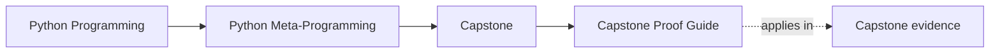

# Capstone Proof Guide

<!-- page-maps:start -->
## Page Maps

<!-- page-maps:end -->

Use this guide when you need to connect a capstone claim to the smallest repeatable proof
route that actually defends it. The capstone becomes noisy when learners gather evidence
without first deciding what they are trying to prove.

## Choose the proof pass you actually need

### Bounded review pass

Use this when you need one honest pass without reopening the whole runtime:

1. Read [Capstone Guide](index.md).
2. Run `make PROGRAM=python-programming/python-meta-programming capstone-tour`.
3. Read [Capstone Map](capstone-map.md).
4. Check one matching test file for the claim under review.

### Deeper executable pass

Use this when the review question is strong enough to justify the full saved proof route:

1. Run `make PROGRAM=python-programming/python-meta-programming test`.
2. Run `make PROGRAM=python-programming/python-meta-programming capstone-verify-report`.
3. Compare the saved outputs with the matching tests.

## Proof targets

- The manifest exposes field and action metadata without executing plugin work.
- The generated constructor signature reflects declared fields accurately.
- Descriptor-backed fields validate and coerce configuration per instance.
- Action decorators preserve signature visibility and record invocation history.
- Plugin registration stays deterministic and rejects duplicates.

## Minimum proof route

1. Run `make PROGRAM=python-programming/python-meta-programming test`.
2. Read `capstone/tests/test_runtime.py`.
3. Read `capstone/tests/test_registry.py`.
4. Read `capstone/tests/test_fields.py`.
5. Read `capstone/tests/test_cli.py`.

For a shorter module-aligned pass, use:

- Modules 01-03: read `manifest` output and `capstone/tests/test_runtime.py`.
- Modules 04-05: read `trace` output and `capstone/tests/test_runtime.py`.
- Modules 07-08: read `capstone/tests/test_fields.py`.
- Module 09: read `registry` output and `capstone/tests/test_registry.py`.
- Module 10: read `capstone/tests/test_cli.py` plus the saved verification bundle.

## Questions to answer

- Which proof confirms definition-time work rather than runtime work?
- Which proof confirms preserved metadata rather than only produced output?
- Which saved bundle is strongest for a human review without rerunning commands?
- Which proof would fail first if the design became more magical?

## Reviewer exit signal

You can stop the proof pass when you can say:

- which claim you checked
- which smallest route established it
- which stronger route you deliberately did not need yet
