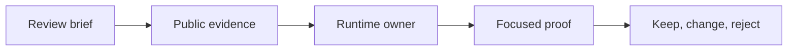
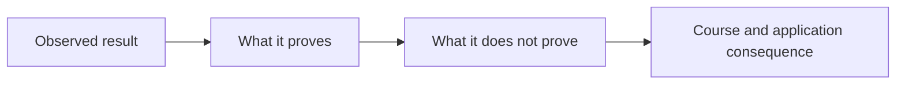

# Capstone Review Answers: Transfer Decisions and Proof Limits

<!-- page-maps:start -->
## Answer Maps




<!-- page-maps:end -->

These answers provide one defensible review route. A different judgment must preserve
the brief’s earlier contract and supply evidence at least as strong.

## Answer 1: keep history with the action wrapper

### Reasoning

Action history records what happened at the callable boundary. `actions.py` owns the
wrapper and the moment of invocation, so it can record history consistently whether the
action is called through the CLI, a test, or ordinary Python code.

The CLI owns presentation. Moving history there would make calls outside the CLI
unobservable or force the CLI to become the runtime owner.

### Evidence route

```bash
make wrapper-lab
make wrapper-lab-test
make capstone-action-wrapper
```

The report should show construction and execution absent while identifying the wrapper
chain, action metadata, explicit signature, and original callable link.

Focused runtime assertions then prove history is recorded during deliberate invocation;
CLI assertions prove that reporting does not replace the runtime fact.

### Common wrong turn

Moving behavior to the layer that displays it. Observation ownership and behavior
ownership are different.

### Proves

- wrapper structure and metadata are inspectable without execution
- call-time history belongs to the action wrapper
- the CLI can report history without creating it

### Does not prove

- every action invocation succeeds
- history is durable across processes
- the capstone implements retry or distributed tracing

### Consequence

Keep history in `actions.py`. Keep CLI handlers thin. Preserve Module 03 signature and
provenance contracts.

## Answer 2: reject shared descriptor value storage

### Prediction

The `Field` object is stored once on the class and shared by all instances. Storing the
latest endpoint on it would let one plugin instance overwrite another instance’s value.

### Evidence route

```bash
make descriptor-lookup-lab
make descriptor-lookup-lab-test
make capstone-field
make capstone-field-ownership
```

`field` exposes schema. `field-ownership` identifies the data descriptor, class access,
declaring class, metaclass collection, and private instance storage key. Per-instance
tests prove two plugin objects retain independent values.

### Common wrong turn

Treating the descriptor as if each instance receives a copy. The descriptor is shared
configuration and behavior; the instance dictionary owns each value.

### Proves

- `Field` is a shared data descriptor
- values are stored under a stable key per instance
- class access returns the descriptor for inspection

### Does not prove

- a cache can never be appropriate
- external storage is impossible
- transaction semantics belong in the field

### Consequence

Reject the optimization. If Module 08 cache pressure becomes real, design an explicit
cache owner and invalidation policy without violating descriptor lookup and instance
isolation.

## Answer 3: reject package discovery during class creation

### Reasoning

`PluginMeta.__new__` runs while a class is being created, usually during module import.
Filesystem discovery adds external I/O, environment-dependent ordering, import
recursion, and failure before the importing module finishes.

Package availability is a deployment/configuration concern, not a fact required to
shape one class.

### Evidence route

```bash
make class-creation-lab
make class-creation-lab-test
make capstone-class-creation
make capstone-governance
```

The class-creation report proves the current hook sequence and rejected powers without
constructing a plugin. Governance explicitly rejects package discovery during class
creation and names explicit discovery/configuration as the alternative.

### Common wrong turn

Arguing that automatic behavior belongs in a metaclass because metaclasses already run
automatically. Shared timing does not establish shared responsibility.

### Proves

- current class creation owns namespace, shaping, and registration facts
- package discovery is outside that owner
- the application publishes a lower-power alternative

### Does not prove

- one particular deployment discovery implementation
- that explicit discovery can never import modules
- broad release confidence

### Consequence

Reject the proposal. Add any future discovery after import at an explicit application
boundary. Preserve deterministic registry ordering and reset behavior.

## Answer 4: pair governance with mechanism evidence

### Evidence chain

```bash
make runtime-governance-lab
make runtime-governance-lab-test
make capstone-governance
make capstone-class-creation
```

The course lab teaches decision fields and proof limits. The transfer contract names the
application owner. `governance` proves the `PluginMeta` decision includes ownership,
observability, rollback, and proof. `class-creation` proves what the mechanism actually
did and did not do.

Focused governance assertions protect decision completeness. Focused class-creation,
registry, and CLI assertions protect timing, generated structure, and non-construction.

### Common wrong turn

Treating “approved” as executable proof. Governance is an index into evidence, not a
substitute for it.

### Proves

- the application explicitly approves a bounded metaclass owner
- class-creation hooks and outputs remain observable
- mechanism and decision tests defend different claims

### Does not prove

- package discovery belongs in the metaclass
- automatic conflict repair is safe
- all capstone behavior passes without the broad gate

### Consequence

Keep `PluginMeta` constrained to tracked declaration events and generated class
contracts. Continue rejecting package discovery, runtime invocation, I/O, and automatic
conflict repair from class creation.

## Final calibration

A strong review answer:

- starts from a completed course claim
- predicts timing and ownership before reading application output
- uses an observational report first
- finds the source owner and focused assertion
- records proof and non-claim
- makes a keep, change, or reject judgment

A matching judgment without that chain is not enough. The learning product is the
reasoning route; the capstone supplies integration evidence.
