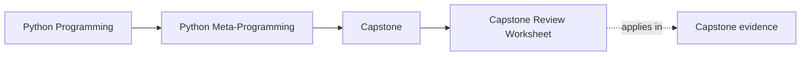
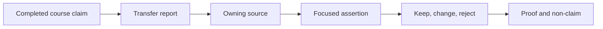

# Capstone Review Worksheet

<!-- page-maps:start -->
## Page Maps




<!-- page-maps:end -->

Use this worksheet after completing the corresponding module exercise. Each brief asks
for a course-to-capstone decision record, not a code change. Complete all four before
opening [Capstone Review Answers](capstone-review-answers.md).

## Decision record

For every brief, submit:

1. completed course claim
2. predicted application owner
3. transfer command
4. observed JSON fields
5. focused capstone assertion
6. keep, change, or reject judgment
7. proof
8. non-claim
9. preserved earlier contract

## Brief 1: review wrapper ownership

### Starting context

Module 04 proved wrapper lifecycle, metadata preservation, and exception identity.
A reviewer proposes moving action-history recording into the CLI because the CLI already
prints traces.

### Objective

Decide whether history ownership should stay in `actions.py`, move to `cli.py`, or be
removed.

### Constraints

- Start with Module 04 focused course evidence.
- Use a non-invoking capstone report before any trace.
- Distinguish the runtime owner from the observation owner.
- Do not justify the design only because existing tests pass.

### Expected evidence

```bash
make wrapper-lab
make wrapper-lab-test
make capstone-action-wrapper
```

Then inspect the focused wrapper and CLI assertions.

### Acceptance checks

- You identify who owns `ActionSpec`, `__signature__`, `__wrapped__`, and history.
- Your judgment explains why the CLI may report history without owning it.
- You state what remains unproved until deliberate invocation.
- The Module 03 signature-evidence contract remains valid.

## Brief 2: review descriptor storage

### Starting context

Module 07 proved data-descriptor precedence and per-instance storage. A proposed
optimization stores the latest `endpoint` value on the shared `Field` object so repeated
reads avoid dictionary lookup.

### Objective

Keep, change, or reject the proposal using public field evidence and focused tests.

### Constraints

- Predict lookup and storage consequences before running the capstone command.
- Separate field schema from descriptor mechanism.
- Address behavior across two plugin instances.
- Do not introduce cache policy from Module 08 without an owner and invalidation rule.

### Expected evidence

```bash
make descriptor-lookup-lab
make descriptor-lookup-lab-test
make capstone-field
make capstone-field-ownership
```

Then inspect per-instance isolation assertions in `test_fields.py`.

### Acceptance checks

- You name the shared descriptor and per-instance storage owners.
- You explain why a schema report alone is insufficient.
- You state the first invariant the optimization would violate.
- The ordinary descriptor lookup contract remains valid.

## Brief 3: review class-creation expansion

### Starting context

Module 09 explains why `PluginMeta` owns namespace recording and generated class
contracts. A proposal adds filesystem package discovery inside `PluginMeta.__new__` so
all plugin modules are found automatically.

### Objective

Decide whether package discovery belongs in class creation.

### Constraints

- Trace timing and blast radius.
- Compare an explicit post-import discovery boundary.
- Use class-creation evidence before governance.
- Name the import-time failure route.

### Expected evidence

```bash
make class-creation-lab
make class-creation-lab-test
make capstone-class-creation
make capstone-governance
```

Then inspect class-creation and governance assertions.

### Acceptance checks

- You distinguish namespace facts from deployment discovery.
- You identify filesystem I/O and import failure consequences.
- Your judgment names a lower-power alternative.
- Existing deterministic registry behavior remains valid.

## Brief 4: audit a governance decision

### Starting context

Module 10 teaches that governance records decisions but does not prove mechanisms. A
reviewer cites the approved `PluginMeta` decision as sufficient evidence that class
creation is correct.

### Objective

Build the smallest evidence chain that reviews both the decision and the mechanism.

### Constraints

- Begin with course governance evidence.
- Use both `governance` and the named mechanism report.
- Locate one focused decision assertion and one focused mechanism assertion.
- State one rejected power that remains outside the application.

### Expected evidence

```bash
make runtime-governance-lab
make runtime-governance-lab-test
make capstone-governance
make capstone-class-creation
```

### Acceptance checks

- You separate decision shape from mechanism behavior.
- The chain names owner, observability, rollback, proof, and non-claim.
- You explain why the broad suite is unnecessary for this bounded review.
- The lower-power mechanism preference remains visible.

## Submission review

Before opening the answers, verify:

- every command follows focused course proof
- every first capstone route is observational
- every judgment names a source owner and focused assertion
- every record includes a non-claim
- no brief treats the capstone as the place where the mechanism is first learned
