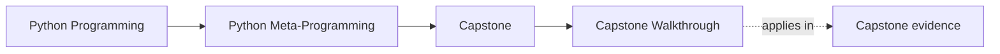

# Capstone Walkthrough

<!-- page-maps:start -->
## Page Maps



```mermaid
flowchart LR
  contract["0<br/>Transfer contract"] --> shape["1<br/>Public shape"]
  shape --> callable["2<br/>Callable boundary"]
  callable --> field["3<br/>Attribute boundary"]
  field --> class["4<br/>Class creation"]
  class --> govern["5<br/>Governance"]
  govern --> runtime["6<br/>Deliberate runtime"]
```
<!-- page-maps:end -->

Use this page for a complete capstone review after at least one module transfer is
understood. It is not the first route for every learning session. Stop at the earliest
point that settles the current question.

Run commands from the Python Metaprogramming course directory unless a local capstone
command is shown explicitly.

## Stop 0: establish the course claim

Choose a module and re-prove its course claim. For the Module 04 example:

```bash
make wrapper-lab
make wrapper-lab-test
```

Record:

- course claim
- expected capstone owner
- mapped observational capstone command
- proof
- non-claim

Do not continue if the module’s focused course proof has not passed. The walkthrough is
integration practice, not a substitute lesson.

## Stop 1: inspect public shape

Run:

```bash
make capstone-manifest
make capstone-registry
make capstone-signatures
```

Compare:

- manifest: exported field and action contracts
- registry: completed concrete plugin classes and order
- signatures: generated constructor and action call shapes

Read the manifest and registry helpers in `framework.py`, then the relevant CLI handlers.

Questions:

- Which facts exist because import and class creation already happened?
- Which facts can be reported without plugin construction?
- Which output is class-family state, and which is one callable contract?

Stop here for Modules 01–02 when the observation claim is settled.

## Stop 2: inspect the callable boundary

Run:

```bash
make capstone-action
make capstone-action-wrapper
make capstone-bind-action
make capstone-check-action
```

Read `actions.py` and the action helpers in `framework.py`.

Trace:

1. public action metadata
2. wrapper layers and `__wrapped__`
3. stored signature and argument binding
4. supported hint checks and refused hints

All four routes remain non-invoking. Do not add `trace` merely because it exists.

Questions:

- Which fact is enforced by Python signature binding?
- Which fact is policy from the application’s supported hint subset?
- Which wrapper owner preserves metadata?
- What remains unproved until deliberate invocation?

This is the main transfer stop for Modules 03–05.

## Stop 3: inspect the attribute boundary

Run:

```bash
make capstone-field
make capstone-field-ownership
make capstone-field-system
```

Read `fields.py`, then the collection helpers in `framework.py`.

Compare:

- schema: public field name, kind, default, and constraints
- mechanism: descriptor category, declaring class, class access, and storage key
- system: accepted field owners and rejected wider powers

Questions:

- Where is the descriptor object stored?
- Where is one plugin instance’s value stored?
- What makes the field a data descriptor?
- Which Module 08 powers remain outside this application?

This is the main transfer stop for Modules 07–08. Module 06 can use the next stop to look
for lower-power alternatives.

## Stop 4: inspect class creation

Run:

```bash
make capstone-class-creation
make capstone-registry
```

Read the stored provenance before reading all of `PluginMeta`.

Separate:

- metaclass selection
- namespace preparation
- class body events
- collected fields and actions
- generated initializer and signature
- completed-class registration

Module 06 asks which of those facts could be owned after class creation. Module 09 asks
which facts genuinely require the class-creation process.

Questions:

- Why is `__init_subclass__` sufficient for registration alone?
- Why does tracked namespace preparation require earlier ownership?
- Which rejected powers would make import behavior unsafe or opaque?

## Stop 5: review governance

Run:

```bash
make capstone-governance
```

Read `governance.py`, then follow one decision to its mechanism report and focused tests.

Review at least:

- one approved power
- the constrained process-global registry
- one rejected power and its lower-power alternative

Questions:

- Does the decision name a real owner?
- Can another reviewer observe the mechanism?
- Is rollback proportionate to the blast radius?
- Does the named test prove the mechanism or only the decision shape?

This is the Module 10 transfer. Governance is not a summary page; it is an evidence
index for design judgment.

## Stop 6: cross into deliberate runtime behavior

Only continue when the question includes construction and action invocation:

```bash
make capstone-trace
```

The trace reports configuration, action metadata, result, and history for one concrete
story. Compare it with `tests/test_runtime.py`.

State explicitly:

- plugin construction occurred
- configuration flowed through descriptors
- the action wrapper recorded history
- one concrete plugin produced the result

A successful trace does not prove registry determinism, all plugin behavior, or broad
regression confidence.

## Save the walkthrough only when needed

For a durable handoff:

```bash
make capstone-tour
```

Inspect `route.txt`, `focus-areas.txt`, the JSON reports, and
`bundle-manifest.json`. The manifest supplies paths, sizes, and hashes so another
reviewer can confirm exactly which artifacts were handed over.

Do not build a saved bundle during every study session. Save it when the review must
survive beyond the current terminal.

## Module stop map

| Module | Required stops |
| --- | --- |
| 01–02 | 0–1 |
| 03–05 | 0–2 |
| 06 | 0, 4 |
| 07–08 | 0, 3 |
| 09 | 0, 4 |
| 10 | 0, 5 |
| integration or runtime story | relevant observational stop, then 6 |

The ranges do not mean “read everything between.” They mean follow the arrows needed for
the chosen module claim.

## Escalation signals

Escalate when:

- a public report conflicts with its focused test
- the owner cannot be identified from the report
- the claim requires construction or invocation
- another reviewer needs a stable bundle
- the complete change set is ready for the broad gate

Stop when:

- the focused transfer record is complete
- the non-claim is explicit
- later stops answer different questions

## Good stopping point

You have completed the walkthrough when you can:

- begin from a completed course claim
- move from public report to owner to focused assertion
- distinguish observation from deliberate execution
- compare mechanism evidence with governance decisions
- explain why the capstone supports, rather than replaces, the course
