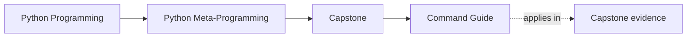
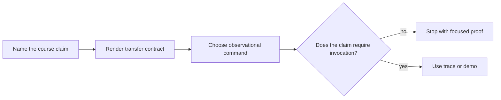

# Command Guide

<!-- page-maps:start -->
## Page Maps




<!-- page-maps:end -->

Use this guide after the module’s focused lab and tests pass. The command is chosen by
the claim, not by a desire for the largest output.

Start by rendering the module contract:

```bash
make transfer-route MODULE=4
```

The packet names the expected application owner, public command, proof, non-claim, and
all three Make entrypoints.

## Observational transfer commands

These commands are the first capstone route for Modules 01–10. They do not construct a
plugin instance or invoke an action.

| Course target | Local target | Best question |
| --- | --- | --- |
| `capstone-manifest` | `manifest` | what public fields and actions exist? |
| `capstone-plugin` | `plugin` | what does one concrete plugin publish? |
| `capstone-field` | `field` | what schema does one field expose? |
| `capstone-field-ownership` | `field-ownership` | which descriptor and storage owner implement it? |
| `capstone-field-system` | `field-system` | which wider field powers are accepted or rejected? |
| `capstone-action` | `action` | what signature and metadata does one action publish? |
| `capstone-action-wrapper` | `action-wrapper` | which wrapper layer owns metadata and provenance? |
| `capstone-bind-action` | `bind-action` | do proposed arguments fit the signature? |
| `capstone-check-action` | `check-action` | which supported runtime hints match? |
| `capstone-class-creation` | `class-creation` | what did preparation, shaping, and registration own? |
| `capstone-registry` | `registry` | which plugins are registered in deterministic order? |
| `capstone-signatures` | `signatures` | what generated constructor and action shapes are public? |
| `capstone-governance` | `governance` | which powers are approved, constrained, or rejected? |

`plugin`, `field`, `action`, `registry`, and `signatures` are useful supporting views.
The ten formal module transfers use the narrower set published by `transfer-route`.

## Three equivalent entry levels

From the repository root:

```bash
make PROGRAM=python-programming/python-meta-programming capstone-field-ownership
```

From the Python Metaprogramming course directory:

```bash
make capstone-field-ownership
```

From the capstone directory:

```bash
make field-ownership
```

The command name changes only because each Makefile owns a different public boundary.
The JSON claim must not change.

Run:

```bash
make transfer-route-test
```

This verifies every repository, course, and capstone Make target referenced by the ten
transfer contracts. A documentation command that does not resolve is a product defect.

## Command claim boundaries

### Public shape

Use `manifest`, `plugin`, `field`, `action`, `registry`, or `signatures` when the claim is
about exported structure. These reports do not prove invocation.

### Ownership

Use `field-ownership`, `field-system`, `action-wrapper`, or `class-creation` when the
claim asks which mechanism owns behavior. These reports include construction/execution
flags so the learner can distinguish stored evidence from runtime work.

### Preflight

Use `bind-action` for Python call-shape rules. Escalate to `check-action` only when the
question includes the supported hint subset. Neither route proves that an action
executes successfully.

### Governance

Use `governance` for application-level mechanism decisions. Follow each decision to its
named mechanism report and focused tests. A policy record cannot prove the behavior it
approves.

## Executing commands

Only these first-pass routes deliberately cross into plugin construction or action
invocation:

| Course target | Local target | What crosses the boundary |
| --- | --- | --- |
| `demo` | `demo` | constructs one plugin and invokes one action |
| `capstone-trace` | `trace` | constructs, invokes, and reports configuration, result, and history |

Choose `trace` when result, configuration, and action history all matter. Choose `demo`
only when the result itself is the claim. Neither is a stronger substitute for
observational ownership evidence.

## Saved bundle and confidence commands

| Course or root target | Local target | Use |
| --- | --- | --- |
| `inspect` | `inspect` | save public shape and ownership reports |
| `capstone-walkthrough` or `capstone-tour` | `tour` | save a guided public-to-runtime story |
| `capstone-verify-report` | `verify-report` | save focused public evidence beside pytest output |
| `capstone-confirm` | `confirm` | run the complete capstone test suite |
| `proof` | `proof` | build every published review bundle |

Saved bundles are for durable handoff. They are not the default first answer during a
learning session.

## Selection examples

### “Why does `endpoint` ignore a same-named instance value?”

Start in the Module 07 course lab. Then use `capstone-field-ownership`. Do not use
`trace`; invocation adds no evidence about descriptor category.

### “Do these values fit `deliver`?”

Start with `capstone-bind-action`. Use `capstone-check-action` only if the claim includes
runtime hints. Do not use `demo` until success or failure of the action itself matters.

### “Why is `PluginMeta` accepted?”

Use `capstone-class-creation` for mechanism evidence and `capstone-governance` for the
decision. Neither output replaces class-creation and governance tests.

### “Did one delivery record history correctly?”

This claim requires execution. Use `capstone-trace`, then the focused runtime test.

## Failure signals

Your route is too broad when:

- you run `proof` before naming a claim
- you cite `confirm` without locating the protecting test
- you use `trace` to explain a non-executing ownership question
- you open a bundle before understanding its component reports

Your route is too narrow when:

- a structural report is used to claim runtime success
- signature binding is used to claim hint compatibility
- governance is used as proof of mechanism behavior
- one focused test is used to claim full capstone regression confidence

## Good stopping point

Stop when you can name:

- the module claim already proved in the course
- the smallest observational capstone command
- whether construction or invocation occurs
- the owning source and focused test
- the explicit non-claim
- the condition that would justify a stronger route
