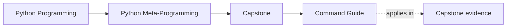

# Command Guide

<!-- page-maps:start -->
## Page Maps




<!-- page-maps:end -->

Use the smallest command that proves the specific claim you care about. The goal is not
to memorize commands. The goal is to choose enough evidence without jumping straight to
the broadest route.

## Start by proof size

| If the question is about... | Start with | Escalate only if needed |
| --- | --- | --- |
| public runtime shape | `capstone-manifest`, `capstone-plugin`, `capstone-field`, `capstone-action`, `capstone-registry`, or `capstone-signatures` | `inspect` |
| partial runtime hint checks without action execution | `capstone-check-action` | runtime and CLI tests |
| stored metaclass and namespace provenance without plugin construction | `capstone-class-creation` | runtime and CLI tests |
| field descriptor ownership without plugin construction | `capstone-field-ownership` | field and CLI tests |
| one concrete runtime behavior | `demo` or `capstone-trace` | `capstone-walkthrough` or runtime tests |
| a saved review artifact for another learner or reviewer | `inspect`, `capstone-walkthrough`, or `capstone-verify-report` | `proof` |
| the strongest local executable confidence | `capstone-confirm` | `proof` |

## From the repository root

```bash
make PROGRAM=python-programming/python-meta-programming capstone-manifest
make PROGRAM=python-programming/python-meta-programming capstone-plugin
make PROGRAM=python-programming/python-meta-programming capstone-field
make PROGRAM=python-programming/python-meta-programming capstone-field-ownership
make PROGRAM=python-programming/python-meta-programming capstone-action
make PROGRAM=python-programming/python-meta-programming capstone-check-action
make PROGRAM=python-programming/python-meta-programming capstone-class-creation
make PROGRAM=python-programming/python-meta-programming capstone-registry
make PROGRAM=python-programming/python-meta-programming capstone-signatures
make PROGRAM=python-programming/python-meta-programming demo
make PROGRAM=python-programming/python-meta-programming capstone-trace
make PROGRAM=python-programming/python-meta-programming inspect
make PROGRAM=python-programming/python-meta-programming capstone-walkthrough
make PROGRAM=python-programming/python-meta-programming capstone-tour
make PROGRAM=python-programming/python-meta-programming capstone-verify-report
make PROGRAM=python-programming/python-meta-programming capstone-confirm
make PROGRAM=python-programming/python-meta-programming proof
```

## From `capstone/`

```bash
make manifest
make plugin
make field
make field-ownership
make action
make check-action
make class-creation
make registry
make signatures
make demo
make trace
make inspect
make tour
make verify-report
make confirm
make proof
```

## When to use which command

- `manifest`: inspect group-level schema and action metadata without execution
- `plugin`: inspect one concrete plugin contract from the public CLI
- `field`: inspect one concrete field contract and its exported schema
- `field-ownership`: inspect descriptor hooks, class access, storage ownership, and
  metaclass collection without constructing a plugin
- `action`: inspect one concrete action contract and its generated signature
- `check-action`: check supported action argument hints and report refused surfaces without execution
- `class-creation`: inspect prepared namespace, declared/inherited members, initializer generation, and registration without construction
- `registry`: inspect registration determinism from the public surface
- `signatures`: inspect constructor and action signatures together
- `demo`: invoke one realistic plugin action directly in the terminal
- `trace`: inspect result, configuration, and action history together
- `inspect`: build the saved guided inspection bundle
- `capstone-walkthrough` from the repository root, or `tour` inside `capstone/`, writes the guided walkthrough bundle into `artifacts/`
- `capstone-tour`: use the same saved walkthrough bundle when you are moving through a proof route rather than a first-pass reading route
- `verify-report`: write the executable verification report bundle into `artifacts/`
- `confirm`: strongest local executable proof through pytest
- `proof`: full published review route with saved bundles

## Default choices when unsure

- Choose `manifest` before `registry` unless plugin order is the actual question.
- Choose `field` or `action` before `plugin` when one contract is the real pressure.
- Choose `trace` before `demo` when metadata or action history probably matter.
- Choose `inspect` before `capstone-walkthrough` when the question is still mainly about ownership.
- Choose `confirm` before `proof` when a saved human-facing bundle is not required.

## A small proof-first route

1. Start with `manifest`, `registry`, `plugin`, `field`, `action`, or `signatures` when the question is about public shape.
2. Move to `demo` or `trace` when the question is about one concrete runtime behavior.
3. Move to `inspect` or `capstone-walkthrough` when the question is about guided study or source ownership.
4. Move to `verify-report`, `proof`, or `confirm` when the question is about executable confidence.

## Good stopping point

Stop when you can say:

- which command you would run first for the current claim
- why that command is smaller and more honest than the larger routes
- what the next stronger route would be if the first one were not enough
