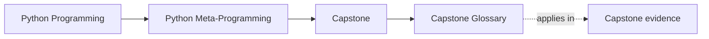

# Capstone Glossary

<!-- page-maps:start -->
## Page Maps

<!-- page-maps:end -->

This glossary keeps the capstone vocabulary stable. The point is not to create one more
list to memorize. The point is to stop the learner from sliding between fuzzy words such
as "magic", "framework", "runtime thing", or "metaclass stuff" when the capstone actually
depends on sharper distinctions.

Use this page whenever:

- two pages seem to disagree but are really using different words for different layers
- you can run the project but cannot explain what the output proves
- you are about to change the capstone and need cleaner review language first

## How to use this glossary

Use it as a repair tool, not as a first reading assignment:

1. Start with the capstone page that gave you trouble.
2. Return here when one term starts carrying too many meanings.
3. Re-read the troubled page using the sharper term.
4. If the page is still unclear, the teaching surface probably needs improvement.

## Core capstone vocabulary

| Term | Meaning in this capstone | What it is not |
| --- | --- | --- |
| ownership layer | the narrowest place where a behavior honestly belongs | "where it was easiest to hack in" |
| public proof route | the smallest repeatable command, saved bundle, or test path that demonstrates a claim | "some evidence exists somewhere" |
| definition-time behavior | work that happens while classes are being created or registered | ordinary runtime execution |
| runtime behavior | work that happens when plugins are instantiated, fields are accessed, or actions are called | metaclass-only logic |
| manifest output | the public structured description of plugins, fields, and actions | plugin execution or hidden internal state |
| trace output | evidence that shows observable runtime flow | complete proof of every invariant |
| extension route | the recommended change path that keeps ownership and proof clear | a shortcut around design boundaries |
| review judgment | an explicit keep, change, or reject decision tied to a claim and proof route | a vague reaction like "seems clever" |

## Layer words

### Plugin

A **plugin** is the concrete example object in the capstone. It is where the framework is
used, not where the framework should automatically grow. If a learner adds a new plugin,
they are extending the example surface first.

### Field

A **field** is the descriptor-backed declaration surface for data shape, coercion, and
validation. A field owns repeated attribute rules. It does not own plugin-specific business
logic.

### Action

An **action** is a public callable behavior exposed by a plugin and wrapped for
observability. In this capstone, actions matter because they let the learner inspect how
wrappers preserve signatures and record behavior without losing readability.

### Registry

A **registry** is the layer that tracks plugins as a managed set. It owns shared
registration rules such as uniqueness or discoverability. It does not own field coercion,
plugin business logic, or unrelated runtime execution.

### Metaclass

A **metaclass** is the highest-power class-creation tool used in the capstone. It exists
to teach definition-time governance, not to serve as the default location for any feature
that feels advanced. If a learner reaches for the metaclass first, they are usually moving
up the power ladder too early.

## Review words

### Claim

A **claim** is one sentence about what the capstone guarantees. Good claims are specific
enough to prove, such as "manifest generation does not execute plugin work" or "duplicate
plugin registration is rejected deterministically."

### Owner

An **owner** is the file or narrow layer responsible for making the claim true. If a claim
has three owners, it probably has no honest owner yet.

### Proof route

A **proof route** is the smallest believable way to verify the claim. That can be a
command, a saved report, a test file, or a combination of those when one surface alone is
not enough.

### Saved bundle

A **saved bundle** is review evidence captured for later reading, such as generated
capstone outputs. It lets an independent learner inspect results without rerunning every
command from scratch.

### Review pass

A **review pass** is one bounded investigation, not a full rewrite campaign. It should end
with one claim, one owner, one proof route, and one judgment.

## Extension words

### Lower-power layer

A **lower-power layer** is a simpler mechanism that can still own the behavior honestly:
plugin code before field abstraction, field logic before registry policy, registry or
decorator layers before metaclass intervention.

### Escalation

An **escalation** is the move to a more powerful mechanism because weaker ones genuinely
cannot preserve the design. Escalation is justified only when the learner can explain why
the lower layer failed conceptually, not merely because it felt less convenient.

### Boundary violation

A **boundary violation** happens when one layer starts doing work that belongs to another.
Examples include manifest generation executing runtime work, plugin-specific behavior being
hidden in the metaclass, or review evidence being buried in unrelated helpers.

### Teaching route

A **teaching route** is the path a missed-class learner can follow through commands,
guides, tests, and outputs to understand a concept without an instructor present. When the
code changes meaningfully, the teaching route must change too.

## Capstone page names as tools

These page names matter because each one solves a different learner problem:

| Page | When to use it |
| --- | --- |
| [Capstone Guide](index.md) | when you need the main entry route and capstone purpose |
| [Capstone Architecture Guide](capstone-architecture-guide.md) | when you need the boundary map between layers |
| [Capstone File Guide](capstone-file-guide.md) | when you need one concrete file entrypoint |
| [Capstone Map](capstone-map.md) | when you need the whole capstone landscape quickly |
| [Capstone Proof Guide](capstone-proof-guide.md) | when you need the smallest honest evidence route |
| [Capstone Review Worksheet](capstone-review-worksheet.md) | when you need to turn intuition into a judgment |
| [Capstone Walkthrough](capstone-walkthrough.md) | when you need a guided first pass across the capstone |
| [Capstone Extension Guide](capstone-extension-guide.md) | when you need to place a change at the right layer |
| [Command Guide](command-guide.md) | when reading is no longer enough and public execution should lead |

## Good stopping point

You can leave this glossary when you can answer, in precise words:

- what layer owns the behavior you are studying
- what claim you are trying to prove
- what route proves it
- whether you are reading, reviewing, or extending
