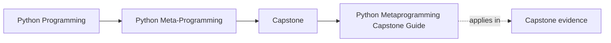
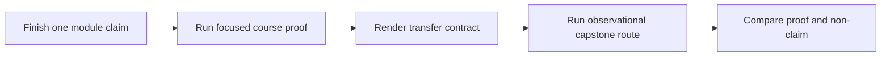

# Python Metaprogramming Capstone Guide


<!-- page-maps:start -->
## Page Maps




<!-- page-maps:end -->

The first diagram places this shelf inside the course. The second is the required
transfer sequence. The course website, runnable labs, worked examples, exercises, and
answers teach the mechanism. This incident-plugin application checks whether one settled
claim remains understandable when several mechanisms interact.

Do not begin here to discover decorators, descriptors, or metaclasses. Begin here with a
module question and a focused course proof.

## What the capstone contributes

The capstone supplies integration pressure that isolated labs deliberately remove:

- descriptors, wrappers, and class creation share one public runtime
- import-time class creation produces state that later commands must expose honestly
- generated signatures and manifests must agree with executable behavior
- global registry state needs deterministic reset and duplicate policy
- reviewers need non-constructing reports before deliberate invocation

That pressure makes the capstone useful. It does not make the capstone the course.

## Entry contract

Before choosing a capstone command, you must be able to state:

1. the module claim being transferred
2. the focused course command already run
3. the focused test that protects the claim
4. the application owner expected to expose the same behavior
5. one fact the capstone command cannot prove

If any item is missing, return to the module rather than browsing the application.

Use the matching row in the module transfer table below. It identifies the course claim,
observational capstone command, and application question without adding a separate tool
between the learner and the subject.

## Module transfer route

| Module | Course claim already proved | Observational capstone route | Application question |
| --- | --- | --- | --- |
| 01 | runtime objects expose inspectable relationships | `capstone-manifest` | which classes, fields, and actions exist publicly? |
| 02 | observation remains separate from execution | `capstone-manifest` | which facts are exported without action invocation? |
| 03 | signature binding can precede invocation | `capstone-bind-action` | do proposed arguments fit the stored signature? |
| 04 | wrappers preserve visible ownership | `capstone-action-wrapper` | which layer owns metadata, signature, and provenance? |
| 05 | callable policy states supported and refused contracts | `capstone-check-action` | which runtime hints are actually checked? |
| 06 | lower-power class tools are considered first | `capstone-class-creation` | which finished-class requirements remain lower-power? |
| 07 | descriptor lookup and storage are predictable | `capstone-field-ownership` | which descriptor and storage owner implement one field? |
| 08 | field-system power is explicitly bounded | `capstone-field-system` | which wider descriptor powers are rejected? |
| 09 | class-creation hooks have distinct timing | `capstone-class-creation` | what requires preparation, shaping, and registration? |
| 10 | runtime powers receive explicit decisions | `capstone-governance` | which powers are approved, constrained, or rejected? |

Repeated commands are intentional. Module 01 asks what objects exist; Module 02 asks
whether the observation route invokes business behavior. Module 06 compares lower-power
owners; Module 09 asks which pre-class facts finally earn `PluginMeta`.

## Run from the right boundary

From the repository root:

```bash
make PROGRAM=python-programming/python-meta-programming capstone-manifest
```

From the course directory:

```bash
make capstone-manifest
```

From `capstone/`:

```bash
make manifest
```

These three entrypoints reach the same public command. Use the repository route when
following published site instructions, the course route during study, and the local
route while reading capstone source.

## Observational before executable

The ten module transfers are deliberately non-constructing and non-invoking. Even when a
report describes runtime behavior, the first transfer stays observational.

Move to `capstone-trace` only when the claim is about deliberate construction,
configuration, invocation, result, and action history. A trace is not a stronger answer
to a class-creation or field-ownership question; it is a different kind of evidence.

## Choose the next page by question

| Question | Page |
| --- | --- |
| Which exact module claim maps to which command? | [Capstone Map](capstone-map.md) |
| Which command is smallest for this transfer? | [Command Guide](command-guide.md) |
| Which file owns the reported behavior? | [Capstone Architecture Guide](capstone-architecture-guide.md) |
| How do I move from output to focused tests? | [Capstone Proof Guide](capstone-proof-guide.md) |
| How do I conduct a complete public-surface tour? | [Capstone Walkthrough](capstone-walkthrough.md) |
| How do I record approve, change, or reject reasoning? | [Capstone Review Worksheet](capstone-review-worksheet.md) |
| Where should a proposed extension land? | [Capstone Extension Guide](capstone-extension-guide.md) |

Do not read every page by default. Choose the page that answers the current learning
problem.

## Recovery when the application feels too dense

Stop and return to the course if:

- several mechanisms look like one piece of “framework magic”
- a saved bundle feels easier to cite than to explain
- you cannot say whether a command constructs or invokes a plugin
- the capstone source becomes the first place you encounter a mechanism
- passing the full suite feels like the only available proof

Use the module checkpoints to find the last claim you can still explain. Rerun that
module’s focused lab and test, then use the matching row in the table above.

## Transfer exit standard

Leave this page when you can:

- name one completed module claim
- choose its mapped observational capstone command
- run the same route from repository, course, and capstone levels
- identify the application owner before reading all source
- state what the report proves and does not prove
- keep the capstone in a supporting integration role
