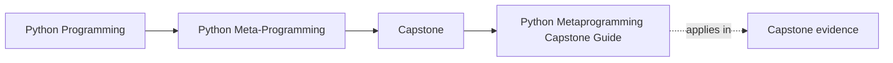

# Python Metaprogramming Capstone Guide

<!-- page-maps:start -->
## Page Maps

<!-- page-maps:end -->

The capstone is the executable proof for the course. It is a compact incident-plugin
runtime where decorators, descriptors, metaclasses, and introspection must coexist
without hiding responsibility.

Use this guide when you need one durable entry point into the capstone shelf. The goal
is not to browse everything. The goal is to choose one learner question, one owning
surface, and one proof route without getting lost in the repository.

## What this capstone is actually teaching

By the end of the capstone, you should be able to explain:

- how public inspection stays separate from runtime execution
- how descriptor-backed field rules remain explicit and per-instance
- how wrapper behavior stays visible instead of erasing callable identity
- how class-definition-time registration can remain deterministic and reviewable
- how a small runtime can still be audited like ordinary code

If the capstone is not teaching those five things, you are either widening too quickly
or using a proof route that is too large for the current question.

## Start by learner question

| If your question is... | Start here | Stop when you can... |
| --- | --- | --- |
| "What does this capstone prove for the course?" | this page, then [Capstone Architecture Guide](capstone-architecture-guide.md) | explain the capstone in plain language |
| "Which repository surface should I read first?" | [Capstone File Guide](capstone-file-guide.md) | name one owning file and one matching test |
| "How do the modules map onto the capstone?" | [Capstone Map](capstone-map.md) | connect one module-stage claim to one capstone route |
| "Which command proves this claim with the smallest blast radius?" | [Command Guide](command-guide.md) and [Capstone Proof Guide](capstone-proof-guide.md) | choose one honest proof route |
| "How should I review the whole runtime as a steward?" | [Capstone Review Worksheet](capstone-review-worksheet.md) | record one keep, change, or reject judgment |
| "Where should a change land?" | [Capstone Extension Guide](capstone-extension-guide.md) | name the correct ownership layer |

## First-day route for a missed-class learner

Use this route if you are studying alone and need one stable first pass:

1. Run `make PROGRAM=python-programming/python-meta-programming capstone-manifest`.
2. Read this page.
3. Read [Capstone Architecture Guide](capstone-architecture-guide.md).
4. Read [Capstone File Guide](capstone-file-guide.md).
5. Read `capstone/src/incident_plugins/framework.py`, then `fields.py`, then `actions.py`.
6. Run `make PROGRAM=python-programming/python-meta-programming capstone-registry`.
7. Read `capstone/tests/test_registry.py` and `capstone/tests/test_fields.py`.
8. Stop there unless your question now clearly requires runtime traces, saved bundles, or change placement.

This route is intentionally incomplete. It gives you ownership and proof before it gives
you breadth.

## Start by module range

| Module range | Best capstone focus | Best first proof route |
| --- | --- | --- |
| Modules 01-03 | manifest export, constructor signatures, and inspectable runtime shape | `capstone-manifest` and `capstone-registry` |
| Modules 04-06 | decorators, wrappers, and action-history behavior | `capstone-action` and `capstone-trace` |
| Modules 07-08 | descriptors, field validation, and focused field tests | `capstone-field` and `tests/test_fields.py` |
| Modules 09-10 | registration, generated constructors, public commands, and saved bundles | `capstone-registry`, `capstone-signatures`, and `capstone-verify-report` |

## Core commands

| If you need... | From the repository root | From the capstone directory |
| --- | --- | --- |
| runtime shape without execution | `make PROGRAM=python-programming/python-meta-programming capstone-manifest` | `make manifest` |
| registry review | `make PROGRAM=python-programming/python-meta-programming capstone-registry` | `make registry` |
| one concrete invocation story | `make PROGRAM=python-programming/python-meta-programming capstone-trace` | `make trace` |
| guided saved route | `make PROGRAM=python-programming/python-meta-programming capstone-walkthrough` | `make tour` |

## What not to do first

- Do not start in `plugins.py` when the ownership model is still unclear.
- Do not start in the whole test suite when the claim itself is still vague.
- Do not start with the largest saved bundle when one public command can answer the question.
- Do not treat the capstone as a separate mini-project detached from the module sequence.

## Guide set

- [Capstone Map](capstone-map.md)
- [Capstone Walkthrough](capstone-walkthrough.md)
- [Command Guide](command-guide.md)
- [Capstone File Guide](capstone-file-guide.md)
- [Capstone Architecture Guide](capstone-architecture-guide.md)
- [Capstone Proof Guide](capstone-proof-guide.md)
- [Capstone Review Worksheet](capstone-review-worksheet.md)
- [Capstone Extension Guide](capstone-extension-guide.md)
- [Glossary](glossary.md)

## Self-check before leaving this page

- Which work happens before an instance exists?
- Which runtime facts stay inspectable from the public surface?
- Which mechanism would you simplify first if the design felt too magical?
- Which proof route would you choose first for one module-stage claim?

## Good stopping point

Stop here when you know:

- which module-stage claim the capstone is making visible
- which file or public output owns that claim
- which smallest command or saved route proves it honestly
