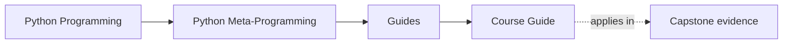

# Course Guide

<!-- page-maps:start -->
## Page Maps

<!-- page-maps:end -->

This guide explains what the course is trying to build inside the learner.

The point is not to collect advanced Python mechanisms. The point is to become the kind
of engineer who can inspect dynamic behavior calmly, choose the lowest-power tool that
owns a problem honestly, and reject "clever" designs that become harder to debug than to
justify.

If you keep that goal in view, the reading order makes sense. If you lose it, the course
can easily collapse into a pile of tricks.

## The course builds four abilities

The course moves through four linked abilities:

1. observe runtime behavior without guessing
2. transform behavior without hiding what changed
3. place ownership at the right boundary
4. govern dynamic power with explicit review standards

Those abilities matter more than the names of the mechanisms themselves.

## The ten-module progression

| Module range | What you are learning to do | Why it comes here |
| --- | --- | --- |
| Module 00 | understand the power ladder and the study stance | you need the course’s rules before the dense mechanisms arrive |
| Modules 01 to 03 | observe runtime objects, attributes, callables, and evidence safely | higher-power tools are dangerous if observation is weak |
| Modules 04 to 05 | wrap behavior while preserving signatures, provenance, and reviewability | wrappers are the first major temptation to hide behavior |
| Module 06 | try lower-power class customization before escalation | learners need a real stopping point before metaclasses |
| Modules 07 to 08 | reason about descriptors, lookup, validation, and reusable field systems | attribute ownership becomes explicit and mechanical here |
| Module 09 | justify class-creation control only when weaker options fail honestly | metaclasses should feel earned, not glamorous |
| Module 10 | turn mechanism knowledge into governance and review judgment | the course should end with restraint, not escalation |

## The three big arcs

### Observation arc

Modules 01 to 03 teach the floor that everything else stands on:

- what Python objects are at runtime
- how names, attributes, and signatures can be inspected safely
- how evidence becomes strong enough to support design or review claims

If this arc is weak, later modules feel magical rather than mechanical.

### Control arc

Modules 04 to 09 teach how behavior can be changed at different boundaries:

- wrappers at call boundaries
- class decorators and helper patterns before stronger hooks
- descriptors at attribute boundaries
- metaclasses at class-creation boundaries

This arc teaches placement and restraint, not just power.

### Governance arc

Module 10 teaches what many advanced courses skip:

- where syntax policy stops and process isolation begins
- why ABC, protocol, and subclass-hook claims have different strengths
- how rollback evidence differs from concurrency or crash safety
- when import hooks and AST transforms belong to tooling rather than applications
- how to publish approve, constrain, and reject decisions with executable proof

The Module 10 course lab is the first learning surface. It supplies five small,
deterministic experiments so each claim can be traced before the learner audits the
larger incident-plugin runtime.

## How the capstone fits the course

The lessons, runnable course labs, worked examples, exercises, and reasoned answers are
the primary product. The capstone is the integration and transfer surface that follows
them.

- Early modules explain how to inspect the capstone without accidental execution.
- Middle modules explain its wrappers, fields, and customization boundaries.
- Later modules explain why its metaclass and registry stay narrow.
- The final module first builds a governance packet in the course lab, then explains how
  to review or reject capstone decisions honestly through `capstone-governance`.

When you study a module, the capstone gives you one place where the module’s claim becomes
visible in code, commands, tests, and saved evidence.

## Why the lab files exist

Start from the lesson and its command, not from the lab directory. The lab source is
split only when the pieces have different teaching jobs:

| File shape | Teaching job | Should you read it first? |
| --- | --- | --- |
| `__init__.py` | exposes the small public lab API | no; it is package plumbing |
| `__main__.py` | lets the Make target run the lab | no; it is command plumbing |
| `evidence.py` | builds the controlled scenario and stable evidence packet | after predicting the lesson output |
| topic file such as `retry.py` or `cache.py` | owns one mechanism taught by one core lesson | yes, when that lesson names it |
| `*_demo.py` | renders one worked example without adding another mechanism | only with its worked-example page |

The remaining folders map to the curriculum as follows:

| Module | Subject files | Why they are separate |
| --- | --- | --- |
| 01 | `runtime_objects/evidence.py` | one small file is enough for ordinary object relationships |
| 02 | `runtime_observation/evidence.py`, `debug_view.py` | the core observation counters stay separate from the safer-debug-printer worked example |
| 03 | `runtime_evidence/evidence.py`, `safe_repr.py`, `repr_demo.py` | evidence trust is the core; representation is one applied example and its runner |
| 04 | `wrapper_runtime/evidence.py`, `bounded_cache.py`, `cache_demo.py` | transparent wrapper mechanics stay separate from stateful cache policy and its runner |
| 05 | `decorator_policy/retry.py`, `validation.py`, `cache_comparison.py`, `evidence.py` | each policy changes a different callable contract; the evidence file only stages deterministic scenarios |
| 06 | `class_customization/transformation.py`, `attributes.py`, `frozen_surface.py`, `evidence.py` | class transformation, attribute ownership, and surface freezing are different lower-power alternatives to a metaclass |
| 07 | `descriptor_lookup/protocol.py`, `precedence.py`, `binding.py`, `quantity.py`, `evidence.py` | protocol, lookup order, method binding, and canonical storage need separate predictions before they are combined |
| 08 | `descriptor_systems/cache.py`, `external.py`, `composition.py`, `hints.py`, `relational.py`, `boundaries.py`, `evidence.py` | each file owns one system pressure; `relational.py` is the optional worked example and `boundaries.py` decides when not to use a descriptor |
| 09 | `class_creation/manual.py`, `resolution.py`, `lifecycle.py`, `namespace.py`, `registry.py`, `boundaries.py`, `evidence.py` | each file isolates one class-creation stage; the boundary file justifies or rejects escalation |
| 10 | `runtime_governance/dynamic.py`, `interfaces.py`, `patching.py`, `tooling.py`, `selection.py`, `evidence.py` | each high-power mechanism gets its own refusal and rollback boundary; the selection file records the final judgment |

If a file is not named by the current lesson, skip it. The lab is evidence for the
course, not a second framework to master.

## Which support page solves which study problem

| Study problem | Best page |
| --- | --- |
| I need the right entry route | [Start Here](start-here.md) |
| I need the course’s discipline made explicit | [Learning Contract](learning-contract.md) |
| I need to know what this module is supposed to settle | [Module Promise Map](module-promise-map.md) |
| I need to know whether I can move on | [Module Checkpoints](module-checkpoints.md) |
| I need a pressure-shaped reading path | [Pressure Routes](pressure-routes.md) |
| I need the smallest honest proof route | [Proof Ladder](proof-ladder.md) |
| I need a direct claim-to-evidence mapping | [Proof Matrix](proof-matrix.md) |
| I need to stabilize the environment before any proof work | [Platform Setup](platform-setup.md) |
| I need to practice choosing a route and proof size | [Study Practicum](../module-00-orientation/study-practicum.md) |
| I am returning after a break | [Module Checkpoints](module-checkpoints.md), then the matching lab and focused test in [Module 00](../module-00-orientation/index.md) |

## How to study the course well

### Before a module

- Read the module promise.
- Know what the module is supposed to settle.
- Know what it does not settle yet.

### During a module

- Keep one lower-power alternative in view.
- Ask what timing boundary the mechanism changes: import time, class-definition time, instance time, or call time.
- Refuse to treat jargon as understanding.

### After a module

- Use the checkpoints.
- Cross into the capstone only when the course question is explicit.
- Prove at least one claim in a real surface instead of trusting prose alone.

## Honest expectations

You should expect the course to feel slower than tutorial-style metaprogramming material.
That is intentional. Fast metaprogramming courses often teach mechanism recognition
without teaching boundary judgment.

By the end of this course, you should be able to answer:

- What changed at runtime?
- Where does that behavior belong?
- Which lower-power option was ruled out?
- What evidence proves the claim?
- What design would I reject as too magical?
