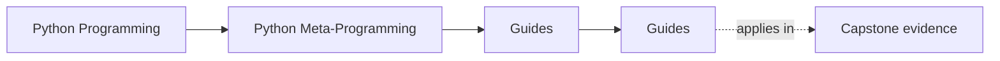

# Guides

<!-- page-maps:start -->
## Page Maps

<!-- page-maps:end -->

This shelf exists for one specific problem: the course modules teach mechanisms, but
independent learners also need help deciding how to move through the course, how to prove
that a module has actually landed, and how to cross from lesson pages into the executable
capstone without getting lost.

If you are studying alone, this shelf is not optional decoration. It is the layer that
turns the course from "many advanced pages" into a guided program.

## What this shelf is for

Use these guides when you need one of the following:

- a sane entry route instead of guessing where to begin
- a study contract strong enough to prevent shallow reading
- a module-by-module promise and exit bar
- a pressure-shaped route for review, debugging, or design work
- a claim-to-proof path that keeps evidence proportional to the question
- a bridge from course ideas into the capstone repository

Do not stay here longer than necessary. These pages should send you back to the modules,
reference shelf, or capstone with a clearer next move.

## Pick the page by need

| If you need... | Start here | What you should get out of it |
| --- | --- | --- |
| the best first route through the course | [Start Here](start-here.md) | an entry sequence that matches your background and pressure |
| the overall shape of the course | [Course Guide](course-guide.md) | a mental model of the ten-module arc and support shelves |
| the discipline required to study this well | [Learning Contract](learning-contract.md) | rules for pacing, proof, and honest escalation |
| the promise of each module in plain language | [Module Promise Map](module-promise-map.md) | what each module settles and what it does not settle yet |
| the exit bar before moving forward | [Module Checkpoints](module-checkpoints.md) | concrete statements you should be able to explain or prove |
| environment stability before running anything public | [Platform Setup](platform-setup.md) | the supported setup contract and setup failure triage |
| a route shaped by a real engineering pressure | [Pressure Routes](pressure-routes.md) | the shortest honest reading path for the problem in front of you |
| the smallest proof route for a claim | [Proof Ladder](proof-ladder.md) | which command to run first and why |
| the exact command and surface for one claim | [Proof Matrix](proof-matrix.md) | one direct claim-to-evidence mapping |

## Recommended routes

### If you are new to the course

1. Read [Start Here](start-here.md).
2. Read [Course Guide](course-guide.md).
3. Read [Learning Contract](learning-contract.md).
4. Read [Module 00](../module-00-orientation/index.md).
5. Begin the modules in order.

### If you are returning after a break

1. Read [Course Guide](course-guide.md).
2. Read [Module Promise Map](module-promise-map.md).
3. Use [Module Checkpoints](module-checkpoints.md) to find the earliest weak boundary.
4. Resume from that module, not from where you wish you were.

### If you entered from a work problem

1. Read [Pressure Routes](pressure-routes.md).
2. Use [Proof Ladder](proof-ladder.md) or [Proof Matrix](proof-matrix.md).
3. Cross into the capstone only after the module-level question is clear.

## When to leave this shelf

Leave as soon as you can answer one of these clearly:

- Which module should I study next?
- Which proof route is the smallest honest one?
- Which course question am I trying to answer in the capstone?
- Which lower-power mechanism must I rule out before escalating?

If you still cannot answer any of those, stay on this shelf and use the more specific page.

## Cross into the capstone deliberately

Once you know the course question, use the capstone pages as the executable continuation:

| Capstone need | Best page |
| --- | --- |
| understand the capstone’s purpose | [Capstone Guide](../capstone/index.md) |
| map modules to repository surfaces | [Capstone Map](../capstone/capstone-map.md) |
| take a bounded first pass through commands and files | [Capstone Walkthrough](../capstone/capstone-walkthrough.md) |
| understand ownership boundaries | [Capstone Architecture Guide](../capstone/capstone-architecture-guide.md) |
| locate one owning file quickly | [Capstone File Guide](../capstone/capstone-file-guide.md) |
| choose a proof route inside the capstone | [Capstone Proof Guide](../capstone/capstone-proof-guide.md) |
| review the repository structurally | [Capstone Review Worksheet](../capstone/capstone-review-worksheet.md) |
| place a change safely | [Capstone Extension Guide](../capstone/capstone-extension-guide.md) |

## Good use of the guide shelf

- Open one guide to solve one concrete study problem.
- Move back to module lessons as soon as the route becomes clear.
- Use reference pages when the problem becomes a stable boundary or review standard.
- Use capstone pages only after you know what concept or claim you are trying to inspect.

## Good stopping point

You can leave this index when you know:

- why you are in the guide shelf
- which specific guide solves your current problem
- where you will go next
