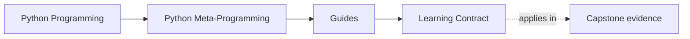

# Learning Contract

<!-- page-maps:start -->
## Page Maps

<!-- page-maps:end -->

This course only works if you treat it as a judgment-building program.

If you read it like a trick catalog, you can finish many pages and still come away with
dangerous instincts: reaching for decorators too early, mistaking metaclasses for
architecture, or trusting dynamic behavior you cannot explain or prove. The contract
below is how you avoid that failure mode.

## What you are agreeing to as a learner

You are agreeing to study metaprogramming as a discipline of restraint:

- observe first
- escalate slowly
- prove claims
- keep lower-power alternatives visible
- reject designs that become harder to review than to implement

This is not a speed contract. It is a seriousness contract.

## Non-negotiable study rules

1. Read the course in order unless you are deliberately using a pressure route and know why.
2. Treat [Module 00](../module-00-orientation/index.md) as required foundation, not optional orientation.
3. Keep one lower-power alternative in view every time the course introduces a stronger mechanism.
4. After each module, prove at least one claim in a concrete surface instead of trusting prose alone.
5. Do not borrow a pattern into production code until you can explain both its benefit and its debugging cost.

## The four questions that must stay alive

Ask these continuously:

- What timing boundary am I dealing with: import time, class-definition time, instance time, or call time?
- What must remain visible after this transformation: metadata, signatures, storage rules, registration state, or public outputs?
- Where does this behavior belong: object, wrapper, field, class, registry, or metaclass layer?
- What becomes harder to test, inspect, or review if I accept this design?

If these questions disappear from your reading, the course is already drifting into empty sophistication.

## Evidence rule

Do not treat a statement as learned just because it sounded plausible.

Every major claim should become checkable through at least one of these:

- a runnable code fence in the lesson
- a named capstone file
- a public capstone command
- a matching test or saved review bundle

If you cannot point to evidence, downgrade the claim from "understood" to "still unproven."

## Rules for moving through modules

### Before a module

- know what the module promises
- know what it does not promise yet
- know which earlier concept it depends on

### During a module

- translate jargon into plain language
- identify the lower-power competitor
- note what timing boundary the mechanism changes

### After a module

- use [Module Checkpoints](module-checkpoints.md)
- prove one concrete claim
- decide whether you are actually ready to advance

## Signs that you are moving too fast

Slow down immediately if any of these happen:

- decorators start feeling interchangeable with descriptors
- descriptors start feeling like "fancy properties" without a clear lookup model
- metaclasses start feeling exciting instead of exceptional
- import hooks, `eval`, or monkey-patching stop sounding risky
- you can repeat the module headline but cannot explain where the behavior lives
- you want to cross into the capstone hoping the repository will explain the lesson for you

These are not small warnings. They usually mean an earlier boundary did not land.

## What honest progress looks like

Honest progress in this course looks like:

- stronger explanations, not just more vocabulary
- fewer blurry boundaries between mechanisms
- more willingness to reject unnecessary power
- easier movement from claim to evidence
- better review judgment in the capstone and in unfamiliar code

## What fake progress looks like

Be suspicious if your progress mostly looks like:

- collecting advanced terms
- memorizing examples without knowing why they were chosen
- skipping proof because the mechanism "seems clear"
- preferring the most powerful tool because it feels more advanced
- jumping to Module 09 or 10 while earlier observation or descriptor boundaries are still shaky

## Good stopping point

You can leave this page when you can say:

- how you will pace yourself through the course
- how you will test whether a claim actually landed
- what kind of "progress" you will refuse to count as understanding
