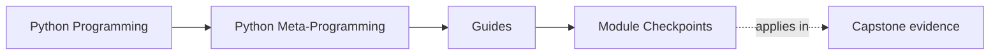

# Module Checkpoints

<!-- page-maps:start -->
## Page Maps

<!-- page-maps:end -->

Use this page at the end of a module.

Its purpose is simple: prevent false advancement. Metaprogramming learners often move on
because the examples felt familiar or the terminology started sounding natural. That is
not enough. Each module needs an exit bar strong enough that later material does not rest
on confusion.

## How to use the checkpoints

For each module:

1. Read the checkpoint.
2. Try to explain it in plain language without looking back.
3. Prove one part of it in the capstone or another concrete surface.
4. If you cannot do both, you are not done with the module.

Use this page to slow yourself down, not to reassure yourself.

## Checkpoints by module

### Module 01: Runtime Objects and the Python Object Model

You are ready to move on when you can:

- explain functions, classes, modules, and instances as runtime objects rather than as syntax categories
- describe what names actually resolve to when Python binds methods or closes over values
- distinguish supported introspection surfaces from implementation-specific curiosities

Proof move:

- choose one capstone object and describe it without executing its business behavior

### Module 02: Safe Runtime Observation and Inspection

You are ready to move on when you can:

- explain why ordinary attribute access is not automatically passive
- separate visible names, stored state, and resolved values
- choose safer inspection tools before reaching for risky value resolution

Proof move:

- inspect manifest and registry output before opening implementation files

### Module 03: Signatures, Provenance, and Runtime Evidence

You are ready to move on when you can:

- use signatures to explain how a callable is meant to be invoked
- validate a complete call with `bind()` and explain why `bind_partial()` answers a
  different question
- distinguish strong runtime evidence from best-effort provenance hints
- explain why two inspection helpers can answer different questions about the same object
- build a stored-state representation without evaluating properties

Proof move:

- run the Module 03 evidence and representation labs, then use capstone action preflight
  to prove argument validation remains separate from execution

### Module 04: Function Wrappers and Transparent Decorators

You are ready to move on when you can:

- describe what happens at definition time and what happens at call time in a decorator
- separate decorator-expression evaluation from bottom-up decorator application
- explain why `functools.wraps` is part of correctness rather than decoration
- tell when a wrapper is still transparent and when it has started hiding semantic change
- distinguish logical signature recovery from the wrapper shell's implementation shape
- trace a stateful wrapper's execution, eviction, failure, and reset policies

Proof move:

- run the wrapper lifecycle and bounded-cache labs, then audit the capstone action wrapper
  before comparing its failed and successful history tests

### Module 05: Decorator Design, Policies, and Typing

You are ready to move on when you can:

- judge whether policy belongs in a decorator or should become an explicit service or object
- explain what annotation-driven runtime behavior can promise honestly and what it cannot
- describe the review cost of hiding retries, validation, or caching behind wrappers

Proof move:

- compare the capstone action decorator with one heavier policy pattern and explain why the capstone stays narrower

### Module 06: Class Customization Before Metaclasses

You are ready to move on when you can:

- explain when a class decorator, property, or explicit helper is sufficient
- describe why post-creation customization is usually less risky than class-creation control
- recognize when a design is drifting toward descriptor or metaclass territory

Proof move:

- inspect class-level customization in the capstone without reaching for `PluginMeta`

### Module 07: Descriptors, Lookup, and Attribute Control

You are ready to move on when you can:

- explain the difference between data and non-data descriptors
- trace one attribute from class declaration to per-instance storage
- justify when a descriptor owns an invariant better than a plain method or property

Proof move:

- inspect `fields.py` and the field tests for coercion, precedence, and storage behavior

### Module 08: Descriptor Systems, Validation, and Framework Design

You are ready to move on when you can:

- say when a descriptor is still one field contract and when it has become architecture
- explain how caching, coercion, or external storage change review cost
- describe why some validation belongs at assignment while other validation belongs elsewhere

Proof move:

- compare the capstone field system with richer descriptor patterns and name the powers it intentionally leaves out

### Module 09: Metaclass Design and Class Creation

You are ready to move on when you can:

- explain what must happen before the class exists for a metaclass to be justified
- compare a metaclass honestly against class decorators and explicit registration
- describe why deterministic, resettable registration matters in tests and reviews

Proof move:

- inspect `framework.py` and `tests/test_registry.py` together

### Module 10: Runtime Governance and Mastery Review

You are ready to finish the course when you can:

- name red lines around dynamic execution, monkey-patching, and import-hook behavior
- explain which powers may be acceptable in tooling but not in normal application code
- review a meta-heavy design for debuggability, observability, and reversibility

Proof move:

- run the capstone proof route and name one design change you would reject immediately

## What to do when a checkpoint fails

- Re-read the module overview and the most relevant lesson page.
- Return to the capstone proof move instead of reading more abstractions.
- Use the previous module’s checkpoint if the current one feels magical.

## Good stopping point

You can leave this page when you know:

- which checkpoint you can defend
- which one still fails
- what concrete proof move you will use next
