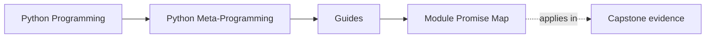

# Module Promise Map

<!-- page-maps:start -->
## Page Maps

<!-- page-maps:end -->

Use this page when you want the course compressed into one honest table:

- what each module is supposed to give you
- what it deliberately does not settle yet
- where the capstone makes that promise visible
- why the next module depends on it

That matters because metaprogramming courses often blur module boundaries. Learners then
expect later powers too early, or assume they understand a concept because they saw a
preview of it. This map keeps the promises sharp.

## The ten-module promise spine

| Module | What this module should leave you able to do | What it does not settle yet | Best first capstone surface | Why the next module depends on it |
| --- | --- | --- | --- | --- |
| 01 Runtime Objects and the Object Model | explain functions, classes, modules, and instances as runtime objects rather than as syntax labels | safe observation strategy and evidence rules | manifest output plus the basic source layout | you cannot inspect safely until you know what kind of object you are looking at |
| 02 Runtime Observation and Inspection | inspect names, storage, callability, and types without assuming observation is always passive | provenance and callable evidence strong enough for review | manifest and registry outputs before opening implementation details | later wrapper and descriptor work depends on safe inspection habits |
| 03 Signatures, Provenance, and Evidence | use signatures and provenance surfaces to make stronger runtime claims | behavior-changing wrappers and policy design | action signatures, CLI outputs, and source evidence surfaces | wrappers become dangerous if callable identity is still blurry |
| 04 Transparent Decorators | explain what a wrapper changes at definition time and at call time while preserving public callable shape | policy-heavy decorators and when wrapping stops being honest | `actions.py`, trace output, and runtime tests | policy design only matters after transparency is understood |
| 05 Decorator Policies, Typing, and Review Cost | judge when wrapper-carried policy is acceptable and when it should become explicit structure | class-level customization and attribute ownership | action metadata, wrapper tests, and manifest behavior | class customization should only come after wrapper limits are visible |
| 06 Class Customization Before Metaclasses | compare class decorators, helpers, and properties before escalating to stronger hooks | descriptor precedence, reusable field systems, and class-creation control | constructor shape and class-level customization surfaces | descriptors and metaclasses need a real lower-power comparison point |
| 07 Descriptors, Lookup, and Attribute Control | explain descriptor precedence, binding, and per-instance storage without folklore | framework-scale descriptor systems and broader validation architecture | `fields.py` and field tests | you need clear lookup mechanics before judging larger field frameworks |
| 08 Descriptor Systems, Validation, and Framework Shape | judge when a descriptor is still one field contract and when it has become architecture | class-creation control and metaclass scope | field schema export, coercion surfaces, and field tests | metaclasses should feel like escalation from real descriptor limits |
| 09 Metaclass Design and Class Creation | explain what truly belongs at class-definition time and reject metaclasses that only hide lower-power options | governance rules for dynamic power across a whole system | `framework.py`, registry output, and registry tests | governance only makes sense after the highest mechanism is understood precisely |
| 10 Runtime Governance and Mastery Review | classify trust, contract, rollback, tooling, and escalation claims through executable evidence | no later module; this is the integrated judgment pass | `runtime-governance-lab` first, then `capstone-governance` and the saved inspection bundle | this is the stewardship layer that converts mechanism knowledge into durable judgment |

## Read the promises as a dependency chain

The modules are not just adjacent topics. They depend on one another.

### Modules 01 to 03: observation chain

These modules teach:

- what exists at runtime
- how to inspect it without accidental execution
- how to turn runtime facts into usable evidence

If this chain is weak, later mechanisms feel mystical.

### Modules 04 to 09: control chain

These modules teach:

- how to change call behavior
- how to place policy and validation
- how to own attribute behavior
- how to justify class-creation control

If this chain is weak, stronger hooks begin solving the wrong problems.

### Module 10: governance chain

This module asks:

- where each mechanism executes and who owns the changed public surface
- which powers are approved, constrained, or rejected
- what focused test proves each decision and what remains unproved
- whether the same judgment transfers from a small course experiment to the capstone

Without this chain, the course can still teach mechanism names while failing to teach judgment.

## How to use the promise map

### Before a module

Read the promise and the "not settled yet" column. That stops you from expecting too much
too early.

### After a module

Use the capstone surface column to make the promise concrete.

### When resuming after a break

Find the last promise you can still explain in plain language. Resume there, not at the
latest topic you remember seeing.

## Good stopping point

You can leave this page when you can answer:

- what the current module is supposed to settle
- what it deliberately leaves for later
- which capstone surface should make its promise visible
