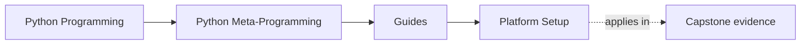

# Platform Setup

<!-- page-maps:start -->
## Page Maps




<!-- page-maps:end -->

This page exists for one reason: before you can learn anything trustworthy from the
capstone, the local environment has to become boring.

That is not a small point. Dynamic Python code can look broken for conceptual reasons or
for environment reasons, and beginners often cannot tell which failure they are seeing.
This guide is how you separate those problems.

## What a "good setup" means in this course

A good setup is not "Python seems to run." A good setup means:

- the supported Python version is in use
- the capstone-managed environment is the one actually running the commands
- the test suite passes from the documented route
- public capstone commands produce the expected outputs under that same environment

Until those conditions hold, do not draw design conclusions from the capstone.

## Minimum requirements

You need:

- Python 3.10 or newer
- Git on the command line
- a writable local filesystem for `artifacts/`
- willingness to use the documented Make targets instead of improvising with global tools

## Trust these setup surfaces

Use these as the authoritative setup contract:

| Surface | Why it matters |
| --- | --- |
| `capstone/pyproject.toml` | defines the supported Python floor and package expectations |
| `capstone/Makefile` | defines the supported install and proof routes |
| [Command Guide](../capstone/command-guide.md) | explains what each public route is supposed to do |

Do not treat a globally installed `pytest`, ad hoc virtual environment, or one-off shell
state as equivalent to the supported course environment.

## Best root-level route

If you are working from the repository root, use this order:

```bash
make PROGRAM=python-programming/python-meta-programming docs-build
make PROGRAM=python-programming/python-meta-programming test
make PROGRAM=python-programming/python-meta-programming capstone-manifest
```

Why this order:

- `docs-build` confirms the course documentation surface is buildable
- `test` confirms the supported capstone environment and executable suite
- `capstone-manifest` checks the smallest public runtime route after the environment is stable

## Best capstone-local route

If you are working inside `capstone/`, use this order:

```bash
make install
make test
make manifest
make inspect
```

This route matters because it moves from environment creation to executable confirmation
to public runtime shape to guided inspection. It does not confuse setup with proof.

## What to verify in order

Work through these checks in sequence:

1. `make install` completes and creates the managed virtual environment under `artifacts/venv/...`.
2. `make test` passes before you trust any saved bundle or public output.
3. `make manifest` and `make registry` render public runtime facts without import-time surprises.
4. `make inspect` writes the guided inspection bundle to the documented `artifacts/` location.

If step 2 fails, stop there. Do not escalate to `proof`, `verify-report`, or guided walkthrough routes yet.

## Common failure patterns

| Symptom | Likely cause | What to do |
| --- | --- | --- |
| virtual environment creation fails | unsupported Python on the path | install a supported Python version and rerun `make install` |
| import errors appear during tests | editable install or environment creation did not complete correctly | rerun `make install` from `capstone/` |
| commands work in one shell and fail in another | global environment and managed environment are mixed | stop using ad hoc commands and return to the documented Make targets |
| manifest or registry output fails after tests passed | the environment drifted or public commands are being run from the wrong location | rerun the documented route exactly from the expected directory |
| bundles do not appear under `artifacts/` | wrong working directory or stale route assumptions | rerun the route from repository root or `capstone/` exactly as documented |

## Drift signals

Re-check setup immediately if:

- Python changed locally but the managed environment was not recreated
- tests pass but `manifest`, `registry`, or `inspect` fail from the documented route
- the command list in the command guide stops matching the Makefile
- a global package install changes behavior that the capstone environment did not request

These are setup warnings first, not deep design insights.

## What not to conclude too early

Do not conclude that:

- a descriptor system is broken
- a wrapper is hiding behavior
- a metaclass is behaving unpredictably

until you know the environment contract is stable. Environment drift can imitate conceptual failure.

## What this page does and does not promise

This page promises:

- the supported setup order
- the minimum environment bar before proof work
- a triage path for common setup failures

This page does not promise:

- support for arbitrary global Python environments
- that "the CLI ran once" is enough evidence of health
- that setup alone answers proof-sizing questions better handled by [Proof Ladder](proof-ladder.md)

## Good stopping point

You can leave this page when you know:

- which setup route you are using
- whether the managed environment is the active one
- whether the executable suite and first public command both behave correctly
