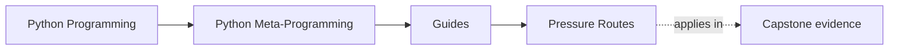

# Pressure Routes

<!-- page-maps:start -->
## Page Maps

<!-- page-maps:end -->

Use this page when you are entering the course from a real engineering pressure rather
than from a full front-to-back study plan.

That pressure might be:

- "I inherited decorator-heavy code and do not trust it."
- "I cannot tell whether this validation belongs in a descriptor or somewhere simpler."
- "Someone proposed a metaclass and I need to review the design honestly."

This page exists to stop that pressure from pushing you straight to the most advanced
mechanism. It routes you through the smallest honest reading path first.

## The rule that governs every route

Always ask:

> what is the lowest-power mechanism that could own this behavior honestly?

If you cannot explain why a stronger mechanism is necessary, you are not ready to approve it.

## Lowest-power comparison table

| If the real problem is... | Try this first | Do not jump to... |
| --- | --- | --- |
| observing runtime structure safely | `inspect`, `type`, `vars`, `getattr_static` | decorators, descriptors, or metaclasses |
| changing one callable while keeping its identity visible | a transparent decorator with `functools.wraps` | descriptors or metaclasses |
| changing one class after it already exists | a class decorator or explicit helper | a metaclass |
| owning behavior for one attribute | `property` or a descriptor | a metaclass |
| sharing one field contract across attributes or classes | a descriptor with `__set_name__` | a metaclass |
| enforcing a rule during class creation | a narrow metaclass hook | global patching or import hooks |

## Choose the route by question

| If your real question is... | Start with | First capstone cross-check |
| --- | --- | --- |
| What is Python actually doing at runtime here? | Modules 01 to 03 | manifest output and `framework.py` |
| How can I inspect this safely without accidental execution? | Module 02 | `make manifest`, `make registry`, and `cli.py` |
| Did this wrapper preserve the callable contract honestly? | Modules 03 to 05 | `make action`, `make signatures`, and `actions.py` |
| Should this live in a class decorator, property, or descriptor? | Modules 06 to 08 | class-customization lab, descriptor-lookup lab, field-ownership evidence, and field tests |
| Does this really belong at class-definition time? | Module 09 | `make registry`, `framework.py`, and registry tests |
| Which runtime powers are too dangerous to approve casually? | Module 10 | verification bundle and review checklist |

## Route 1: Review a wrapper without losing provenance

Use this route when the immediate pressure is decorator-heavy code.

Study order:

1. [Review Checklist](../reference/review-checklist.md)
2. [Module 03](../module-03-signatures-provenance-runtime-evidence/index.md)
3. [Module 04](../module-04-function-wrappers-transparent-decorators/index.md)
4. [Module 05](../module-05-decorator-design-policies-typing/index.md)
5. `actions.py` plus the capstone action surfaces

Use this route to answer:

- Did the decorator preserve signature and metadata?
- Is the wrapper still a call-boundary change, or is it hiding policy?
- Would an explicit object be easier to inspect than another decorator?

Best first capstone move:

- for wrapper provenance, run
  `make PROGRAM=python-programming/python-meta-programming capstone-action-wrapper`
- for partial runtime hint policy, run
  `make PROGRAM=python-programming/python-meta-programming capstone-check-action`
- cross into execution only when needed with
  `make PROGRAM=python-programming/python-meta-programming capstone-trace`

## Route 2: Untangle attribute ownership and validation

Use this route when the pressure is around properties, descriptors, or field systems.

Study order:

1. [Module 06](../module-06-class-customization-pre-metaclasses/index.md)
2. [Module 07](../module-07-descriptors-lookup-attribute-control/index.md)
3. [Module 08](../module-08-descriptor-systems-validation-framework-design/index.md)
4. `fields.py` plus the field tests

Use this route to answer:

- Does the invariant belong on attribute access?
- Why does one field yield to instance state while another does not?
- Is this still a field contract, or has it turned into hidden architecture?

Start with `make class-customization-lab` to compare lower-power class tools. Continue
with `make descriptor-lookup-lab-test` and `make descriptor-lookup-lab` to predict and
observe protocol status, precedence, binding, and storage before reading the capstone
field system. Use `make capstone-class-creation` when the question becomes class-family
timing rather than one attribute boundary.

Best first capstone move:

- run
  `make PROGRAM=python-programming/python-meta-programming capstone-field-ownership`
  to inspect descriptor ownership without plugin construction
- use `capstone-field` next when the question is the exported schema rather than the
  lookup mechanism

## Route 3: Decide whether a metaclass is actually justified

Use this route when the design proposal involves class creation, registries, or import-time control.

Study order:

1. [Module 06](../module-06-class-customization-pre-metaclasses/index.md)
2. [Module 09](../module-09-metaclass-design-class-creation/index.md)
3. [Module 10](../module-10-runtime-governance-mastery-review/index.md)
4. `framework.py` plus `tests/test_registry.py`

Use this route to answer:

- What must happen before the class exists?
- Could a class decorator or explicit registration function own this more honestly?
- Is the metaclass deterministic, resettable, and inspectable?

Best first capstone move:

- run `make PROGRAM=python-programming/python-meta-programming capstone-registry`

## Route 4: Inherit a dynamic codebase without trusting its magic

Use this route when the code already exists and you need a calm order for inspection.

Study order:

1. [Start Here](start-here.md)
2. [Course Guide](course-guide.md)
3. [Module 00](../module-00-orientation/index.md)
4. [Module 02](../module-02-runtime-observation-inspection/index.md)
5. [Module 03](../module-03-signatures-provenance-runtime-evidence/index.md)
6. only then move toward descriptors or metaclasses

Use this route to answer:

- Where does the system execute code during inspection?
- Which behavior happens at import time rather than call time?
- What should be kept, and what should be redesigned downward?

Best first capstone move:

- run `make PROGRAM=python-programming/python-meta-programming inspect`

## Route 5: Build a framework without teaching the wrong lesson

Use this route when you are designing a reusable dynamic system and want maintainers to
be able to inspect it later without pain.

Study order:

1. Modules 01 to 03 for the observation floor
2. Modules 04 to 06 for lower-power customization
3. Modules 07 to 09 only where lower-power options fail honestly
4. Module 10 before approving the overall design

Use this route to answer:

- Which mechanism owns this invariant with the smallest blast radius?
- Will another engineer be able to inspect this behavior without running business code?
- Does the design remain testable once multiple extension points exist?

Best first capstone move:

- run `make PROGRAM=python-programming/python-meta-programming capstone-verify-report`

## When a route is working

The route is working if, by the end, you can say:

- what boundary was under pressure
- which lower-power option you considered first
- why you escalated or refused to escalate
- which capstone surface or proof route settled the decision
