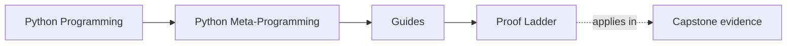

# Proof Ladder

<!-- page-maps:start -->
## Page Maps

<!-- page-maps:end -->

Use this page when you know the claim you want to verify but do not yet know how much
proof is enough.

That distinction matters. Learners often do one of two bad things:

- run the biggest route every time and drown in output
- run the smallest route available and claim too much from weak evidence

The ladder exists to keep proof proportional to the question.

## Two kinds of proof pressure

There are two different pressures here:

- **human-review pressure**: you need enough evidence to inspect or explain a claim honestly
- **executable-confidence pressure**: you need strong confirmation that the runnable system still holds together

Those are not the same job, so they should not always use the same route.

## The ladder

| Level | When to start here | Command | What this level gives you |
| --- | --- | --- | --- |
| 1. Public shape | you need to inspect declared runtime facts without executing business behavior | `make manifest`, `make registry`, `make plugin`, `make field`, `make action`, `make signatures` | direct public outputs for metadata, registration, field shape, and signatures |
| 2. One concrete behavior | you need to see one action or runtime behavior actually happen | `make demo` or `make trace` | one concrete execution plus visible configuration and history |
| 3. Saved inspection route | you need a guided review bundle without opening source first | `make inspect` | one saved bundle of public surfaces and reading notes |
| 4. Guided walkthrough route | you need to connect commands, files, and tests across the repository | `make tour` | a broader walkthrough bundle with code-reading guidance |
| 5. Executable verification route | you need to confirm that tests and public surfaces still agree | `make verify-report` | executable confirmation plus saved review evidence |
| 6. Full public proof route | you need the whole inspection, walkthrough, and verification surface together | `make proof` | the broadest review bundle |
| 7. Strongest local confirmation | you need the strongest direct runnable confirmation | `make confirm` | raw executable confidence through the test-driven confirmation route |

## Where to start

### Start at level 1 when the claim is structural

Good questions for level 1:

- Which plugins are registered?
- What fields or actions does this plugin expose?
- Did a wrapper preserve the public signature?
- Can I inspect this fact without invoking behavior?

### Start at level 2 when the claim is behavioral

Good questions for level 2:

- What does one action invocation look like?
- What state or history remains visible after execution?
- Is the runtime behavior still inspectable after it happens?

### Start at levels 3 or 4 when the problem is understanding

Good questions for levels 3 and 4:

- What should I read first?
- How do the public outputs connect to the repository layout?
- Which files and tests support the runtime story I just saw?

### Start at levels 5 to 7 when the problem is confidence

Good questions for levels 5 to 7:

- Did a recent change break a contract?
- Do the tests still agree with the public surfaces?
- Do I need merge-level or publication-level confidence?

## Escalation rules

- Do not jump to `proof` when `manifest`, `registry`, or `trace` would settle the claim.
- Do not jump to `confirm` when your real need is explanation rather than raw confidence.
- Escalate from `inspect` to `tour` only when you need file ownership and repository walkthrough, not just public outputs.
- Escalate from `tour` to `verify-report` only when reading routes are no longer enough and executable confirmation is now required.
- Treat `confirm` as the strongest confidence route, not the best teaching route.

## Common mistakes

Avoid these habits:

- using level 7 to answer a level 1 question
- claiming design understanding from test success alone
- claiming strong confidence from one pretty CLI output
- treating bigger routes as automatically better routes

## A practical selection rule

When choosing a proof route, say:

1. what claim you are trying to prove
2. what kind of pressure you are under
3. what the smallest honest route is
4. what stronger route you will use only if that one fails to settle the question

If you cannot say all four, you are probably picking the route by anxiety instead of by reasoning.

## Good stopping point

You are using the ladder well when you can say:

- which claim you tested
- why the chosen route was enough
- which output or bundle actually settled the question
- which stronger route you deliberately did not run
