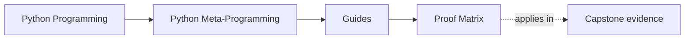

# Proof Matrix

<!-- page-maps:start -->
## Page Maps

<!-- page-maps:end -->

Use this page when the claim is already clear and you want the fastest honest route to
evidence.

This page is different from the proof ladder. The ladder helps you choose how much proof
you need. The matrix helps you choose where to go once you know what claim you are trying
to settle.

## How to use this page

1. State the claim in one sentence.
2. Find the row that matches it most closely.
3. Start with the first command listed there.
4. Inspect the first surface before escalating.

If you still do not know what claim you are testing, go back to [Proof Ladder](proof-ladder.md)
or [Pressure Routes](pressure-routes.md).

## Core runtime claims

| Claim | Best first command | Best first evidence surface |
| --- | --- | --- |
| public runtime shape stays observable without executing plugin work | `make PROGRAM=python-programming/python-meta-programming capstone-manifest` | `manifest.json` plus `cli.py` |
| registered plugins stay deterministic and inspectable | `make PROGRAM=python-programming/python-meta-programming capstone-registry` | `registry.json`, `framework.py`, and `tests/test_registry.py` |
| one plugin contract remains legible from the public CLI | `make PROGRAM=python-programming/python-meta-programming capstone-plugin` | `plugin.json` plus `plugins.py` |
| one field invariant stays attached to attribute ownership | `make PROGRAM=python-programming/python-meta-programming capstone-field` | `field.json`, `fields.py`, and `tests/test_fields.py` |
| action decorators preserve public callable shape while adding behavior | `make PROGRAM=python-programming/python-meta-programming capstone-action` | `action.json`, `actions.py`, and `tests/test_runtime.py` |
| action values match the supported runtime hint subset without hidden execution | `make PROGRAM=python-programming/python-meta-programming capstone-check-action` | `check-action.json`, `actions.py`, and runtime tests |
| generated constructor and action signatures still reflect declared fields honestly | `make PROGRAM=python-programming/python-meta-programming capstone-signatures` | `signatures.json`, `framework.py`, and runtime tests |
| one concrete runtime action remains traceable after execution | `make PROGRAM=python-programming/python-meta-programming capstone-trace` | `trace.json` plus runtime tests |

## Bundle and review claims

| Claim | Best first command | Best first evidence surface |
| --- | --- | --- |
| you can inspect the runtime without reading source first | `make PROGRAM=python-programming/python-meta-programming inspect` | the saved inspection bundle under `artifacts/inspect/...` |
| you can follow a guided repository walkthrough honestly | `make PROGRAM=python-programming/python-meta-programming capstone-walkthrough` | the walkthrough bundle under `artifacts/tour/...` |
| executable tests and public review surfaces still agree | `make PROGRAM=python-programming/python-meta-programming capstone-verify-report` | `pytest.txt` plus matching public outputs |
| the raw executable suite still passes | `make PROGRAM=python-programming/python-meta-programming test` | the core test files |
| the strongest local confirmation route still holds | `make PROGRAM=python-programming/python-meta-programming capstone-confirm` | the confirmation route plus its public command surfaces |
| the full public proof route still builds | `make PROGRAM=python-programming/python-meta-programming proof` | inspection, walkthrough, and verification bundles together |

## Course outcome to evidence route

| If you are trying to prove... | Best first route | Best first surface |
| --- | --- | --- |
| I can inspect runtime structure safely | `capstone-manifest`, `capstone-registry`, or `inspect` | public CLI outputs plus `framework.py` |
| wrappers preserved metadata and public callable shape | `capstone-action`, `capstone-signatures`, or `capstone-trace` | `actions.py`, runtime tests, and trace output |
| field or descriptor ownership is placed honestly | `capstone-field` or `capstone-plugin` | `fields.py`, `field.json`, and field tests |
| class-creation control is justified and deterministic | `capstone-registry` | `framework.py`, `registry.json`, and registry tests |
| review routes remain observational rather than magical | `inspect`, `capstone-verify-report`, or `proof` | saved bundles plus CLI and test surfaces |

## Module bridge

| Module range | Main question | Best first evidence route |
| --- | --- | --- |
| Modules 01 to 03 | what can be observed safely without accidental execution | `manifest`, `registry`, `signatures`, or `inspect` |
| Modules 04 to 05 | did a wrapper preserve evidence and keep its policy claims bounded | `action-wrapper`, `check-action`, `trace`, and `tests/test_runtime.py` |
| Modules 06 to 08 | does the chosen customization boundary really belong to fields and lookup | `field`, `plugin`, and `tests/test_fields.py` |
| Module 09 | is class-definition-time behavior justified and deterministic | `registry`, `framework.py`, and `tests/test_registry.py` |
| Module 10 | do the public review routes stay observable under real scrutiny | `inspect`, `capstone-verify-report`, or `proof` |

## Quick review questions

| If you are asking... | Best first move |
| --- | --- |
| Where should I start if the public runtime shape already feels suspicious? | `capstone-manifest` or `capstone-registry` |
| Where should I start if the issue is one field or one action contract? | `capstone-field` or `capstone-action` |
| Which saved bundle is strongest for a human review? | `inspect` or `capstone-verify-report` |
| Which route should I use before approving a larger change? | `capstone-verify-report` or `proof` |

## Best companion pages

- [Proof Ladder](proof-ladder.md)
- [Pressure Routes](pressure-routes.md)
- [Command Guide](../capstone/command-guide.md)
- [Capstone Map](../capstone/capstone-map.md)
- [Capstone Proof Guide](../capstone/capstone-proof-guide.md)
