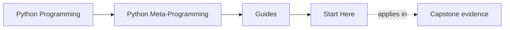

# Start Here

<!-- page-maps:start -->
## Page Maps

<!-- page-maps:end -->

This page answers the first question an independent learner actually has:

> should I study this course, and if yes, what is the safest way to begin?

Python metaprogramming is easy to approach badly. Many learners meet decorators,
descriptors, or metaclasses as isolated tricks and only later discover the debugging,
review, and design costs. This course takes the opposite route. It begins with runtime
observation, builds a ladder of increasingly powerful tools, and keeps asking whether a
lower-power design would be more honest.

If that is the kind of learning you want, start here.

## This course is a good fit if

- you need to inspect, wrap, validate, or register Python objects without hiding runtime behavior
- you review libraries or frameworks that already use decorators, descriptors, or metaclasses
- you want a principled way to reject unnecessary "magic" instead of just learning how to write it
- you are willing to move from beginner-friendly runtime observation toward advanced class-creation control step by step

## This course is not the right first stop if

- you still need a basic introduction to Python classes, methods, attributes, and ordinary object design
- you mainly want clever tricks without paying attention to testability, observability, or maintenance cost
- your problem is still better solved by plain functions, plain classes, or explicit composition and you are looking for permission to skip that simpler route

## The safest way to begin

If you are new to the course, use this route exactly:

1. Read [Course Home](../index.md) to understand the promise and the overall terrain.
2. Read [Course Guide](course-guide.md) to see the ten-module arc and how the support shelves fit around it.
3. Read [Learning Contract](learning-contract.md) so the study bar is explicit before the dense material begins.
4. Read [Module 00](../module-00-orientation/index.md) to learn the power ladder and the course’s idea of "honest escalation."
5. Read [First-Contact Map](../module-00-orientation/first-contact-map.md) if the course still feels large and you want the shortest clean entry through foundations.
6. Read [Platform Setup](platform-setup.md) before running public commands.
7. Begin [Module 01](../module-01-runtime-objects-object-model/index.md).

This route matters because the later modules only make sense if import time,
class-definition time, instance time, and call time are already distinct in your head.

## Pick the route that matches your current pressure

### If you want full mastery

Study the course in order from [Module 00](../module-00-orientation/index.md) through
[Module 10](../module-10-runtime-governance-mastery-review/index.md). Use the guide shelf
to keep the promises, checkpoints, and proof routes explicit as you go.

### If you are reviewing a dynamic codebase

Start with [Course Guide](course-guide.md), then [Module 00](../module-00-orientation/index.md),
then use [Pressure Routes](pressure-routes.md) to choose the relevant hotspot route.

### If you are returning after a break

Use [Module Promise Map](module-promise-map.md) and
[Module Checkpoints](module-checkpoints.md) to find the last boundary you still understand.
Resume there, not at the most advanced topic you remember seeing.

### If your environment is the blocker

Go directly to [Platform Setup](platform-setup.md). Do not waste time interpreting runtime
behavior until the supported environment is stable.

## Reading routes by learner type

### Foundation-first route

Choose this when the power ladder still feels abstract:

- Read Module 00 carefully.
- Study Modules 01 to 03 in order.
- Do not rush toward wrappers or metaclasses until safe observation feels ordinary.

### Reviewer route

Choose this when you already work with dynamic code and need the shortest honest review path:

- Read Module 00.
- Focus first on Modules 04, 07, 09, and 10.
- Keep [Pressure Routes](pressure-routes.md) open.
- Use the capstone only after the review question is explicit.

### Attribute-and-validation route

Choose this when your real pressure is field ownership, lookup order, or validation design:

- Read Module 06.
- Then Modules 07 and 08.
- Cross-check with field-related capstone surfaces.

### Class-creation route

Choose this when the pressure is registries, import-time behavior, or metaclass proposals:

- Revisit Module 06 first.
- Then read Module 09.
- Finish with Module 10 before you trust your own judgment.

## When to move into the capstone

Move into the capstone only after you can name the current course question clearly. Good
reasons to cross over include:

- "I want to inspect one field system after Module 07."
- "I want to see whether the action decorator keeps signatures visible after Module 04."
- "I want to test whether the metaclass is actually justified after Module 09."

Poor reasons include:

- "I’m bored of theory."
- "I want to skip ahead to the real code."
- "Maybe the repository will explain the module for me."

When the course question is clear, start with [Capstone Guide](../capstone/index.md) or
[Capstone Map](../capstone/capstone-map.md).

## Good stopping point

You are ready to leave this page when you can answer:

- why this course fits your current need
- which route you will use first
- which module or guide you will open next
