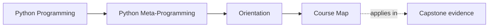
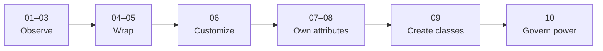

# Course Map

<!-- page-maps:start -->
## Page Maps




<!-- page-maps:end -->

The first diagram places this map inside the course and its supporting capstone. The
second shows the dependency chain. It is not a ranking of increasingly impressive
features. Each stage adds a more invasive owner only after the previous stage supplies
the observation and judgment needed to review it.

## Read the map as a dependency argument

The course has five transitions:

1. observation before transformation
2. transparent wrapping before policy-heavy wrapping
3. lower-power class customization before descriptor or metaclass escalation
4. descriptor mechanics before field-system architecture
5. class-creation mechanics before runtime governance

Skipping a transition does not merely omit content. It removes the lower-power comparison
that later decisions depend on.

## Complete course route

Run commands from the Python Metaprogramming course directory. The course command and
focused test are the learning surface. The capstone command comes afterward and asks
whether the same explanation survives in the incident-plugin application.

| Module | Learning question | Course evidence | Focused proof | Capstone transfer |
| --- | --- | --- | --- | --- |
| 01 | What objects exist at runtime? | `make lab` | `make lab-test` | `make capstone-manifest` |
| 02 | Which observation routes avoid accidental execution? | `make observation-lab` | `make observation-lab-test` | `make capstone-manifest` |
| 03 | Which evidence is strong enough for a runtime claim? | `make evidence-lab` | `make evidence-lab-test` | `make capstone-bind-action` |
| 04 | What must a wrapper preserve? | `make wrapper-lab` | `make wrapper-lab-test` | `make capstone-action-wrapper` |
| 05 | Which policies belong at a callable boundary? | `make decorator-policy-lab` | `make decorator-policy-lab-test` | `make capstone-check-action` |
| 06 | Can a lower-power class tool own the behavior? | `make class-customization-lab` | `make class-customization-lab-test` | `make capstone-class-creation` |
| 07 | Which lookup layer owns an attribute result? | `make descriptor-lookup-lab` | `make descriptor-lookup-lab-test` | `make capstone-field-ownership` |
| 08 | Which field-system powers earn their complexity? | `make descriptor-system-lab` | `make descriptor-system-lab-test` | `make capstone-field-system` |
| 09 | What must happen before a class exists? | `make class-creation-lab` | `make class-creation-lab-test` | `make capstone-class-creation` |
| 10 | Which runtime powers should be approved or rejected? | `make runtime-governance-lab` | `make runtime-governance-lab-test` | `make capstone-governance` |

This table is generated independently as executable evidence by:

```bash
make study-route
```

If the page and JSON disagree, treat the mismatch as a course defect. Do not silently
choose whichever route is more convenient.

## Stage contracts

### Observation: Modules 01–03

You learn to distinguish runtime objects, stored state, resolved values, call shapes,
and provenance claims. The stage preserves ordinary Python behavior while improving the
quality of evidence.

Move forward when you can predict whether an inspection route executes user code and can
bind a call without invoking it.

### Callable control: Modules 04–05

You follow a function through decorator expression evaluation, wrapper construction,
binding, and call time. Then you add retry, validation, and cache policy without
pretending wrappers are invisible.

Move forward when you can identify the wrapper owner, preserved public surface, state
lifetime, failure identity, and reset boundary.

### Class and attribute control: Modules 06–08

You compare explicit helpers, properties, class decorators, descriptors, and wider
field systems. The point is placement: behavior should live at the narrowest boundary
that actually owns it.

Move forward when you can predict descriptor precedence, locate per-instance storage,
and explain why one-field behavior has or has not become framework policy.

### Class creation: Module 09

You trace `type(...)`, metaclass resolution, `__prepare__`, namespace capture,
`__new__`, `__init__`, and registration. The metaclass must earn its place by owning a
fact unavailable after ordinary class creation.

Move forward when you can name the lower-power tool that failed and the exact
definition-time requirement that remains.

### Governance: Module 10

You review dynamic execution, runtime interfaces, patching, import hooks, AST transforms,
and the mechanisms already used by the capstone. Outcomes include approve, constrain,
and reject.

Finish when every accepted power names an owner, observability route, rollback, proof,
and escalation boundary—and every rejected power names a lower-power alternative.

## Transition hazards

| Transition | Common wrong turn | Recovery |
| --- | --- | --- |
| 03 → 04 | wrapping before evidence is trustworthy | rerun binding and provenance packets before changing behavior |
| 05 → 06 | moving callable policy into class-wide machinery | state which instances or subclasses actually need the rule |
| 06 → 07 | treating all attribute control as descriptor behavior | predict ordinary lookup before adding hooks |
| 08 → 09 | using metaclasses because descriptor collection feels advanced | separate post-creation collection from pre-creation facts |
| 09 → 10 | treating mechanism fluency as approval | publish a constrain or reject case with evidence |

## Choose a staged map

- [First-Contact Map](first-contact-map.md) traces Modules 01–03 and their evidence
  boundary.
- [Mid-Course Map](mid-course-map.md) traces Modules 04–08 from wrapper ownership to
  field architecture.
- [Mastery Map](mastery-map.md) traces Modules 09–10 from class creation to governance.

Use [Module Checkpoints](../guides/module-checkpoints.md) for exit criteria and
[Proof Ladder](../guides/proof-ladder.md) when the verification route feels larger than
the claim. Open [Capstone Map](../capstone/capstone-map.md) only after the relevant course
evidence is settled.

## Good stopping point

You understand this map when you can:

- explain why each transition needs the stage before it
- choose the course command before the capstone transfer
- identify the preserved contract for the module you are studying
- name the focused test without defaulting to the broad suite
- locate the right staged map after a break
