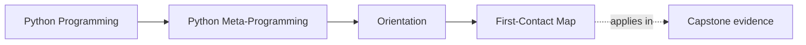
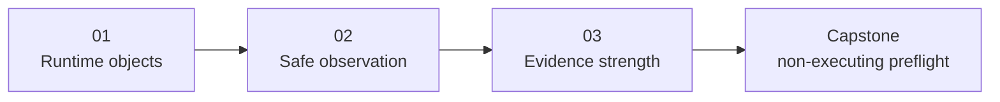

# First-Contact Map

<!-- page-maps:start -->
## Page Maps




<!-- page-maps:end -->

The first diagram places this foundation route inside the course. The second shows the
claim progression: identify runtime objects, learn which observation operations may
execute code, then decide how strong the resulting evidence is. Only after those claims
are stable should you inspect the capstone’s non-executing surfaces.

Use this map as a first-time route or as a recovery route when later wrappers,
descriptors, or metaclasses feel magical.

## Foundation contract

Modules 01–03 do not transform application behavior. They teach you to observe and
classify the behavior that already exists.

The preserved contract is:

> Inspection must not quietly become execution, and evidence must not claim more than
> the operation actually established.

That contract is the review floor for every later module.

## Module 01: establish runtime identity

Start by predicting what the runtime owns:

- a function owns code, defaults, annotations, globals, and possibly closure cells
- a class is a runtime object created from a namespace
- a module is a cached namespace object whose import has execution semantics
- an instance carries state according to its class’s storage and lookup rules

Run:

```bash
make lab
make lab-test
```

Do not merely read the JSON. For each packet, identify:

1. the operation that produced the evidence
2. the object whose identity is being compared
3. the behavior that was deliberately not executed
4. one fact that would change after mutation or reload

The capstone transfer is intentionally small:

```bash
make capstone-manifest
```

Use it to identify classes, functions, and exported metadata. Do not infer that a
manifest proves an action succeeds.

## Module 02: separate observation from access

Module 01 tells you what exists. Module 02 asks whether the route used to inspect it is
passive.

Run:

```bash
make observation-lab
make observation-lab-test
```

The key comparison is not “`dir` versus `getattr`.” It is:

| Question | Safer starting evidence | Risk to name |
| --- | --- | --- |
| Which names are visible? | `dir(obj)` | names may be synthesized and values remain unknown |
| What state is directly stored? | `vars(obj)` when supported | slots and inherited state are absent |
| What class attribute is statically present? | `inspect.getattr_static` | result may be a descriptor rather than its resolved value |
| What does normal access return? | `getattr` or dotted access | descriptors and fallback hooks may execute |
| Can the object be called? | `callable(obj)` | says nothing about a valid argument list |

Write the risk beside the result. A value without its observation route is weak review
evidence.

Use `make capstone-manifest` again, but ask a different question: which facts were
published without plugin construction or action invocation? Reusing a command is not
repeating a lesson when the claim has changed.

## Module 03: classify evidence strength

Module 03 turns observations into explicit contracts and limitations.

Run:

```bash
make evidence-lab
make evidence-lab-test
make evidence-repr
make evidence-repr-test
```

Trace four evidence classes:

- enforced: Python itself rejects a call shape through signature binding
- structural: static members and wrapper metadata expose an owned shape
- best effort: source and provenance helpers can legitimately fail
- diagnostic only: frames and stack data are bounded observations, not application APIs

Then transfer argument binding into the capstone:

```bash
make capstone-bind-action
```

The expected evidence says construction and execution are absent. The command proves
that proposed arguments fit the stored signature. It does not prove annotation
compatibility, plugin configuration validity, or action success.

## One complete first-contact study session

Suppose a learner asks, “Can I call this object safely?”

1. Module 01 identifies whether the object is a function, bound method, class, or
   callable instance.
2. Module 02 checks static structure before triggering dynamic access.
3. Module 03 obtains the signature and binds proposed arguments.
4. The learner predicts the binding result before running it.
5. The focused test proves the binding contract.
6. `capstone-bind-action` checks the same reasoning in the application without invoking
   the action.

The answer is still not “safe to call.” It is “the call shape is compatible with this
observed signature.” That narrower sentence is the learning result.

## Failure and recovery routes

| Symptom | Missing boundary | Recovery |
| --- | --- | --- |
| `getattr` surprises you | static and dynamic access are blurred | rerun Module 02’s property and fallback cases |
| a bound method looks like a copied function | object identity and binding are blurred | rerun Module 01’s class packet |
| source recovery failure feels like a broken lesson | best-effort provenance is overstated | rerun Module 03’s provenance packet |
| passing `callable` feels like validation | capability and valid invocation are blurred | bind with the real signature |
| capstone output feels like business execution | report and invocation routes are blurred | verify the packet’s construction/execution flags |

After a longer break, re-prove the first boundary directly:

```bash
make lab
make lab-test
```

If Module 01 is still stable, continue with `make observation-lab` and
`make observation-lab-test`. Move forward only when you can explain why observation and
execution are different.

## Ready for Module 04

Move into wrappers only when you can:

- distinguish a function from a bound method by identity
- explain why module import is already execution
- choose static lookup before normal access when observation is the claim
- bind arguments without invoking the callable
- classify provenance and frame evidence honestly
- state what `capstone-bind-action` proves and refuses to prove

Keep [Module Checkpoints](../guides/module-checkpoints.md) open for the formal exit bar.
The capstone remains supporting evidence; Modules 01–03 and their labs are the learning
sequence.
