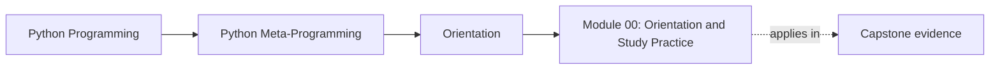
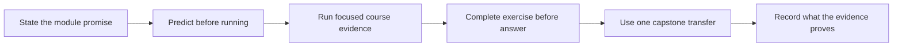

# Module 00: Orientation and Study Practice


<!-- page-maps:start -->
## Page Maps




<!-- page-maps:end -->

The first diagram places orientation between the Python Programming family, this course,
and the incident-plugin integration project. The second is the working study cycle.
Follow it from left to right for every substantive module. The course website and
runnable course material are the product you are studying; the capstone is the transfer
surface at the end of the cycle.

Python metaprogramming is where runtime power and runtime confusion meet. This course
replaces vague “magic” explanations with runtime traces, ownership decisions, bounded
claims, and tests a learner can run without an instructor.

## Who this course is for

This course is designed for Python developers who can already write ordinary functions,
classes, modules, exceptions, and tests. It is especially useful if you:

- maintain libraries or frameworks that expose decorators, descriptors, or registries
- review dynamic code whose execution timing and ownership are hard to explain
- need to preserve signatures and introspection when behavior is transformed
- want a principled reason to reject a metaclass, hook, or runtime patch

This is not a first Python course. If method binding, class versus instance state, or
exception control flow are still new, strengthen those foundations before beginning.

## Prerequisite self-check

Before Module 01, you should be able to explain and demonstrate:

1. the difference between a class attribute and an instance attribute
2. how a function call differs from retrieving a bound method
3. why importing a module executes module-level code
4. how to run a focused `unittest` suite and interpret a failing assertion
5. why an annotation is metadata unless some runtime owner enforces it

Do not guess. Write a five-minute example for any item that feels uncertain. The point
is not to pass an entrance exam; it is to keep later behavior from looking magical only
because an earlier Python rule was missing.

## The question this course owns

Keep one question visible throughout the course:

> What exactly is Python doing at runtime, and is this the lowest-power mechanism that
> can solve the problem honestly?

Every core sharpens one part of that question. Every lab makes a claim observable.
Every exercise asks you to make or review a decision. Every capstone route checks whether
the explanation survives when mechanisms interact.

## How modules and cores relate

Modules 01 through 10 form one progression. A module owns a learning problem; its cores
separate that problem into traceable mechanisms and decisions.

Within a module:

1. read the module landing page and prerequisites
2. run the named lab before treating prose as proof
3. study the cores in order because later cores reuse earlier vocabulary
4. trace the worked example from input through failure and evidence
5. complete the exercises before opening the answers
6. transfer one settled claim into the capstone
7. use the exit standard to decide whether to continue

Do not read all cores and postpone execution until the end. Metaprogramming claims are
easy to misunderstand when the observation arrives hours after the explanation.

## The power ladder

The course climbs only when a lower-power owner is insufficient:

1. plain functions, classes, and explicit composition
2. observation and introspection
3. callable wrappers and decorators
4. properties, class decorators, and descriptors
5. class-creation hooks and metaclasses
6. tightly governed dynamic execution, patching, import hooks, and transforms

Moving upward is not progress by itself. Progress means being able to explain why the
current owner is necessary, what public surface changed, how it can be inspected, which
failure it introduces, and how to remove or constrain it.

## Run the study route

From the Python Metaprogramming course directory:

```bash
make study-route
make study-route-test
```

`study-route` publishes the complete course-first sequence as JSON. Each substantive
module names:

- the question it owns
- the focused course command
- the focused test command
- the later capstone transfer
- the earlier contract that must remain true
- the evidence required before moving forward

The command does not decide whether you understand the material. It prevents the route
itself from drifting into undocumented or capstone-first advice.

## Independent-study cycle

Use one study session for one coherent claim:

| Moment | Learner action | Evidence to retain |
| --- | --- | --- |
| orient | state the module question and prerequisite | one sentence you can test |
| predict | write what should happen and when | expected value, exception, or trace |
| observe | run the smallest course command | focused JSON or console evidence |
| prove | run the matching focused tests | the exact protected contract |
| practice | solve before reading the answer | your decision and rejected alternative |
| calibrate | compare with the reasoned answer | corrected reasoning, proof, and non-claim |
| transfer | run one capstone command | application evidence for the same concept |

A session may stop after focused proof. The broad course gate belongs near a release or
mastery boundary, not after every reading session.

## How to use exercises and answers

Exercises are decision work, not syntax copying. For each exercise:

1. record the starting contract that must remain true
2. predict the timing, owner, public surface, and failure route
3. implement or inspect the smallest honest change
4. run the acceptance evidence named in the prompt
5. write what the result proves and what it does not prove
6. only then open the answer

Use the answer to compare reasoning, not just output. A matching output with the wrong
ownership model is not a correct solution. A different implementation can be correct if
it preserves the stated contract and produces equally strong evidence.

## How the capstone participates

The incident-plugin capstone is a supporting integration project. It combines:

- observational manifest and registry reports
- action decorators with visible wrapper ownership
- descriptor-backed configuration fields
- metaclass-driven class creation and registration
- an explicit governance report for accepted and rejected powers

Do not enter it to discover a mechanism for the first time. First learn the mechanism in
the module lab, then use the named capstone command to answer one transfer question.
The application is intentionally more crowded than the lab; that pressure is useful only
after the isolated claim is clear.

## Choose the smallest honest verification

Use proof in this order:

1. one course example or evidence command
2. the matching focused course tests
3. one observational capstone transfer
4. one runtime capstone route when execution is part of the claim
5. the broad course gate only when the complete course state is under review

Passing a broad suite does not explain why a claim is true. A small test does not prove
unrelated runtime behavior. Name the claim before choosing the proof.

## Return after a break

Do not resume at the last page you remember opening. Resume from the last module whose
exit evidence you can still explain.

For example:

```bash
make study-route LAST_TRUSTED_MODULE=4
```

The generated re-entry plan first re-runs Module 04’s focused evidence, then moves to
Module 05’s course lab and tests, and only afterward names the capstone transfer. If the
refresh evidence is surprising, move the trusted boundary backward and rebuild the plan.

Use the companion maps for the relevant range:

- [First-Contact Map](first-contact-map.md) for Modules 01–03
- [Mid-Course Map](mid-course-map.md) for Modules 04–08
- [Mastery Map](mastery-map.md) for Modules 09–10
- [Course Map](course-map.md) when the whole arc needs to be visible

## Orientation exit standard

Begin Module 01 when you can:

- explain who this course is and is not for
- name the prerequisite you would refresh first
- describe how a core, lab, exercise, answer, and capstone transfer differ
- run and interpret `make study-route`
- choose focused proof before broad proof
- state the last trusted boundary you would use after a long break
- explain why the course—not the capstone—is the primary learning surface

Use the [Reference Glossary](../reference/glossary.md) when recurring vocabulary becomes
unstable, but return to executable evidence rather than trying to memorize the shelf.
