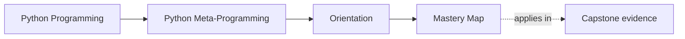
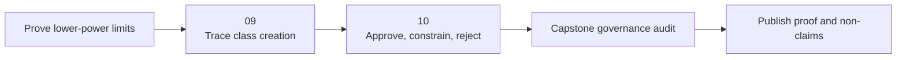

# Mastery Map

<!-- page-maps:start -->
## Page Maps




<!-- page-maps:end -->

The first diagram places mastery inside the course and supporting capstone. The second
shows the required order: prove lower-power limits, trace class creation, make an
explicit governance decision, then transfer that judgment into the application.

Use this map after Modules 01–08 are stable. Mastery is not the ability to write the
strongest hook. It is the ability to explain its timing and cost, choose a weaker owner
when possible, and reject power that does not belong in the application.

## Mastery entry contract

Before Module 09, you should be able to defend these statements with focused evidence:

- wrappers own callable transformations, not class-family creation policy
- properties and descriptors own attribute behavior, not arbitrary orchestration
- class decorators can transform an existing class but cannot control namespace
  preparation before the class exists
- field systems should not silently grow import, transaction, or global registry powers

If any statement is only familiar rather than provable, return to the matching
mid-course lab before continuing.

## Module 09: trace class creation before approving metaclasses

Run:

```bash
make class-creation-lab
make class-creation-lab-test
```

The evidence route separates:

1. explicit `type(name, bases, namespace)` construction
2. metaclass candidate selection and conflict
3. `__prepare__` namespace ownership
4. class body execution
5. metaclass `__new__` shaping
6. metaclass `__init__` registration
7. the narrower reach of `__init_subclass__`

The tests prove timing and ownership claims. They do not prove that a metaclass is a good
design choice.

Transfer with:

```bash
make capstone-class-creation
```

The capstone report records why `PluginMeta` exists:

- it owns a prepared namespace that records declaration events
- it collects descriptor and action contracts
- it generates an initializer before returning the finished class
- it registers the completed concrete class

The same report also names powers outside that boundary. Package discovery, network
access, runtime invocation, and automatic conflict repair do not belong in class
creation.

## The class-creation approval test

Before accepting a metaclass, complete this comparison:

| Question | Evidence required |
| --- | --- |
| Why is an explicit helper insufficient? | the rule must apply without caller cooperation |
| Why is a class decorator insufficient? | a required fact exists before the finished class |
| Why is `__init_subclass__` insufficient? | namespace preparation or constructor shaping is required |
| What does the metaclass own? | one named class-family invariant |
| What remains ordinary Python? | instance behavior and concrete methods remain inspectable |
| How is the behavior observed? | stored provenance, public report, and focused tests |
| How is state reset? | deterministic registry cleanup or explicit redeployment |

If the proposal cannot answer the first three questions, stop below the metaclass.

## Module 10: convert fluency into governance

Run the course lab before auditing the application:

```bash
make runtime-governance-lab
make runtime-governance-lab-test
```

The five evidence surfaces cover:

- bounded internal dynamic execution without a sandbox claim
- ABC, runtime Protocol, and structural subclass-check claim strength
- scoped patch rollback without concurrency or crash-safety overclaims
- import-hook and AST-transform lifetimes restricted to trusted tooling
- six mechanism decisions with approval, constraint, and rejection outcomes

For each mechanism, ask:

1. What pressure exists?
2. Which object or process owns the behavior?
3. Which lower-power alternative was considered?
4. What is the blast radius?
5. How is it observed?
6. How is it rolled back?
7. Which focused proof defends the claim?
8. What escalation would require a different boundary?

Only then transfer into the capstone:

```bash
make capstone-governance
```

The application approves action decorators, field descriptors, `PluginMeta`, and its
observational CLI; constrains process-global registry state; and rejects configuration
`eval`/`exec`, application monkey-patching, application import hooks or AST rewriting,
package discovery during class creation, and automatic metaclass conflict repair.

## One complete mastery review

Suppose a proposal adds package discovery inside `PluginMeta.__new__`.

1. Module 09 identifies the timing: class-definition time during import.
2. The owner is wrong: deployment discovery is not a fact about constructing one class.
3. The blast radius includes import latency, filesystem state, and failure during module
   loading.
4. The lower-power alternative is an explicit discovery/configuration boundary after
   import.
5. `make capstone-class-creation` proves current class creation is observational and
   bounded.
6. `make capstone-governance` records package discovery as rejected.
7. The review rejects the proposal without needing to prototype the stronger hook.

That is mastery: mechanism knowledge supports a defensible “no.”

## Proof escalation

Use the smallest route that answers the review question:

| Claim | First route | Stronger route |
| --- | --- | --- |
| class-creation timing | `make class-creation-lab` | `make class-creation-lab-test` |
| capstone hook ownership | `make capstone-class-creation` | focused capstone class-creation tests |
| mechanism decision | `make runtime-governance-lab` | `make runtime-governance-lab-test` |
| application policy | `make capstone-governance` | governance and named mechanism tests |
| complete release confidence | focused routes above | broad course gate once |

Do not start with the broad gate. Passing every test does not explain whether a proposed
power belongs in the design.

## Re-entry after a break

If Module 08 remains trustworthy:

```bash
make descriptor-system-lab
make descriptor-system-lab-test
```

Then continue to class creation. If Module 09 remains trustworthy, rerun
`make class-creation-lab` and `make class-creation-lab-test` before governance. A learner
who completed the course can repeat `make runtime-governance-lab` and
`make runtime-governance-lab-test` without pretending mastery is permanent.

## Course completion standard

Complete the course when you can:

- trace class creation without collapsing its hooks into “metaclass magic”
- prove why a lower-power owner is insufficient
- distinguish mechanism behavior from mechanism approval
- publish approve, constrain, and reject decisions
- name observability, rollback, proof, and non-claims
- transfer each decision into a focused capstone report
- reject unjustified runtime power even when you know how to implement it

Keep [Review Checklist](../reference/review-checklist.md),
[Anti-Pattern Atlas](../reference/anti-pattern-atlas.md), and
[Proof Ladder](../guides/proof-ladder.md) open during future reviews. The course material
remains the durable learning surface; the capstone is one application that demonstrates
the judgment under integration pressure.
