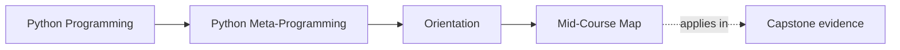

# Mid-Course Map

<!-- page-maps:start -->
## Page Maps



```mermaid
flowchart LR
  wrapper["04<br/>Transparent wrapper"] --> policy["05<br/>Callable policy"]
  policy --> class["06<br/>Class customization"]
  class --> lookup["07<br/>Descriptor lookup"]
  lookup --> system["08<br/>Field system"]
```
<!-- page-maps:end -->

The first diagram places this route inside the course. The second is an ownership
progression, not a power ladder to climb automatically. It begins at one callable,
widens to one class, narrows again to one attribute, and only then considers a reusable
field system.

Use this map when Modules 01–03 are stable but wrappers, class decorators, descriptors,
and field frameworks are beginning to blur together.

## Mid-course contract

The preserved foundation is:

> Runtime evidence remains strong enough to expose what transformation changed, when it
> changed, and which object now owns the behavior.

Each module must keep signatures, provenance, state, and failure routes inspectable.
“The abstraction works” is not enough if a reviewer cannot locate its owner.

## Module 04: transparent wrapper mechanics

Module 04 isolates the transformation lifecycle before adding policy.

Run:

```bash
make wrapper-lab
make wrapper-lab-test
make wrapper-cache
make wrapper-cache-test
```

Trace:

1. decorator expression evaluation
2. decorator application
3. wrapper object creation
4. descriptor binding when the wrapper is a class attribute
5. call-time entry and exit

The bounded cache case adds state, eviction, failure, and reset. It proves that
`functools.wraps` preserves selected metadata and the `__wrapped__` chain; it does not
make policy or state transparent.

Transfer only after the wrapper trace is clear:

```bash
make capstone-action-wrapper
```

The report inspects wrapper ownership without executing the action.

## Module 05: callable policy under pressure

Module 05 asks when retry, validation, and cache policy still belong at the callable
boundary.

Run:

```bash
make decorator-policy-lab
make decorator-policy-lab-test
```

Review every policy with five questions:

- Which exceptions or values trigger the policy?
- How many attempts, entries, or checks are permitted?
- Where does state live and how is it reset?
- Does the original exception and signature remain visible?
- Which wider service concern is explicitly excluded?

Then inspect the capstone’s deliberately bounded annotation contract:

```bash
make capstone-check-action
```

It starts from real signature binding, checks a supported runtime-hint subset, and
reports refused or unannotated parameters. It is not a general runtime type checker.

## The wrapper-to-class transition

Move behavior off the callable boundary only when the pressure is truly class-wide.

| Pressure | Callable wrapper | Class customization |
| --- | --- | --- |
| record one action invocation | strong fit | unnecessarily wide |
| enforce all instances expose one class-level marker | repeated wrapper cannot own it | possible fit |
| validate one attribute assignment | wrong timing and owner | property or descriptor |
| coordinate a whole subclass family before class existence | insufficient | later class-creation mechanism |

This comparison prevents “decorator” from becoming a generic word for every
transformation.

## Module 06: lower-power class customization

Before descriptors and metaclasses, test ordinary and post-creation owners:

```bash
make class-customization-lab
make class-customization-lab-test
```

The lab compares:

- explicit helper functions
- `dataclass` generation
- properties
- a small descriptor
- class decorators
- a bounded frozen-surface policy

For each mechanism, identify whether it acts after a class exists, during instance
access, or at initialization. Refuse metaclass reasoning unless a requirement truly
depends on the class-creation process.

The capstone transfer is:

```bash
make capstone-class-creation
```

At this point, use the report to identify which capstone facts could have been owned by
a lower-power tool. Do not yet treat `PluginMeta` as approved merely because it exists.

## Module 07: attribute lookup and descriptor ownership

Module 07 makes normal lookup predictable before building a field framework.

Run:

```bash
make descriptor-lookup-lab
make descriptor-lookup-lab-test
```

Predict the winner before access:

1. data descriptor
2. instance dictionary
3. non-data descriptor
4. plain class attribute or failure

Then prove method binding through `__func__` and `__self__`, and separate the shared
descriptor object from per-instance storage.

Transfer with:

```bash
make capstone-field-ownership
```

The report should confirm descriptor category, declaring class, class access, metaclass
collection, and storage key without plugin construction.

## Module 08: field systems and framework boundaries

Only now widen from one descriptor to a system:

```bash
make descriptor-system-lab
make descriptor-system-lab-test
```

The lab compares cache freshness, external storage authority, wrapper ordering,
annotation-driven policy, relational composition, and the narrower record model. The
learning goal is not to accumulate features. It is to decide which owner and blast
radius each feature requires.

Transfer with:

```bash
make capstone-field-system
```

The capstone accepts coercion, validation, defaults, and per-instance storage. It
deliberately rejects cache, external storage, wrapper composition, broad hint inference,
and transaction semantics. Those rejected powers are part of the design, not missing
features to add.

## One ownership comparison

Suppose a plugin endpoint must be normalized.

- A function is sufficient if one call site owns normalization.
- A decorator fits if normalization belongs to one callable boundary.
- A property fits if one class owns explicit getter/setter behavior.
- A descriptor fits when repeated attributes share lookup and storage semantics.
- A field system fits only when several fields need shared metadata and collection.
- A metaclass remains unjustified unless a fact must be captured during class creation.

The same behavior can be implemented at several layers. The course asks which layer
makes the invariant easiest to inspect, test, and remove.

## Re-entry and failure routes

Use the last module whose exit evidence is still trustworthy:

```bash
make study-route LAST_TRUSTED_MODULE=5
```

| Symptom | Return to |
| --- | --- |
| wrapper order or identity is unclear | Module 04 |
| retries or validation swallow ownership | Module 05 |
| every class problem seems to need a metaclass | Module 06 |
| instance values unexpectedly shadow class values | Module 07 |
| a field object is becoming a hidden framework | Module 08 |

The generated plan re-proves the trusted module before moving forward and defers the
broad gate.

## Ready for Module 09

Continue only when you can:

- trace a wrapper from expression evaluation through invocation
- place retry, validation, and cache state at explicit callable boundaries
- prefer an ordinary helper, property, or class decorator when it is sufficient
- predict descriptor precedence and storage ownership
- distinguish one-field semantics from field-system policy
- explain which lower-power capstone surfaces already work
- name one requirement that genuinely must happen before a class exists

Keep [Module Checkpoints](../guides/module-checkpoints.md) and
[Proof Ladder](../guides/proof-ladder.md) open. Use the capstone as transfer evidence,
not as a replacement for the five course modules above.
