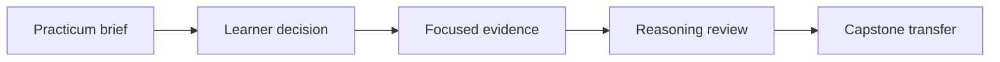
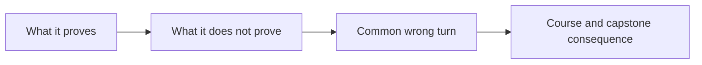

# Study Practicum Review: Reasoning About Learning Routes

<!-- page-maps:start -->
## Review Maps




<!-- page-maps:end -->

These reviews calibrate reasoning rather than prescribe one transcript. Your command
output may differ in incidental ordering details. Your ownership, proof order, and
non-claims should be equivalent.

## Review 1: start from runtime objects

### Defensible decision

Begin at Module 01. Recognizing decorator syntax is not evidence that function identity,
binding, import execution, or inspection risk are stable. Those contracts are required
before Module 04 can explain what a wrapper changes.

### Executable route

```bash
make lab
make lab-test
```

The Course Map starts with Module 01’s course evidence and focused tests. Only after
those claims are understood does it name `make capstone-manifest`.

A small identity example can be:

```python
class Handler:
    def deliver(self, incident: str) -> str:
        return incident


handler = Handler()
bound = handler.deliver

assert bound.__func__ is Handler.__dict__["deliver"]
assert bound.__self__ is handler
```

Prediction: retrieving `handler.deliver` returns a new bound-method object that retains
the original function and receiver identities. The assertions test that prediction.

### Common wrong turn

“I have used decorators, so I can skip foundations.” Usage experience may establish
syntax fluency while leaving definition time, binding, or metadata ownership unclear.
Module 04 depends on those distinctions.

### What the result proves

- the learner can identify a function and receiver behind a bound method
- the course-first route begins with Module 01
- focused proof precedes capstone transfer

### What it does not prove

- that the learner understands safe attribute inspection
- that a wrapper preserves method binding
- that the capstone manifest proves runtime invocation

### Course and capstone consequence

Continue through Modules 01–03. Use `capstone-manifest` only to transfer object and
observation claims after the relevant course evidence is settled.

## Review 2: move the trusted boundary backward

### Defensible decision

Choose Module 03 as the last trusted boundary. The learner cannot currently explain
wrapper construction from Module 04 or descriptor shadowing from Module 07. Claiming
Module 06 as trusted would make the plan depend on missing intermediate contracts.

### Executable route

```bash
make evidence-lab
make evidence-lab-test
make wrapper-lab
make wrapper-lab-test
make capstone-action-wrapper
```

This route refreshes Module 03 before continuing to Module 04 and keeps the broad gate
deferred.

### Reasoning

Re-proving Module 03 confirms that signatures, binding, provenance, and diagnostic
evidence are stable before any wrapper changes behavior. Module 04 then rebuilds the
missing transformation lifecycle. The capstone action-wrapper audit comes last because
it contains more interacting machinery.

If the Module 03 evidence packet is surprising—especially static versus dynamic member
claims—the trusted boundary should move backward to Module 02.

### Common wrong turn

Starting from Module 06 because it was previously completed. Completion history is not
a current proof boundary.

### What the result proves

- the re-entry plan is based on a present-tense claim
- the refresh is tested before continuation
- the capstone remains transfer evidence

### What it does not prove

- that Modules 05–06 remain mastered
- that passing Module 04 tests restores descriptor knowledge
- that a broad suite is unnecessary at the final release boundary

### Course and capstone consequence

Resume sequentially from Module 04. Re-evaluate the trusted boundary after each module’s
exit evidence instead of jumping back to Module 07.

## Review 3: prove the retry policy narrowly

### Defensible decision

Use Module 05’s policy evidence and focused tests:

```bash
make decorator-policy-lab
make decorator-policy-lab-test
```

Inspect the retry packet for the caught exception type, attempt limit, ordered attempts,
and final exception identity. Then locate the focused assertion that proves an
unhandled or exhausted failure is not silently replaced.

### Reasoning

The change narrows which exception enters retry control flow. Therefore the first proof
should exercise the retry owner directly. The complete course suite would provide
regression confidence but would hide which assertions defend the changed policy.

`make capstone-check-action` is the Module 05 transfer, but it checks bounded runtime
hint policy rather than retry. It demonstrates another policy-heavy wrapper boundary; it
does not prove the capstone action decorator retries.

### Common wrong turn

Running the broad gate first and citing “all tests pass.” That result does not identify
attempt bounds, caught exception scope, or failure identity.

### What the result proves

- matching failures retry within an explicit bound
- non-matching failures escape the retry owner
- exhausted retries preserve the final failure contract

### What it does not prove

- network retry safety
- idempotence of arbitrary wrapped callables
- backoff timing under real scheduling
- any retry behavior in the incident-plugin capstone

### Course and capstone consequence

Run `capstone-check-action` only to review the related question of bounded callable
policy. Use the broad gate once when the completed course state is ready for integration
verification.

## Review 4: learn class creation before auditing `PluginMeta`

### Defensible route

```bash
make class-creation-lab
make class-creation-lab-test
make capstone-class-creation
make capstone-governance
```

### Question-to-command map

| Command | Question answered | Question not answered |
| --- | --- | --- |
| `class-creation-lab` | when do selection, preparation, shaping, and registration occur? | is `PluginMeta` justified? |
| `class-creation-lab-test` | which timing and namespace claims are executable contracts? | does the whole capstone work? |
| `capstone-class-creation` | which stored facts and generated structures does `PluginMeta` own? | should every plugin system use a metaclass? |
| `capstone-governance` | which application powers are approved, constrained, or rejected? | does a decision replace its mechanism tests? |

`__init_subclass__` can own deterministic registration after a subclass exists. It
cannot supply a custom prepared namespace or change facts needed while the class body is
executing. `PluginMeta` earns its place only for the latter requirements and the
generated class contract tied to them.

### Common wrong turn

Reading `PluginMeta` first and reverse-engineering the lesson from the application. The
capstone combines descriptor collection, wrapper metadata, constructor generation, and
registration. Without isolated timing evidence, those owners collapse into one
imprecise idea of “metaclass behavior.”

### What the result proves

- course evidence separates class-creation hooks by timing and owner
- the capstone report remains non-constructing and non-invoking
- governance approval is a separate judgment from mechanism execution

### What it does not prove

- that metaclasses are generally preferable to explicit helpers
- that class creation should perform package discovery or I/O
- that automatic metaclass conflict repair is safe
- that the governance record proves every underlying mechanism

### Course and capstone consequence

Approve `PluginMeta` only for tracked namespace events and generated class-family
contracts. Keep package discovery, application hooks, runtime execution, and automatic
conflict repair outside class creation.

## Review your packet

A complete submission should show:

- a present-tense trusted boundary
- a prediction before command output
- a focused course command and focused proof
- an explicit non-claim
- one later capstone transfer
- a condition for continuing or stepping backward

If your output matches but the capstone appears before the course evidence, revise the
route. If your commands are ordered correctly but you cannot say what each refuses to
prove, revise the reasoning. Orientation is complete only when study choices are as
reviewable as the runtime mechanisms you will study.
