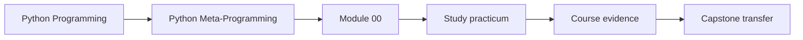
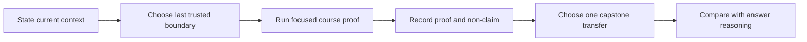

# Study Practicum: Building an Evidence-First Learning Route

<!-- page-maps:start -->
## Practicum Maps




<!-- page-maps:end -->

This practicum turns orientation into learner work. You are not being asked to memorize
the course map. You are being asked to construct a defensible study route, execute its
smallest proof, and explain why the capstone comes later.

Complete all four briefs before opening
[Study Practicum Review](study-practicum-answers.md).

## Working contract

Run commands from the Python Metaprogramming course directory. Keep a short study record
with:

- the boundary you believe is stable
- the prediction you made before execution
- the focused command and result
- what the result proves
- what it does not prove
- the next course surface
- the later capstone transfer

Do not run the broad course gate in this practicum. The point is to practice proportional
proof.

## Brief 1: establish an honest starting boundary

### Starting context

You are comfortable writing Python classes and functions, but you have never studied
metaprogramming systematically. You recognize `@decorator` syntax and `property`, yet
you cannot confidently explain descriptor precedence or metaclass timing.

### Objective

Decide whether to begin at Module 01 or skip directly to wrappers in Module 04.

### Constraints

- Do not use familiarity with syntax as evidence of runtime understanding.
- Test at least one prerequisite claim with a small Python example.
- Use the Course Map to identify the first subject lab and focused test.
- Do not open capstone source as a substitute for the prerequisite check.

### Expected evidence

```bash
make lab
make lab-test
```

Retain the Module 01 claim and exit evidence. Add one tiny example that distinguishes a
function from a retrieved bound method or class state from instance state.

### Acceptance checks

- Your chosen start names the missing runtime contract, not just a module number.
- Your prediction appears before the example output.
- The course command precedes its focused test and capstone transfer.
- You explain why recognizing decorator syntax does not justify skipping Modules 01–03.

### Preserved contract

Ordinary Python object identity remains the starting point for later transformation.

## Brief 2: recover after a long break

### Starting context

You previously completed through Module 06. Six months later, you remember class
decorators and properties but cannot explain when a wrapper is constructed or whether a
descriptor can be shadowed by an instance attribute.

### Objective

Choose the last genuinely trusted module and build a re-entry plan that does not
overstate memory.

### Constraints

- “I completed it before” is not evidence.
- Move the trusted boundary backward until you can state its exit evidence precisely.
- Re-prove that boundary before starting a new module.
- Defer the broad gate.

### Expected evidence

Test both the remembered boundary and the safer earlier boundary:

```bash
make class-customization-lab
make class-customization-lab-test
make evidence-lab
make evidence-lab-test
```

Compare which evidence you can explain without reading the answers. Choose one boundary
and justify it; do not treat a green command as proof of understanding.

### Acceptance checks

- The selected boundary matches a claim you can explain now.
- The refresh command and focused test precede the continuation.
- Your plan names the next capstone command but does not begin there.
- You record what would cause you to move the boundary backward again.

### Preserved contract

Re-entry begins with the last provable contract, not the most advanced remembered page.

## Brief 3: choose proportional proof

### Starting context

During Module 05, you change a bounded retry decorator so it catches a narrower exception
type. You want evidence that the retry contract still preserves the final exception.

### Objective

Choose the smallest proof sequence that answers the claim without hiding the learning
question inside the full suite.

### Constraints

- Start with the course surface.
- Distinguish the runtime example from the focused tests.
- Name the later capstone transfer and explain why it is not the first proof.
- State one claim the selected evidence cannot establish.

### Expected evidence

```bash
make decorator-policy-lab
make decorator-policy-lab-test
```

Record the relevant retry evidence and test assertion.

### Acceptance checks

- Your proof order is course command → focused tests → capstone transfer.
- You identify attempt bounds, caught exception scope, and final exception identity.
- You do not claim that the capstone’s action decorator implements retry.
- You explain when the broad gate would become appropriate.

### Preserved contract

Focused proof remains tied to the changed policy while unrelated course behavior is left
for the final broad gate.

## Brief 4: separate learning from application transfer

### Starting context

A learner wants to start Module 09 by reading `PluginMeta` because “the capstone is the
real product.” They have not run the class-creation lab and treat
`__init_subclass__`, metaclass `__new__`, and metaclass `__init__` as interchangeable.

### Objective

Design a course-first correction that ends in a focused capstone audit.

### Constraints

- The first executable evidence must come from the Module 09 lab.
- The plan must distinguish namespace preparation, shaping, and registration timing.
- The capstone audit must remain non-constructing and non-invoking.
- Finish by checking the Module 10 governance decision rather than automatically
  approving the metaclass.

### Expected evidence

Your route should use:

```bash
make class-creation-lab
make class-creation-lab-test
make capstone-class-creation
make capstone-governance
```

For each command, write the question it answers and one question it does not answer.

### Acceptance checks

- Course evidence precedes application transfer.
- You identify a requirement that `__init_subclass__` can own and one it cannot own.
- You explain why class-creation evidence does not by itself approve `PluginMeta`.
- Your governance conclusion names a lower-power alternative or an explicit accepted
  owner.

### Preserved contract

The website and course labs teach the mechanism; the capstone tests transfer and
integration judgment.

## Submission packet

Your completed practicum should contain four short decision records. Each record must
name:

1. starting boundary
2. prediction
3. focused course route
4. observed result
5. proof
6. non-claim
7. capstone transfer
8. condition for continuing or stepping back

Open the answer only after these records exist. The review provides one defensible route,
not a script to copy.
