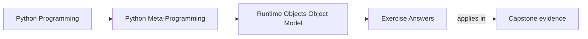

# Exercise Answers


<!-- page-maps:start -->
## Page Maps




<!-- page-maps:end -->

Use this page after you have attempted the exercises yourself. The point is not to match
every example literally. The point is to compare your reasoning against an answer that
names the runtime object, cites evidence, and stays honest about boundaries.

The supplied lab is one defensible implementation route, not the only acceptable answer.
Compare your work with:

- `labs/runtime_objects/evidence.py` for the probes
- `tests/test_runtime_objects_lab.py` for claim-level proof
- `make lab` for learner-visible evidence
- `make lab-test` for the focused verification result

## Answer 1: Tell the truth about one function object

Example answer:

```python
def outer(base):
    def inner(x: int) -> int:
        return x + base
    return inner


fn = outer(5)
```

Strong evidence:

- `fn.__name__ == "inner"`
- `fn.__qualname__` includes `"outer.<locals>.inner"`
- `fn.__module__` names the defining module
- `fn.__code__.co_freevars == ("base",)`
- `fn.__closure__` exists because the function captures an outer binding

Good conclusion:

`fn` is more than "something callable." It is a Python-defined function object carrying
identity, metadata, executable code, and closure state.

## Answer 2: Explain one class without saying "class magic"

Example answer:

```python
class Demo:
    label = "demo"

    def run(self):
        return self.label
```

Strong evidence:

- `type(Demo) is type`
- `Demo.__bases__` shows the direct bases
- `Demo.__dict__["run"] is Demo.run`
- `Demo()` creates an instance whose `__class__` is `Demo`

Good conclusion:

The class statement created a class object, stored a function object under `run`, and
instance access later binds that function into a method. No special "magic" explanation
is required.

If you used a descriptor example, a strong answer also says whether a data descriptor,
instance storage, or non-data descriptor won the lookup.

## Answer 3: Prove module identity and stale imported values

Example answer:

```python
import importlib
import sys
import types

name = "sample_mod"
mod = types.ModuleType(name)
mod.value = "old"
sys.modules[name] = mod

again = importlib.import_module(name)
copied = mod.value

mod.value = "new"
```

Strong evidence:

- `mod is again` proves both names refer to the same module object
- `mod.value == "new"` while `copied == "old"` proves copied-out values can go stale

Good conclusion:

Imports usually return references to a cached module object. Names copied out of the
module do not automatically refresh when the module namespace changes.

## Answer 4: Compare instance storage models honestly

Example answer:

```python
class Regular:
    pass


class Slotted:
    __slots__ = ("x",)


regular = Regular()
regular.x = 1

slotted = Slotted()
slotted.x = 1
```

Strong evidence:

- `regular.__dict__ == {"x": 1}`
- `hasattr(slotted, "__dict__")` is often `False`
- assigning `slotted.y = 2` raises `AttributeError`

Good conclusion:

The regular instance stores dynamic state in a dictionary. The slotted instance uses a
fixed storage layout and rejects undeclared attributes. `__slots__` is justified when the
layout is stable and the memory or constraint tradeoff is intentional, not when it is
added only to make the code look advanced.

## Answer 5: Trace one runtime object chain from module to call

Example answer:

```python
class Processor:
    def process(self, data):
        return len(data)


import sys

module = sys.modules[__name__]
cls = module.Processor
inst = cls()
bound = inst.process
func = bound.__func__
```

Strong evidence:

- `cls is module.Processor`
- `inst.__class__ is cls`
- `bound.__self__ is inst`
- `bound.__func__ is cls.process`
- `func.__globals__ is module.__dict__`

Good conclusion by runtime moment:

- import time: the module object was created and executed
- class-definition time: the class object was built and bound into the module namespace
- instance-creation time: calling the class created `inst`
- call time: instance lookup created `bound`, and calling it invoked `func` with access to module globals

This trace prevents several misunderstandings at once, especially the idea that methods
are stored inside instances or that call behavior can be explained without reference to
the module and class objects involved.

## Answer 6: Review a brittle introspection helper

Example answer:

Suppose the helper tries to recover source with:

- `func.__code__.co_filename`
- `func.__code__.co_firstlineno`
- indentation scanning

Strong classification:

- `__name__`, `__qualname__`, and `inspect.signature()` are supported introspection surfaces
- `__code__`, `co_filename`, and `co_firstlineno` are diagnostic surfaces useful for tools but too weak for guaranteed source recovery
- indentation scanning is a heuristic layered on top of incomplete runtime metadata

Good conclusion:

The rewrite should report supported metadata first and use `inspect.getsource(func)` only
as a best-effort convenience with a clear failure path. The tool should not claim that it
can reconstruct the true source of any callable from code-object fields alone.

## Answer 7: Separate function, method, and bound-method identities

Example answer:

```python
class Reporter:
    def emit(self, value):
        return value.upper()


inst = Reporter()
bound = inst.emit
func = Reporter.emit
```

Strong evidence:

- `bound.__self__ is inst`
- `bound.__func__ is func`
- `func is Reporter.__dict__["emit"]`
- `inst.__dict__` does not contain `"emit"`

Good conclusion:

The instance did not store a method object in advance. Instance lookup created a bound
method on demand from the function stored on the class, attaching the instance only at
access or call time.

## Answer 8: Map one import-time object graph

Example answer:

```python
# in module demo_mod.py
def helper(x):
    return x + 1


class Worker:
    def run(self, value):
        return helper(value)
```

Strong evidence after import:

- the module object exists in `sys.modules`
- `demo_mod.Worker` is a class object bound in the module namespace
- `demo_mod.helper` is a function object bound in the same module namespace
- creating `demo_mod.Worker()` introduces an instance only after the import has already finished

Good conclusion:

Import time creates the module object and executes the definitions that bind classes and
functions into that namespace. Instance objects are later runtime values, not part of the
module's initial object graph.

## Answer 9: Compare supported evidence with diagnostic evidence

A strong answer might ask:

- "Which module defined this function, and what stable relationship proves that?"

Supported route:

- `fn.__module__`
- `fn.__globals__`
- the defining module object from `sys.modules`

Diagnostic or brittle route:

- source-path assumptions from `fn.__code__.co_filename`
- line-number guesses from `co_firstlineno`

Good conclusion:

Supported surfaces answer ownership and namespace questions directly. Diagnostic surfaces
can help tooling, but they are weaker teaching defaults because they tempt readers to
infer more than the runtime actually promises.

## Answer 10: Produce a runtime evidence packet

The packet is strong when another learner can answer:

- which object is a function, class, module, instance, or bound method
- which runtime moment created the relationship under discussion
- which evidence is a supported surface and which is only diagnostic

If readers still need phrases like "Python magic" to follow the packet, the object model
is not explicit enough yet.

## Review every answer for overclaiming

Use this table after reading the worked answers. It identifies the most common wrong turn
and the boundary each answer must preserve.

| Answer | Why the route is defensible | Common wrong turn | What the result proves | What it does not prove |
| --- | --- | --- | --- | --- |
| 1 function | it combines supported identity metadata, one call result, and a clearly labeled code-object observation | treating every callable as if it had `__code__` and `__closure__` | this Python function carries metadata, code-related evidence, and captured state | that all callables share those internals or that closure inspection is a good application dependency |
| 2 class | it locates the function in the class namespace and follows lookup into a bound method | saying the method is stored inside the instance | this class object stores the function used by instance method binding | that all class customization is ordinary or that metaclass use is justified |
| 3 module | it proves cache identity independently from stale copied binding and cleans up global state | confusing module rebinding with automatic refresh of copied names | this import returned the cached object and this copied value became stale | that reload is safe for arbitrary stateful modules |
| 4 instance | it observes dictionary and slot behavior directly | claiming slots are automatically faster or always use less memory | these two classes expose different storage and assignment contracts | a general performance result or a universal design preference |
| 5 graph | it follows identity edges from instance to the live defining namespace | drawing a static class diagram that omits runtime timing | this method call uses the shown object relationships and module global | that wrappers or descriptors preserve every edge transparently |
| 6 brittle helper | it reports supported metadata first and makes source recovery explicitly best effort | reconstructing source from filename and indentation as if it were guaranteed | the tool can provide partial runtime evidence without lying | that runtime objects always retain recoverable original source |
| 7 method identity | it compares class storage with the object returned by instance lookup | comparing two fresh bound-method objects with `is` and calling that the contract | the bound method points to the expected instance and stored function | that Python must cache one stable bound-method object |
| 8 import graph | it orders module, class, function, and later instance creation by event | placing every object in the graph at import time | which bindings the chosen module execution actually created | that other modules avoid import-time instance creation or side effects |
| 9 evidence choice | it answers one question through two routes and limits the conclusion | assuming lower-level detail is automatically stronger | the supported route is sufficient for the stated runtime question | that diagnostic evidence is never useful in debuggers or profilers |
| 10 packet | it combines saved output, tests, reasoning, and a transfer trace | submitting green commands without explaining the claims | another learner can reproduce and review the Module 01 object model | that the entire capstone architecture is correct |

## Capstone transfer answer

A strong Module 01 capstone note chooses one narrow relationship, usually
`ConsoleNotifier().deliver`, and records:

```python
instance = ConsoleNotifier()
bound = instance.deliver
stored = ConsoleNotifier.__dict__["deliver"]

assert bound.__self__ is instance
assert bound.__func__ is stored
```

The note should also say that `stored` is already a decorated wrapper. That observation
connects the answer to the application architecture without pretending the learner has
already completed the decorator modules. The right conclusion is:

> the ordinary function/class/instance binding floor remains observable in the capstone;
> wrapper provenance is the next design pressure, not a solved Module 01 topic.

Run `make test` only after the focused lab check. A passing integration suite shows the
course lab and capstone coexist; it does not replace the reasoning above.

## What strong Module 01 answers have in common

Across the whole set, strong answers share the same habits:

- they start from a named runtime object
- they use evidence instead of folklore
- they distinguish supported surfaces from implementation detail
- they explain behavior in terms of import time, class-definition time, instance time, and call time when relevant
- they keep bound methods separate from functions stored on classes
- they leave behind a packet another learner can audit without guessing

If your answer still depends on phrases like "Python just knows" or "class magic," revise
it until you can point to the actual object and relationship doing the work.

## Continue through Module 01

- Previous: [Exercises](exercises.md)
- Return: [Overview](index.md)
- Next module: [Module 02](../module-02-runtime-observation-inspection/index.md)
- Terms: [Glossary](glossary.md)
