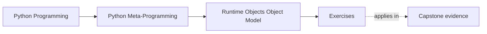

# Exercises


<!-- page-maps:start -->
## Page Maps




<!-- page-maps:end -->

Use these after reading the five core lessons and the worked example. The goal is not to
repeat vocabulary from memory. The goal is to make the runtime object model visible from
evidence.

Each exercise asks for three things:

- the runtime object or relationship you are trying to explain
- the evidence that proves your claim
- the boundary or design judgment that follows from that evidence

Treat the ten exercises as one full lab day on the Python object model.

Do them in order:

- Exercises 1-3 establish functions, classes, and modules as ordinary runtime objects
- Exercises 4-6 compare storage models and supported versus brittle introspection
- Exercises 7-8 make bound methods and import-time relationships explicit
- Exercises 9-10 package the full model into a reviewable runtime evidence packet

Keep one evidence table while you work:

| Runtime object or relationship | Evidence used | Supported or brittle surface | Design judgment that follows |
| --- | --- | --- | --- |

## Starting context and verification contract

Work from `programs/python-programming/python-meta-programming`. Begin from a green
baseline:

```console
make lab
make lab-test
```

Save the first command's JSON as your before-state. Exercises 1-5 extend or explain
`labs/runtime_objects/evidence.py`; Exercises 6 and 9 review evidence boundaries;
Exercises 7-8 and 10 transfer the model into your own example or the incident-plugin
runtime.

Every implementation change must preserve these earlier contracts unless the exercise
explicitly asks you to change one:

- all five packet names remain present
- the lab leaves no synthetic module behind in `sys.modules`
- class-stored functions and bound methods remain distinguishable
- the storage packet makes no unmeasured performance claim
- `make lab-test` finishes successfully

Use this map to keep the work cumulative:

| Exercise | Starting surface | Decision you must make | Required evidence | Earlier contract to preserve |
| --- | --- | --- | --- | --- |
| 1 | `function_evidence()` | which function facts are supported versus diagnostic | before/after function packet and focused test | closure still produces `incident: queue lag` |
| 2 | `class_evidence()` | which object owns the stored function and binding | class namespace, `__self__`, and `__func__` | class remains an ordinary instance of `type` |
| 3 | `module_evidence()` | how to prove cache identity separately from stale binding | identity and stale-value observations | synthetic module cleanup |
| 4 | `instance_evidence()` | whether a storage restriction earns its cost | dictionary, slot, and failed-assignment observations | no performance conclusion without measurement |
| 5 | `object_graph_evidence()` | which edges stay stable when global data changes | two packets plus edge comparison | the call still reaches the defining namespace |
| 6 | worked-example helper | where supported evidence ends | failure transcript and replacement rule | no guaranteed source-recovery claim |
| 7 | class and instance probe | how lookup creates a bound method | stored-function and bound-method identities | no method pre-storage claim |
| 8 | module or capstone module | which objects exist after import versus later calls | event-ordered object map | import and instance time remain distinct |
| 9 | one question from Exercises 1-8 | which evidence route is proportionate | supported and brittle routes side by side | conclusion stays within evidence |
| 10 | all prior work | what belongs in a reviewable handoff | saved JSON, tests, table, and transfer trace | every earlier contract |

## Exercise 1: Tell the truth about one function object

Choose one Python-defined function and explain what it carries at runtime.

What to hand in:

- the function's `__name__`, `__qualname__`, and `__module__`
- one example of live environment state through `__globals__` or closure state
- one sentence explaining why "callable" is too broad to describe this object fully

Acceptance check: add or refine one focused assertion in
`tests/test_runtime_objects_lab.py`, run `make lab-test`, and label any use of
`__code__` or `__closure__` as diagnostic evidence.

## Exercise 2: Explain one class without saying "class magic"

Choose one small class and trace how it becomes a runtime object.

What to hand in:

- the class object's metaclass, bases, and one useful entry from `cls.__dict__`
- one explanation of a method as a function stored on the class
- one lookup example showing whether a descriptor or instance storage won

Constraint: establish the ordinary class-object and binding behavior before introducing
a custom descriptor or metaclass. Your result is accepted when another learner can
locate the stored function and identify both halves of the bound method.

## Exercise 3: Prove module identity and stale imported values

Build or inspect one module example that shows how module caching works.

What to hand in:

- evidence that two imports or lookups refer to the same module object
- one demonstration that a copied-out value can stay stale after module state changes
- one sentence explaining why module-qualified access is safer in reload-heavy workflows

Acceptance check: prove that the synthetic module is absent from `sys.modules` after the
probe. A correct identity demonstration that leaks global state is not a complete answer.

## Exercise 4: Compare instance storage models honestly

Create one dictionary-backed class and one slotted class, then compare them as runtime
objects.

What to hand in:

- one proof that the dictionary-backed instance stores state in `__dict__`
- one proof that the slotted instance rejects or reshapes dynamic attributes
- one judgment about when `__slots__` is justified and when it is only adding constraint

Constraint: do not claim a memory or speed benefit unless you add an appropriate
measurement. The required proof concerns observable storage and assignment behavior.

## Exercise 5: Trace one runtime object chain from module to call

Start with a bound method in a tiny example program and trace the whole path backward.

What to hand in:

- the module object, class object, instance, bound method, and function involved
- one sentence for each runtime moment: import time, class-definition time,
  instance-creation time, and call time
- one explanation of which object-model misunderstanding this trace would prevent

Acceptance check: change one global label and show that the identity edges stay true
while the call result changes. Restore the baseline before continuing.

## Exercise 6: Review a brittle introspection helper

Use the worked example as a model and evaluate one introspection helper or design idea
that feels clever but risky.

What to hand in:

- the exact runtime surfaces the helper depends on
- which of those surfaces are supported and which are diagnostic-only
- one rewrite or rule that makes the helper more honest

Acceptance check: include one input for which the brittle route cannot recover source,
then show how the replacement reports partial evidence without turning that limitation
into a crash or a false guarantee.

## Midday self-check

Before moving into the final four exercises, make sure you can already answer these
questions clearly:

- what makes one function object more than "something callable"
- why one class statement produced an ordinary runtime object instead of an abstract type
- how one imported module proves identity and stale copied values at the same time
- which introspection surfaces in one helper are strong enough to trust

If you cannot answer those four questions in plain language, return to Exercises 1-6 and
make the object relationships more explicit before continuing.

## Exercise 7: Separate function, method, and bound-method identities

Take one bound method example and compare the function stored on the class with the bound
method produced through instance access.

What to hand in:

- one class, one instance, the function stored on the class, and the bound method
- evidence showing `bound.__self__` and `bound.__func__`
- one explanation of why methods are not pre-stored inside instances

Capstone transfer: repeat the identity checks with `ConsoleNotifier.deliver`, but record
the wrapper as an unexplained layer to revisit in Module 04 rather than pretending Module
01 has already justified it.

## Exercise 8: Map one import-time object graph

Build or inspect one tiny module that defines at least one class and one helper function.
Then trace the graph that exists after import.

What to hand in:

- the module object, one class object, one function object, and one instance created from that class
- one explanation of which bindings exist at import time versus after instance creation
- one judgment about what misunderstanding this graph would prevent in code review

Constraint: put events in order. Do not place an instance in the import-time graph unless
module execution actually creates it.

## Exercise 9: Compare supported evidence with diagnostic evidence

Choose one runtime question and answer it twice: once with mostly supported surfaces and
once with diagnostic-only or brittle surfaces.

What to hand in:

- the runtime question
- one supported evidence path and one brittle evidence path
- one explanation of why the supported route is the better teaching or tooling default

Acceptance check: state what each route proves and what it does not prove. More internal
detail is not automatically stronger evidence.

## Exercise 10: Produce a runtime evidence packet

Assemble:

- one evidence table covering functions, classes, modules, and instances
- one bound-method trace
- one module identity or stale-value demonstration
- one brittle-introspection rewrite rule

The packet is strong when another learner can use it to answer:

- which object is doing the work
- which runtime moment created the relevant relationship
- which evidence is safe to rely on and which is only diagnostic

Required verification:

```console
make lab-test
make test
```

Include the command results and a short capstone transfer note. The second command is an
integration check; it does not replace your explanation of the Module 01 evidence.

## Mastery standard for this exercise set

Across all six answers, the module wants the same habits:

- you name the runtime object before describing the behavior
- you separate supported introspection from brittle implementation detail
- you explain behavior in terms of object relationships and runtime moments
- you avoid "Python magic" as a substitute for a real object-model explanation

Across all ten answers, add two more habits:

- you distinguish stored functions from bound methods created by lookup
- you leave behind a reviewable packet that another learner could audit without guessing

If an answer still sounds like folklore, keep going.

## Continue through Module 01

- Previous: [Worked Example: Reviewing a Brittle Source-Recovery Tool](worked-example-reviewing-a-brittle-source-recovery-tool.md)
- Next: [Exercise Answers](exercise-answers.md)
- Return: [Overview](index.md)
- Terms: [Glossary](glossary.md)
