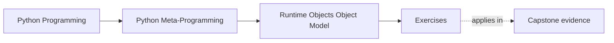

# Exercises

<!-- page-maps:start -->
## Page Maps

<!-- page-maps:end -->

Use these after reading the five core lessons and the worked example. The goal is not to
repeat vocabulary from memory. The goal is to make the runtime object model visible from
evidence.

Each exercise asks for three things:

- the runtime object or relationship you are trying to explain
- the evidence that proves your claim
- the boundary or design judgment that follows from that evidence

Treat the ten exercises as one full lab day on the Python object model.

Do them in order:

- Exercises 1-3 establish functions, classes, and modules as ordinary runtime objects
- Exercises 4-6 compare storage models and supported versus brittle introspection
- Exercises 7-8 make bound methods and import-time relationships explicit
- Exercises 9-10 package the full model into a reviewable runtime evidence packet

Keep one evidence table while you work:

| Runtime object or relationship | Evidence used | Supported or brittle surface | Design judgment that follows |
| --- | --- | --- | --- |

## Exercise 1: Tell the truth about one function object

Choose one Python-defined function and explain what it carries at runtime.

What to hand in:

- the function's `__name__`, `__qualname__`, and `__module__`
- one example of live environment state through `__globals__` or closure state
- one sentence explaining why "callable" is too broad to describe this object fully

## Exercise 2: Explain one class without saying "class magic"

Choose one small class and trace how it becomes a runtime object.

What to hand in:

- the class object's metaclass, bases, and one useful entry from `cls.__dict__`
- one explanation of a method as a function stored on the class
- one lookup example showing whether a descriptor or instance storage won

## Exercise 3: Prove module identity and stale imported values

Build or inspect one module example that shows how module caching works.

What to hand in:

- evidence that two imports or lookups refer to the same module object
- one demonstration that a copied-out value can stay stale after module state changes
- one sentence explaining why module-qualified access is safer in reload-heavy workflows

## Exercise 4: Compare instance storage models honestly

Create one dictionary-backed class and one slotted class, then compare them as runtime
objects.

What to hand in:

- one proof that the dictionary-backed instance stores state in `__dict__`
- one proof that the slotted instance rejects or reshapes dynamic attributes
- one judgment about when `__slots__` is justified and when it is only adding constraint

## Exercise 5: Trace one runtime object chain from module to call

Start with a bound method in a tiny example program and trace the whole path backward.

What to hand in:

- the module object, class object, instance, bound method, and function involved
- one sentence for each runtime moment: import time, class-definition time,
  instance-creation time, and call time
- one explanation of which object-model misunderstanding this trace would prevent

## Exercise 6: Review a brittle introspection helper

Use the worked example as a model and evaluate one introspection helper or design idea
that feels clever but risky.

What to hand in:

- the exact runtime surfaces the helper depends on
- which of those surfaces are supported and which are diagnostic-only
- one rewrite or rule that makes the helper more honest

## Midday self-check

Before moving into the final four exercises, make sure you can already answer these
questions clearly:

- what makes one function object more than "something callable"
- why one class statement produced an ordinary runtime object instead of an abstract type
- how one imported module proves identity and stale copied values at the same time
- which introspection surfaces in one helper are strong enough to trust

If you cannot answer those four questions in plain language, return to Exercises 1-6 and
make the object relationships more explicit before continuing.

## Exercise 7: Separate function, method, and bound-method identities

Take one bound method example and compare the function stored on the class with the bound
method produced through instance access.

What to hand in:

- one class, one instance, the function stored on the class, and the bound method
- evidence showing `bound.__self__` and `bound.__func__`
- one explanation of why methods are not pre-stored inside instances

## Exercise 8: Map one import-time object graph

Build or inspect one tiny module that defines at least one class and one helper function.
Then trace the graph that exists after import.

What to hand in:

- the module object, one class object, one function object, and one instance created from that class
- one explanation of which bindings exist at import time versus after instance creation
- one judgment about what misunderstanding this graph would prevent in code review

## Exercise 9: Compare supported evidence with diagnostic evidence

Choose one runtime question and answer it twice: once with mostly supported surfaces and
once with diagnostic-only or brittle surfaces.

What to hand in:

- the runtime question
- one supported evidence path and one brittle evidence path
- one explanation of why the supported route is the better teaching or tooling default

## Exercise 10: Produce a runtime evidence packet

Assemble:

- one evidence table covering functions, classes, modules, and instances
- one bound-method trace
- one module identity or stale-value demonstration
- one brittle-introspection rewrite rule

The packet is strong when another learner can use it to answer:

- which object is doing the work
- which runtime moment created the relevant relationship
- which evidence is safe to rely on and which is only diagnostic

## Mastery standard for this exercise set

Across all six answers, the module wants the same habits:

- you name the runtime object before describing the behavior
- you separate supported introspection from brittle implementation detail
- you explain behavior in terms of object relationships and runtime moments
- you avoid "Python magic" as a substitute for a real object-model explanation

Across all ten answers, add two more habits:

- you distinguish stored functions from bound methods created by lookup
- you leave behind a reviewable packet that another learner could audit without guessing

If an answer still sounds like folklore, keep going.

## Continue through Module 01

- Previous: [Worked Example: Reviewing a Brittle Source-Recovery Tool](worked-example-reviewing-a-brittle-source-recovery-tool.md)
- Next: [Exercise Answers](exercise-answers.md)
- Return: [Overview](index.md)
- Terms: [Glossary](glossary.md)
