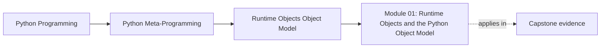

# Module 01: Runtime Objects and the Python Object Model

<!-- page-maps:start -->
## Page Maps




<!-- page-maps:end -->

Module 01 gives the floor the rest of the course stands on: Python functions, classes,
modules, and instances are ordinary runtime objects, and metaprogramming becomes honest
only when that sentence feels mechanically true instead of inspirational.

The module is a complete teaching unit rather than a preface to the capstone. Its five
core lessons build the model, a runnable lab makes each relationship observable, the
worked example applies review judgment, and the exercises require you to produce your
own evidence. Only then does the capstone provide a transfer check in a larger system.

## What this module is for

By the end of Module 01, you should be able to explain five things cleanly:

- what makes a Python function an object with metadata, globals, and callable behavior
- how classes are created, stored, and used as ordinary runtime values
- why modules are cached objects with a live namespace instead of passive source files
- how instances store state and participate in attribute lookup
- how module, class, instance, method, and function relationships form one runtime graph

## Keep these pages open

- [First-Contact Map](../module-00-orientation/first-contact-map.md)
- [Module Promise Map](../guides/module-promise-map.md)
- [Module Checkpoints](../guides/module-checkpoints.md)
- [Capstone Map](../capstone/capstone-map.md)

## The learning loop

Use the module in this order:

1. Read one core lesson and predict what its example will prove.
2. Run `make lab`, then inspect only the JSON packet named by that lesson.
3. Open `labs/runtime_objects/evidence.py` and trace how the packet was produced.
4. Change or extend the smallest relevant probe while keeping `make lab-test` green.
5. Complete the matching exercise without copying the answer.
6. Transfer the object relationship to the incident-plugin capstone.

The lab is deliberately smaller than the capstone. It removes descriptors, decorators,
and metaclasses that Module 01 has not taught yet, so you can observe ordinary functions,
classes, modules, instances, and bound methods without unexplained framework machinery.

## Run the module lab

From `programs/python-programming/python-meta-programming`:

```console
$ make lab
{
  "class": {
    "bound_method_has_function": true,
    "bound_method_has_instance": true,
    ...
  },
  ...
}
$ make lab-test
Ran 6 tests

OK
```

The JSON is the observation surface. The tests are the claim-to-proof surface. Their
important distinction is:

- `make lab` helps you explain *what exists at runtime*
- `make lab-test` checks the relationships the course depends on
- neither command proves that arbitrary dynamic code is safe or well designed

## The published lesson set

1. Overview (`index.md`)
2. [Functions as Runtime Objects](functions-as-runtime-objects.md)
3. [Classes as Runtime Objects](classes-as-runtime-objects.md)
4. [Modules as Runtime Objects](modules-as-runtime-objects.md)
5. [Instances as Runtime Objects](instances-as-runtime-objects.md)
6. [Object Graph and Runtime Cycle](object-graph-and-runtime-cycle.md)
7. [Worked Example: Reviewing a Brittle Source-Recovery Tool](worked-example-reviewing-a-brittle-source-recovery-tool.md)
8. [Exercises](exercises.md)
9. [Exercise Answers](exercise-answers.md)
10. [Glossary](glossary.md)

The executable companion is `labs/runtime_objects/`, with focused verification in
`tests/test_runtime_objects_lab.py`.

## How to use the lesson set

| If you need to... | Start here |
| --- | --- |
| understand what a Python function really carries at runtime | [Functions as Runtime Objects](functions-as-runtime-objects.md) |
| explain class creation, lookup precedence, and descriptor pressure | [Classes as Runtime Objects](classes-as-runtime-objects.md) |
| reason about import identity, caching, and reload behavior | [Modules as Runtime Objects](modules-as-runtime-objects.md) |
| compare `__dict__`-backed and slotted instances | [Instances as Runtime Objects](instances-as-runtime-objects.md) |
| connect functions, modules, classes, instances, and bound methods into one model | [Object Graph and Runtime Cycle](object-graph-and-runtime-cycle.md) |
| watch the boundary between supported introspection and brittle heuristics fail in practice | [Worked Example: Reviewing a Brittle Source-Recovery Tool](worked-example-reviewing-a-brittle-source-recovery-tool.md) |
| run all five object-model probes before editing them | `make lab` |
| verify the teaching claims after an edit | `make lab-test` |
| test your understanding before moving to Module 02 | [Exercises](exercises.md) |
| compare your reasoning against a reference answer | [Exercise Answers](exercise-answers.md) |
| stabilize the module vocabulary | [Glossary](glossary.md) |

## The running question

Carry this question through every page:

> What runtime object, namespace, or binding is actually doing the work here?

Strong Module 01 answers usually mention one or more of these:

- a function object and the environment it carries
- a class object created at definition time
- a module object cached in `sys.modules`
- an instance storage model and lookup path
- a bound method linking an instance back to a function and module namespace

## Learning outcomes

By the end of this module, you should be able to:

- describe Python runtime behavior without appealing to framework magic
- separate supported introspection from interpreter-specific diagnostic surfaces
- explain what happens at import time, class-definition time, instance time, and call time
- use the capstone runtime as evidence for ordinary object relationships

## Capstone transfer, not capstone-first study

After the lab feels explainable, inspect
`capstone/src/incident_plugins/plugins.py` and choose `ConsoleNotifier.deliver`. Trace:

1. the `plugins` module object that owns the global namespace
2. the `ConsoleNotifier` class object bound into that namespace
3. the function stored under `deliver` on the class
4. one `ConsoleNotifier` instance
5. the bound method produced by `instance.deliver`

The capstone adds decorator and metaclass behavior that later modules will teach. In
Module 01, acknowledge those layers but do not try to explain them early. The transfer
goal is only to prove that the ordinary object graph still exists underneath them.

## Exit standard

Do not move on until all of these are true:

- you can explain why functions, classes, modules, and instances are all ordinary objects
- you can name which runtime facts are stable and which are diagnostic-only
- you can trace one bound method back through instance, class, function, and module state
- you can describe one brittle introspection idea and say exactly why it fails
- you can run `make lab-test`, explain what each test proves, and name one claim it does
  not prove

When those feel ordinary, Module 01 has done its job and Module 02 can focus on safe
observation instead of object-model confusion.
