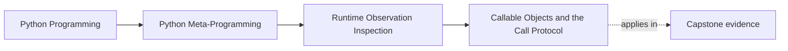

# Callable Objects and the Call Protocol


<!-- page-maps:start -->
## Page Maps




<!-- page-maps:end -->

Once you can inspect names, state, and type relationships, another review question shows
up quickly:

> can this object be called?

Python answers that with `callable(obj)`, but the answer is narrower than many people
expect. This page makes that boundary explicit.

This is another place where beginner language gets dangerously loose. "It is callable"
often gets used to mean all of these at once:

- the runtime permits a call attempt
- the signature will match
- the call is safe to run now
- the object is function-like in the way the surrounding code expects

Those are four different claims. This page keeps them apart.

## The sentence to keep

When you see `callable(obj)`, ask:

> does this only mean a call attempt is supported, or is the code pretending it proves too
> much?

`callable()` is a useful gate. It is not a complete safety proof.

Add one more repair sentence:

> callability is permission to attempt invocation, not evidence that invocation is valid,
> cheap, reversible, or appropriate during observation.

## What `callable(obj)` actually means

`callable(obj)` is `True` when the runtime recognizes the object as supporting call
syntax.

Common examples include:

- Python-defined functions
- built-in functions
- bound methods
- classes
- instances whose type provides `__call__`

That last phrase matters. Callability is tied to the object's type-level call protocol,
not to any random attribute named `__call__` attached later.

Use this quick matrix while you read:

| If your question is... | First tool | Why |
| --- | --- | --- |
| "May the runtime attempt `obj(...)`?" | `callable(obj)` | it answers the gate question directly |
| "What kind of callable is this?" | classification after the gate | functions, classes, bound methods, and callable instances behave differently |
| "Will this call accept these arguments?" | signature or explicit call validation later | callability alone cannot answer argument fitness |
| "Should this tool execute the call right now?" | policy review | observation and execution are still different boundaries |

## `callable()` does not promise success

A `True` result does not mean:

- the arguments are valid
- the call is side-effect free
- the call is cheap
- the object is a Python-defined function

It means only that the runtime will let you attempt `obj(...)`.

That is a valuable but limited observation.

The limit matters most in tooling. A plugin loader, admin panel, serializer, or debug
helper may only need to know whether invocation is possible, not whether it is wise to
perform it during inspection.

## The type provides the call protocol

This example may be surprising:

```python
class Plain:
    pass


item = Plain()
item.__call__ = lambda: 1

assert callable(item) is False
```

Why?

Because the runtime does not determine callability by looking for an instance attribute
named `__call__`. The object's type must provide the call behavior.

```python
class CallableThing:
    def __call__(self):
        return 1


obj = CallableThing()
assert callable(obj) is True
assert obj() == 1
```

This is a clean Module 02 lesson because it separates a visible attribute name from the
protocol the runtime actually uses.

It also corrects a false analogy from earlier pages: just as a visible name is not proof
of local storage, an instance attribute named `__call__` is not proof that the runtime
treats the object as callable.

## Classes are callable too

A class object is callable because calling it constructs an instance.

```python
class Service:
    pass


assert callable(Service) is True
instance = Service()
assert isinstance(instance, Service)
```

This is another reminder that callability is broader than "ordinary function."

It is also why review comments should avoid saying "function" when they really mean
"callable." Classes, bound methods, and callable instances may all pass the same gate but
carry different semantics for construction, binding, or stateful invocation.

## One picture of the observation boundary

```text
callable(obj)
  -> may I attempt obj(...)?

It does not answer:
  -> will the arguments match?
  -> will the call succeed?
  -> is this safe to execute during inspection?
```

That distinction matters in tooling, plugin discovery, and generic wrappers.

## A repair table for common callability mistakes

These are the mistakes this page should remove from your reviews:

| Weak move | Why it is weak | Better repair |
| --- | --- | --- |
| treating `callable(obj)` as proof the call will succeed | argument validity and runtime failures are separate questions | use `callable` as the gate, then validate arguments or handle failures honestly |
| calling something during inspection because it is callable | observation and execution have different risk budgets | make invocation an explicit later step |
| saying "function" when the object might be a class or callable instance | callable categories differ in semantics and review expectations | classify the callable after the gate |
| attaching `obj.__call__ = ...` and assuming the runtime now sees a callable object | callability depends on type-level protocol support | provide `__call__` on the class or use another explicit wrapper design |

## One realistic self-study lab

Build four values:

- a plain Python function
- a class object
- a bound method
- an instance with type-level `__call__`

Then write one row for each:

- what `callable(...)` tells you
- what it still does not tell you
- what category the value belongs to
- one reason a review tool might care about that category

If your rows all sound the same, you are still treating "callable" as one uniform runtime
surface.

## `callable()` versus callable categories

A review often needs one more question after `callable(obj)`:

> what kind of callable is this?

The answer might be:

- function
- bound method
- class
- instance with `__call__`

That is why Module 02 keeps separating observation questions instead of treating every
"callable" as the same kind of thing. Later modules rely on those differences.

## A practical helper should keep failure information

If you want a small call guard, do not collapse everything into one boolean:

```python
def guarded_call(func, *args, **kwargs):
    if not callable(func):
        return (False, TypeError(f"{func!r} is not callable"))

    try:
        return (True, func(*args, **kwargs))
    except Exception as exc:
        return (False, exc)
```

This helper is still executing behavior when the object is callable. That is the point.
It keeps "cannot be called" separate from "can be called, but the call failed."

That is the reader-first teaching move here: name the exact boundary crossed by the
helper. The boolean gate is observational. The attempted call is behavioral.

## Review rules for callability checks

When reviewing callability logic, keep these questions close:

- is `callable(obj)` being used only as a gate for attempted invocation, or is the code reading more into it than it should?
- does the design need to distinguish function, bound method, class, and callable instance?
- is the code assuming an instance-level `__call__` attribute makes the object callable when it does not?
- is a call attempt happening during observation when the tool should have remained non-executing?
- are call failures kept distinct from non-callable inputs?

One final pressure question:

> If a plugin registry says it accepts "callables," does it really mean any callable, or
> does it mean one narrower callable category with a particular signature and lifecycle?

## What to practice from this page

Try these before moving on:

1. Build one class whose instances become callable through a type-level `__call__`.
2. Add a `__call__` attribute directly to one instance and explain why `callable(obj)` stays false.
3. Write `guarded_call(f, *args, **kwargs)` and keep non-callable inputs separate from
   callable-but-failing ones.

If those feel ordinary, the last core can connect the whole module into one disciplined
observation workflow with static lookup.

## Continue through Module 02

- Previous: [Exactness and Polymorphism in Runtime Type Checks](exactness-and-polymorphism-in-runtime-type-checks.md)
- Next: [Static Lookup and Disciplined Observation](static-lookup-and-disciplined-observation.md)
- Practice: [Exercises](exercises.md)
- Terms: [Glossary](glossary.md)
