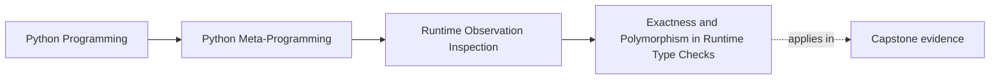

# Exactness and Polymorphism in Runtime Type Checks


<!-- page-maps:start -->
## Page Maps




<!-- page-maps:end -->

Runtime observation is not only about attributes. It is also about classification.

When you look at a value and ask "what is this?", Python gives you several different
questions to ask:

- what is the exact runtime type?
- does this object satisfy a broader class relationship?
- does this class stand in a subclass relationship to another class?

This page keeps those questions separate so review and tooling code do not overfit to the
wrong kind of type check.

For self-study learners, this lesson usually fixes a specific kind of vagueness:

- "I wanted to be precise, so I used `type(...) is ...`"
- "I wanted to accept subclasses, so I used `isinstance`"

Those can both be right, but only after you name the review question precisely.

## The sentence to keep

When choosing a type check, ask:

> do I need exact identity here, or do I need a polymorphic relationship?

That distinction is the difference between `type(obj) is T` and `isinstance(obj, T)`.

The better habit is:

> write the runtime truth you need in plain language first, then choose the narrowest
> check that matches that truth.

## The three tools answer different questions

For Module 02, the basic roles are:

- `type(obj)` returns the exact runtime class of `obj`
- `isinstance(obj, T)` asks whether the object is an instance of `T` or one of its subclasses
- `issubclass(C, T)` asks whether a class stands in a subclass relationship to `T`

Those are related tools, but they are not interchangeable.

Use them through this matrix:

| If your question is... | Tool | What the result means |
| --- | --- | --- |
| "What exact runtime class is this object?" | `type(obj)` | one concrete type identity |
| "Can this object participate in a role or family?" | `isinstance(obj, T)` | object satisfies the accepted relationship |
| "Does this class belong to a broader hierarchy?" | `issubclass(C, T)` | class satisfies the accepted relationship |

## `type(obj)` is exact

`type(obj)` gives the concrete runtime class.

That is useful when exactness matters:

- a review wants to reject subclasses
- a serializer has special handling for one concrete type
- a design needs to distinguish `bool` from `int`

```python
assert isinstance(True, int) is True
assert (type(True) is int) is False
assert (type(True) is bool) is True
```

This is the classic example because it shows why exact checks exist at all.

It also shows why "precise" is not enough as a justification. Exactness is only correct
when exact identity is the truth you actually need.

## `isinstance` is usually the better default

Most of the time, polymorphism is the point.

If a function accepts a family of related objects, `isinstance` usually matches the
design better because it accepts subclasses and other supported relationships rather than
rejecting them for being "too specific."

That is why review guidance for Module 02 is simple:

- default to `isinstance` when you are checking whether an object can play a role
- use exact type checks only when subclass rejection is part of the requirement

That second bullet matters. If you cannot explain why subclass rejection is necessary, the
exact check is usually hiding an underspecified design.

## `issubclass` is about class relationships, not instances

`issubclass(C, T)` is the class-level version of that broader relationship.

It expects a class object as the first argument:

```python
class Base:
    pass


class Derived(Base):
    pass


assert issubclass(Derived, Base) is True
```

If you pass an instance where a class is required, Python raises `TypeError`. That is a
useful reminder that this is a different question, not a slightly different spelling of
`isinstance`.

## One picture of the classification choices

```text
type(obj) is T
  -> exact identity

isinstance(obj, T)
  -> object fits class relationship

issubclass(C, T)
  -> class fits class relationship
```

When review comments blur these together, they often end up enforcing stricter behavior
than the design actually needs.

One useful study question is:

> if a future subclass behaved correctly for the same role, would this check accept it or
> reject it for no good reason?

## ABCs make polymorphic checks broader on purpose

Abstract base classes from `collections.abc` widen the meaning of `isinstance` and
`issubclass` beyond direct inheritance.

```python
from collections.abc import Iterable


class Numbers:
    def __iter__(self):
        return iter([1, 2, 3])


assert isinstance(Numbers(), Iterable) is True
```

This is disciplined duck typing:

- the check stays explicit
- the code still talks about a capability or category
- it does not require exact nominal inheritance from one concrete class in your project

That is often the reader-first way to teach classification: start from the role the
object must play, not from the concrete type you happened to use while writing examples.

## Exact checks are sometimes necessary

This module is not arguing that exact checks are bad. It is arguing that they should be
conscious.

Strong reasons to use exact checks include:

- a concrete type has semantics subclasses are allowed to change
- you need to distinguish `bool` from `int`
- the code is implementing a narrow compatibility boundary

Weak reasons include:

- habit
- discomfort with inheritance or ABCs
- wanting a simpler mental model at the expense of correct polymorphic behavior

Add one more weak reason to your review vocabulary:

- trying to make uncertain design intent look "strict" instead of naming the real acceptance rule

## Review questions become clearer with the right tool

Suppose a helper is meant to accept any iterable except strings.

The clearer question is not:

> is this exactly a list, tuple, or set?

It is:

> is this object iterable, and is it one of the string-like cases I want to reject?

That pushes the implementation toward a capability check plus a narrow exclusion rule.

```python
from collections.abc import Iterable


def ensure_iterable(value):
    if isinstance(value, str):
        raise TypeError("strings are excluded here")
    if not isinstance(value, Iterable):
        raise TypeError("expected an iterable")
    return iter(value)
```

This is a good Module 02 example because it shows classification as a design question, not
just a syntax question.

## A repair table for common classification mistakes

These are the mistakes this page is trying to remove from your reviews:

| Weak move | Why it is weak | Better repair |
| --- | --- | --- |
| `type(obj) is list` when any iterable would work | exactness rejects legitimate participants | ask for `Iterable` plus any necessary exclusions |
| `isinstance(obj, Base)` when a special concrete type needs unique semantics | role checks hide a concrete compatibility boundary | switch to exactness and document the reason |
| `issubclass(type(obj), Base)` for ordinary instance checks | class-relationship syntax obscures a simpler question | use `isinstance(obj, Base)` unless you truly need class objects |
| "precise" exact checks with no subclass policy | strictness is asserted, not justified | explain the subclass rejection rule first |

## One realistic self-study lab

Build a tiny hierarchy such as `Report`, `HtmlReport`, and `JsonReport`, then answer
three questions separately:

1. which check should accept any report-like object?
2. which check should accept only one concrete serializer output?
3. which check belongs on classes rather than instances?

Write your answers in this form:

- runtime question
- chosen check
- one sentence explaining why the other two checks would be weaker or less honest

If you cannot write the third bullet, you probably still chose the tool by habit.

## Guided lab: classify by question, not strictness

Run:

```console
$ python3 -m labs.runtime_observation |
  python3 -c 'import json, sys; print(json.load(sys.stdin)["type_checks"])'
{'bool_is_exact_int': False, 'bool_is_instance_of_int': True, 'extension_is_exact_base_type': False, 'extension_matches_delivery_role': True}
```

The two pairs expose different design pressures:

- `bool` is an `int` subclass, so inheritance-aware classification accepts it while an
  exact integer check rejects it.
- `CustomDeliveryPolicy` is a valid `DeliveryPolicy` extension, so role classification
  accepts it while an exact base-type check rejects the extension.

Neither result makes one tool universally better. The packet forces the missing question:
does this boundary want inherited participation or one concrete implementation?

### Failure route

Change a role gate from `isinstance(extension, DeliveryPolicy)` to
`type(extension) is DeliveryPolicy`. The packet will reject the extension. Write the
specific subclass behavior that supposedly makes rejection necessary. If you cannot name
one, the exact check has made the API narrower without earning that cost.

Restore the role check and run `make observation-lab-test`.

### Transfer to the incident-plugin runtime

Concrete notifiers such as `ConsoleNotifier` extend `PluginBase`. A tool that accepts
only `type(plugin) is PluginBase` would reject every useful plugin instance, including
future extensions. The capstone's extension boundary therefore needs role-compatible
reasoning, while narrow serialization or scalar-coercion boundaries may still justify
exact checks for specific values.

The teaching claim comes from the controlled hierarchy. The capstone demonstrates why
the choice matters in a plugin architecture.

## Review rules for type checks

When reviewing runtime classification logic, keep these questions close:

- is the code asking for exact identity or for role compatibility?
- is `type(obj) is T` rejecting subclasses without a real reason?
- would an ABC or capability-oriented `isinstance` check express the intent more honestly?
- is `issubclass` being used only where the first input is actually a class object?
- does the code explain why strings or bytes are special exclusions instead of treating them as an afterthought?

One final pressure question:

> If a review comment says "use `type(...) is ...` so the code is more precise," what
> exact subclass behavior is it trying to reject?

## What to practice from this page

Try these before moving on:

1. Write one helper that uses `isinstance` by default and explain why an exact type check
   would be too strict.
2. Build one example where `type(obj) is T` is the right choice and name the reason.
3. Implement `ensure_iterable(x)` that accepts iterables, rejects strings, and returns an iterator.

If those feel ordinary, the next step is callability: a value may be observable, classifiable,
and still raise new review questions the moment someone wants to invoke it.

## Continue through Module 02

- Previous: [Dynamic Attribute Access Is Not Inspection](dynamic-attribute-access-is-not-inspection.md)
- Next: [Callable Objects and the Call Protocol](callable-objects-and-the-call-protocol.md)
- Practice: [Exercises](exercises.md)
- Terms: [Glossary](glossary.md)
