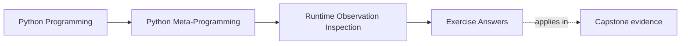

# Exercise Answers


<!-- page-maps:start -->
## Page Maps




<!-- page-maps:end -->

Use this page after attempting the exercises yourself. The goal is not to match every
example exactly. The goal is to compare your reasoning against answers that ask a precise
runtime question and then choose a tool that fits that question honestly.

Read each answer as a review model, not as a template to copy blindly. A strong answer
should always make four things visible:

- the runtime question
- the tool choice
- the evidence produced by that choice
- the exact point where the workflow stays observational or crosses into behavior

The supplied course code is one defensible route:

- `labs/runtime_observation/evidence.py` makes side effects countable
- `labs/runtime_observation/debug_view.py` implements the bounded attachment-first helper
- `tests/test_runtime_observation_lab.py` proves the stated boundaries
- `make observation-lab-test` runs the focused review route

Use it to review your reasoning, not as an answer to copy without explanation.

## Answer 1: Separate visible names from stored state

Example answer:

```python
class Explorer:
    def __init__(self):
        self.instance_only = "personal"

    def method(self):
        return "ok"


obj = Explorer()
```

Strong evidence:

- `vars(obj) == {"instance_only": "personal"}`
- `"method" in dir(obj)` is `True`
- `"method" in vars(obj)` is `False`

Good conclusion:

`dir(obj)` discovers candidate names from instance, class, and MRO context. `vars(obj)`
shows only dictionary-backed stored state. Those are different questions and should not be
treated as interchangeable.

Reasoning checkpoint:

- the runtime question is "what names look reachable here?" when you choose `dir(obj)`
- the runtime question is "what state is stored directly on this instance?" when you choose `vars(obj)`
- a missing instance `__dict__` still does not prove missing state because slot-backed storage can exist without a dictionary

## Answer 2: Show that dynamic access is behavior

Example answer:

```python
class Risky:
    @property
    def value(self):
        print("property executed")
        return 10


obj = Risky()
```

Strong evidence:

- `getattr(obj, "value")` prints `property executed`
- `hasattr(obj, "value")` also prints `property executed`

Good conclusion:

Dynamic reads participate in the attribute protocol. They are not neutral inspection
because descriptors and hooks can execute code while the caller thinks it is only
"checking" an attribute.

Reasoning checkpoint:

- the narrower safer question is often "what object is attached under this name?" rather than "what value does runtime lookup produce?"
- if that narrower question is the real need, static lookup is the better first move
- `hasattr` is not a harmless pre-check because it walks the same dynamic path and can trigger the same behavior

## Answer 3: Choose the right type check

Example answer:

```python
from collections.abc import Iterable


def ensure_iterable(value):
    if isinstance(value, str):
        raise TypeError("strings are excluded")
    if not isinstance(value, Iterable):
        raise TypeError("expected an iterable")
    return iter(value)
```

Strong evidence:

- `isinstance([1, 2], Iterable)` is `True`
- rejecting `str` is a narrow rule layered on top of that broader capability check
- `type(True) is bool` is a good exact-type example when distinguishing `bool` from `int`

Good conclusion:

`isinstance` is usually the right default when the question is role compatibility.
`type(obj) is T` is right when the requirement truly depends on exact identity and should
reject subclasses.

Reasoning checkpoint:

- the iterable helper asks a capability question, so `isinstance` matches the job
- `type(obj) is T` should be paired with a concrete rejection reason such as "subclasses may overload arithmetic semantics" or "subclasses may carry policy we must not silently accept"
- if you cannot name the rejected subclass behavior, your exact-type check is probably not justified yet

## Answer 4: Prove what `callable()` does and does not promise

Example answer:

```python
class CallableThing:
    def __call__(self):
        return 1


class Plain:
    pass


callable_obj = CallableThing()
plain_obj = Plain()
plain_obj.__call__ = lambda: 1
```

Strong evidence:

- `callable(callable_obj)` is `True`
- `callable(plain_obj)` is `False`

Good conclusion:

Callability depends on the object's type-level protocol, not on an instance attribute with
the same name. A true result means only that the runtime permits a call attempt. It does
not guarantee valid arguments, safe execution, or success.

Reasoning checkpoint:

- `CallableThing()` is a callable instance because its type provides `__call__`
- `plain_obj` remains non-callable because attaching `__call__` to the instance does not install the call protocol
- your answer should still name the callable category: function, bound method, class, or callable instance

## Answer 5: Compare static and dynamic lookup directly

Example answer:

```python
import inspect


class Demo:
    @property
    def value(self):
        print("property executed")
        return 10


obj = Demo()
raw = inspect.getattr_static(obj, "value")
resolved = getattr(obj, "value")
```

Strong evidence:

- `raw` is the `property` object itself
- `resolved == 10`
- the dynamic read prints `property executed`

Good conclusion:

Static lookup better fits tooling when the goal is to inspect what is attached without
triggering behavior. Dynamic lookup is the right choice only when the tool intentionally
wants normal runtime semantics.

Reasoning checkpoint:

- attachment truth ends when you inspect the raw `property` object
- execution truth begins the moment you ask `getattr` to resolve the attribute normally
- the important habit is not "always use static lookup," but "cross into resolution only when the runtime question truly needs it"

## Answer 6: Review a debug or inspection helper

Example answer:

Suppose the helper currently does this:

- discover names with `dir(obj)`
- read each value with `getattr(obj, name)`
- recurse into everything it prints

Strong diagnosis:

- `dir(obj)` is a discovery step
- `getattr(obj, name)` is dynamic resolution and may execute code
- naive recursion can amplify accidental execution and create cycles

Good repair:

- keep `dir(obj)` only for candidate names
- move default reads to `inspect.getattr_static`
- make property evaluation and recursion explicit opt-ins

That repair matches the module's main discipline: the tool should stay observational by
default and cross into execution only on purpose.

Reasoning checkpoint:

- after the repair, the helper can promise "I show attached structure by default and only resolve runtime values when you explicitly opt in"
- that promise is reviewable because the default path no longer depends on descriptor execution
- if recursion remains enabled, the helper should also state where recursion stops or why it cannot silently explode work

## Answer 7: Compare inheritance-aware and exact inspection

Example answer:

```python
class Animal:
    pass


class Dog(Animal):
    pass


pet = Dog()
```

Strong evidence:

- `isinstance(pet, Animal)` is `True`
- `type(pet) is Animal` is `False`
- `type(pet) is Dog` is `True`

Good conclusion:

Inheritance-aware checks answer capability or role questions. Exact-type checks answer
identity questions. The right choice depends on what truth the review actually needs.

Reasoning checkpoint:

- a plugin-style extension system usually wants inheritance-aware acceptance because exact-type checks would reject legitimate extensions
- exact identity becomes appropriate only when the contract depends on one concrete implementation boundary

## Answer 8: Inspect one fallback hook without tripping it first

Example answer:

```python
import inspect


class LazyBag:
    def __getattr__(self, name):
        print(f"building {name}")
        return name.upper()


obj = LazyBag()
```

Strong evidence:

- `inspect.getattr_static(obj, "__getattr__")` exposes the fallback method without triggering it
- `getattr(obj, "token")` prints `building token`
- the dynamic route produces a value only by executing fallback behavior

Good conclusion:

Tooling should inspect the attachment story first and cross into fallback execution only
when the user explicitly wants runtime behavior rather than structure.

Reasoning checkpoint:

- `inspect.getattr_static(obj, "__getattr__")` answers whether fallback machinery exists
- `getattr(obj, "token")` answers what that fallback chooses to produce at runtime
- "check first with `hasattr`" is not a repair because it still executes the lookup path you were trying to inspect safely

## Answer 9: Build a least-risk inspection workflow

A strong answer might use this debugging question:

- "Why does this object appear to have a `value` attribute?"

Strong least-risk order:

1. inspect `type(obj)` and the class MRO
2. inspect `vars(obj)` or `obj.__dict__` if available
3. inspect `inspect.getattr_static(obj, "value")`
4. only then use `getattr(obj, "value")` if you actually want runtime semantics

Good conclusion:

The order matters because it keeps structure, storage, and behavior separate. Jumping
straight to `getattr` would answer a different question and might execute code too early.

Reviewable packet note:

- a strong submission names the exact step where the workflow crosses into behavior
- it also explains why each earlier step failed to answer the debugging question completely
- if the learner cannot defend the order, the workflow is still too hand-wavy

## Answer 10: Produce an inspection decision packet

The packet is strong when another learner can answer:

- what runtime question is being asked
- which observation tool answers it with the least unnecessary behavior
- where the workflow intentionally crosses into dynamic execution

If readers still cannot tell whether a step was discovery, storage inspection, or
behavioral resolution, the packet is not explicit enough yet.

## Repair table for weak answer keys

Use this table when your answer explains the outcome but not the reasoning:

| Weak answer move | What it leaves unclear | Better revision move |
| --- | --- | --- |
| "It works because `getattr` returned the value." | whether lookup executed behavior and whether that was acceptable | name the runtime question and whether dynamic resolution was intentionally chosen |
| "I used `type` for precision." | the subclass behavior being rejected | state what subclass-specific variation would make the broader check unsafe |
| "The helper is safer now." | the exact user promise that changed | write the new default contract in one sentence |
| "Static lookup is better." | better for which question | say whether you needed attached object truth or resolved runtime value truth |

## Review what each answer can support

| Answer | Defensible reasoning | Common wrong turn | What it proves | What it does not prove |
| --- | --- | --- | --- | --- |
| 1 names and storage | it compares `dir` and `vars` on the same object | treating visible class names as instance fields | these discovered names and stored names differ | that `dir` is passive for every type |
| 2 dynamic access | it records a counter before and after each operation | calling `hasattr` a safe pre-check | this property executed once per dynamic check | that every attribute read has the same cost |
| 3 type checks | it names the extension policy before selecting a check | calling exactness "more precise" without a rejection rule | the role check accepts this valid extension | that exact checks are never appropriate |
| 4 callability | it keeps the gate, valid call, and failing call separate | using `callable` as proof of argument fitness | this type supports call syntax and owns a separate input policy | that invocation is cheap, reversible, or safe during inspection |
| 5 static lookup | it identifies attachment first and execution second | interpreting static absence as dynamic absence | fallback is attached and dynamic lookup generated the value | that static lookup reveals the eventual runtime value |
| 6 debug helper | it begins from a bounded non-evaluating contract | adding recursion and evaluation without new policy tests | the baseline reports selected attachments without triggering the target counters | that arbitrary `repr`, recursion, or concurrency is safe |
| 7 inheritance | it ties polymorphism to a plugin-style extension boundary | rejecting extensions merely because their concrete type differs | the chosen hierarchy supports role-compatible acceptance | that every subclass satisfies unrelated behavioral contracts |
| 8 fallback | it inspects fallback machinery before resolving a missing name | using `hasattr` and triggering fallback while "checking" | the static route stays non-executing for this target | that fallback execution is always unsafe when explicitly requested |
| 9 least-risk order | it stops as soon as the current evidence answers the question | escalating through every tool regardless of need | the workflow minimizes unnecessary behavior for the stated question | that the same order answers every debugging question |
| 10 packet | it joins evidence, tests, reasoning, and capstone transfer | presenting green commands as the explanation | another learner can reproduce the Module 02 boundary claims | that all capstone metaprogramming mechanisms are justified |

## Capstone transfer answer

A strong transfer compares public behavior rather than vaguely saying "inspect the
capstone":

```console
make capstone-manifest
make demo
```

The manifest route returns field and action descriptions without invoking a delivery
action. The demo constructs a concrete plugin, resolves `deliver`, and calls it. The
important answer is not that one command is safe and the other is dangerous. It is that
they promise different product behavior:

- manifest: describe registered structure
- demo: execute an incident-delivery behavior with explicit inputs

The capstone contains mechanisms that later modules will explain. Module 02 proves only
that a reviewer can distinguish the observation route from the execution route and
choose evidence accordingly.

## What strong Module 02 answers have in common

Across the whole set, strong answers share the same habits:

- they state the observation question before choosing a builtin
- they separate discovery, storage inspection, classification, and value resolution
- they treat dynamic attribute access as execution-capable behavior
- they use static lookup when tooling needs attachment truth more than runtime behavior
- they separate inheritance-aware questions from exact-identity questions
- they leave behind a least-risk workflow another learner can reuse without guessing

If an answer still depends on "I just checked the attribute," revise it until you can say
what kind of observation or execution actually happened.

## Continue through Module 02

- Previous: [Exercises](exercises.md)
- Return: [Overview](index.md)
- Next module: [Module 03](../module-03-signatures-provenance-runtime-evidence/index.md)
- Terms: [Glossary](glossary.md)
