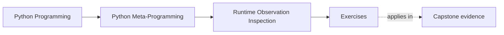

# Exercises


<!-- page-maps:start -->
## Page Maps




<!-- page-maps:end -->

Use these after reading the five core lessons and the worked example. The goal is not to
memorize tool names. The goal is to make your observation choices visible and reviewable.

Each exercise asks for three things:

- the runtime question you are actually trying to answer
- the least risky tool that answers that question
- the evidence or output that would prove your choice was honest

Treat the ten exercises as one full lab day on safe runtime observation.

This is not ten disconnected prompts. It is one inspection packet built under pressure.
The packet should make your tool choice, risk judgment, and evidence route visible enough
that another learner could review them without asking what you "meant."

Do them in order:

- Exercises 1-3 separate names, storage, and type-check intent
- Exercises 4-6 compare callability, static lookup, and safer helper design
- Exercises 7-8 extend that discipline into inheritance and fallback hooks
- Exercises 9-10 package the whole observation workflow into a reviewable inspection packet

Keep one observation table while you work:

| Runtime question | Candidate tool | Why it is or is not safe | Evidence produced | Follow-on design judgment |
| --- | --- | --- | --- | --- |

Build one small packet beside that table:

- one object that gives meaningfully different answers through `dir`, `vars`, static lookup, and dynamic lookup
- one property or fallback-hook demo
- one least-risk inspection workflow for a realistic debugging question
- one repair note for a helper you would no longer trust as written

## Starting context and acceptance contract

Work from `programs/python-programming/python-meta-programming` and establish the
before-state:

```console
make observation-lab
make observation-debug-view
make observation-lab-test
```

Exercises 1-5 extend or interpret the five evidence packets. Exercise 6 reviews the
attachment-first debug view. Exercises 7-10 transfer the same decisions into inheritance,
fallback behavior, and the capstone inspection boundary.

Preserve these contracts unless the exercise explicitly asks you to change one:

- static property inspection leaves `_property_reads` at zero
- static missing-name inspection leaves `_fallback_reads` at zero
- dynamic access increments the matching counter
- callability remains separate from successful invocation
- the debug view stays bounded and does not evaluate properties or fallback hooks
- all Module 01 lab tests remain green

Use this map to keep the exercises cumulative:

| Exercise | Starting surface | Decision required | Expected evidence | Acceptance check |
| --- | --- | --- | --- | --- |
| 1 | `visible_names_evidence()` | whether the question concerns names or storage | packet comparison and stored-name explanation | method remains visible but not instance-stored |
| 2 | `dynamic_access_evidence()` | whether behavior should execute | counter timeline | static count stays zero; dynamic and `hasattr` counts rise |
| 3 | `type_check_evidence()` | role compatibility or exact identity | accepted and rejected subclasses | rejection reason is explicit |
| 4 | `callability_evidence()` | call gate or invocation policy | callable category plus failing call | failed call remains distinct from non-callable input |
| 5 | `static_lookup_evidence()` | attachment truth or resolved value | before/after fallback count | crossing point is named |
| 6 | `build_debug_view()` | which observations the tool promises | saved debug view and focused test | property and fallback counters remain zero |
| 7 | delivery-policy hierarchy | extensibility or concrete implementation | both classification results | legitimate extension is not rejected accidentally |
| 8 | `IncidentObservationTarget.__getattr__` | whether fallback execution is appropriate | static and dynamic routes | `hasattr` is not presented as passive |
| 9 | all five packets | least-risk ordering | ordered workflow with stop condition | every escalation has a reason |
| 10 | course lab plus capstone CLI | observation versus application execution | manifest/demo comparison and test log | course explanation remains primary |

## Exercise 1: Separate visible names from stored state

Pick one object and compare what `dir(obj)` reveals with what `vars(obj)` or `obj.__dict__`
reveals.

What to hand in:

- one object with ordinary dictionary-backed state
- one attribute name that appears in `dir(obj)` but not in stored state
- one sentence explaining why name discovery and storage inspection are different questions
- one sentence explaining why missing `__dict__` does not prove missing state

Use the supplied target or justify a replacement. If you replace it, preserve at least
one class-provided name that is visible but not instance-stored.

## Exercise 2: Show that dynamic access is behavior

Build one object whose attribute access executes code.

What to hand in:

- one property, descriptor, or `__getattr__` example
- evidence that `getattr` or `hasattr` triggered behavior
- one explanation of why that makes the access unsafe as casual inspection
- one sentence explaining which narrower question you should have asked before reaching for dynamic access

Include counter evidence or another deterministic side-effect record. Printed prose alone
is not enough to prove how many times lookup executed.

## Exercise 3: Choose the right type check

Write a tiny helper whose correctness depends on the difference between exact and
polymorphic checks.

What to hand in:

- one example where `isinstance` is the right default
- one example where `type(obj) is T` is the right choice
- one sentence explaining why the two checks answer different review questions
- one sentence naming the subclass behavior your exact check is intentionally rejecting

If you cannot name that behavior, keep the polymorphic check.

## Exercise 4: Prove what `callable()` does and does not promise

Create examples of both callable and non-callable objects.

What to hand in:

- one callable instance created through a type-level `__call__`
- one non-callable instance with an instance-level `__call__` attribute
- one explanation of why `callable(obj)` does not guarantee argument validity or safe execution
- one sentence naming which callable category your example belongs to

Include one callable-but-failing invocation so success is not silently folded into the
callability claim.

## Exercise 5: Compare static and dynamic lookup directly

Use one object with a property or descriptor and compare `inspect.getattr_static` with
`getattr`.

What to hand in:

- the object definition
- the result of the static lookup
- the result or side effect of the dynamic lookup
- one explanation of which lookup style better fits tooling and why
- one sentence naming the exact moment your workflow crosses from attachment truth into execution truth

Acceptance requires a zero side-effect count after static lookup and a positive count
after the deliberate dynamic read.

## Exercise 6: Review a debug or inspection helper

Take a tiny introspection helper of your own or use the worked example pattern.

What to hand in:

- where the helper discovers names
- where it reads stored state or resolves values
- one repair that makes the helper less eager to execute runtime behavior
- one sentence explaining which user promise the repaired helper can now make honestly

Start from `build_debug_view()` or explain why its non-recursive contract cannot answer
your question. Added evaluation or recursion must have a focused failure test.

## Midday self-check

Before moving into the final four exercises, make sure you can already answer these
questions clearly:

- which question `dir(obj)` answers and which one it does not
- why `getattr` and `hasattr` can execute behavior
- when exact type checks and polymorphic checks answer different review questions
- why `inspect.getattr_static` is sometimes the safer first move

If you cannot answer those four questions in plain language, return to Exercises 1-6 and
make the observation questions more explicit before continuing.

Add one more self-check before continuing:

- can you point to the exact step where your workflow crosses from observation into execution?

## Exercise 7: Compare inheritance-aware and exact inspection

Build one tiny class hierarchy and answer a runtime question that changes depending on
whether you care about exact identity or inherited behavior.

What to hand in:

- the hierarchy
- one runtime question answered with `isinstance` or `issubclass`
- the same area answered with an exact-type check
- one explanation of which review question each route serves better
- one sentence explaining which of the two routes would become misleading in a plugin-style extension system

## Exercise 8: Inspect one fallback hook without tripping it first

Choose one object that uses `__getattr__` or another late-bound fallback and explain how
you would inspect it safely before resolving values dynamically.

What to hand in:

- the object definition
- one static inspection route
- one dynamic access route and the behavior it triggers
- one judgment about what a tooling helper should do by default
- one sentence explaining why "check first with `hasattr`" is not a satisfactory repair

## Exercise 9: Build a least-risk inspection workflow

Take one realistic debugging question and write the inspection order you would use from
least risky to most invasive.

What to hand in:

- the debugging question
- the ordered observation steps
- the point where you intentionally cross from observation into behavior
- one explanation of why a different order would be less honest

## Exercise 10: Produce an inspection decision packet

Assemble:

- one observation table
- one property or descriptor example
- one static-versus-dynamic lookup comparison
- one helper repair rule

The packet is strong when another learner can use it to answer:

- what question is actually being asked
- which tool answers that question with the least unnecessary behavior
- where the workflow crosses into execution on purpose

Required final evidence:

```console
make observation-lab-test
make test
```

Add a comparison between `make capstone-manifest` and `make demo`. The manifest route
supports an observation claim; the demo route intentionally performs application
behavior. Green commands do not replace that explanation.

## Repair table for weak exercise drafts

Use this when an answer still sounds vague:

| Weak answer pattern | What is missing | Repair |
| --- | --- | --- |
| "I inspected the object with `getattr`." | the runtime question and the risk judgment | name whether you needed attachment truth or resolved value truth |
| "I used `type` to be precise." | the subclass rejection reason | state what subclass behavior must be excluded |
| "I checked `hasattr` first." | the cost of executing lookup during probing | explain why probing should or should not execute behavior |
| "I used `callable` so I know it works." | argument validity and execution risk | separate the call gate from the attempted call |

## Mastery standard for this exercise set

Across all six answers, the module wants the same habits:

- you name the exact observation question before naming a tool
- you use the least risky tool that answers that question
- you distinguish discovery, storage inspection, classification, and execution
- you avoid treating dynamic access as harmless by default

Across all ten answers, add two more habits:

- you separate inheritance-aware questions from exact-identity questions
- you leave behind a least-risk workflow another learner could reuse without guessing

If an answer still sounds like "I just checked the attribute," keep going.

## Continue through Module 02

- Previous: [Worked Example: Building a Safer Debug Printer](worked-example-building-a-safer-debug-printer.md)
- Next: [Exercise Answers](exercise-answers.md)
- Return: [Overview](index.md)
- Terms: [Glossary](glossary.md)
