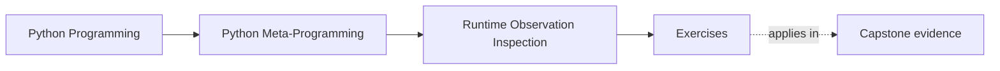

# Exercises

<!-- page-maps:start -->
## Page Maps

<!-- page-maps:end -->

Use these after reading the five core lessons and the worked example. The goal is not to
memorize tool names. The goal is to make your observation choices visible and reviewable.

Each exercise asks for three things:

- the runtime question you are actually trying to answer
- the least risky tool that answers that question
- the evidence or output that would prove your choice was honest

Treat the ten exercises as one full lab day on safe runtime observation.

Do them in order:

- Exercises 1-3 separate names, storage, and type-check intent
- Exercises 4-6 compare callability, static lookup, and safer helper design
- Exercises 7-8 extend that discipline into inheritance and fallback hooks
- Exercises 9-10 package the whole observation workflow into a reviewable inspection packet

Keep one observation table while you work:

| Runtime question | Candidate tool | Why it is or is not safe | Evidence produced | Follow-on design judgment |
| --- | --- | --- | --- | --- |

## Exercise 1: Separate visible names from stored state

Pick one object and compare what `dir(obj)` reveals with what `vars(obj)` or `obj.__dict__`
reveals.

What to hand in:

- one object with ordinary dictionary-backed state
- one attribute name that appears in `dir(obj)` but not in stored state
- one sentence explaining why name discovery and storage inspection are different questions

## Exercise 2: Show that dynamic access is behavior

Build one object whose attribute access executes code.

What to hand in:

- one property, descriptor, or `__getattr__` example
- evidence that `getattr` or `hasattr` triggered behavior
- one explanation of why that makes the access unsafe as casual inspection

## Exercise 3: Choose the right type check

Write a tiny helper whose correctness depends on the difference between exact and
polymorphic checks.

What to hand in:

- one example where `isinstance` is the right default
- one example where `type(obj) is T` is the right choice
- one sentence explaining why the two checks answer different review questions

## Exercise 4: Prove what `callable()` does and does not promise

Create examples of both callable and non-callable objects.

What to hand in:

- one callable instance created through a type-level `__call__`
- one non-callable instance with an instance-level `__call__` attribute
- one explanation of why `callable(obj)` does not guarantee argument validity or safe execution

## Exercise 5: Compare static and dynamic lookup directly

Use one object with a property or descriptor and compare `inspect.getattr_static` with
`getattr`.

What to hand in:

- the object definition
- the result of the static lookup
- the result or side effect of the dynamic lookup
- one explanation of which lookup style better fits tooling and why

## Exercise 6: Review a debug or inspection helper

Take a tiny introspection helper of your own or use the worked example pattern.

What to hand in:

- where the helper discovers names
- where it reads stored state or resolves values
- one repair that makes the helper less eager to execute runtime behavior

## Midday self-check

Before moving into the final four exercises, make sure you can already answer these
questions clearly:

- which question `dir(obj)` answers and which one it does not
- why `getattr` and `hasattr` can execute behavior
- when exact type checks and polymorphic checks answer different review questions
- why `inspect.getattr_static` is sometimes the safer first move

If you cannot answer those four questions in plain language, return to Exercises 1-6 and
make the observation questions more explicit before continuing.

## Exercise 7: Compare inheritance-aware and exact inspection

Build one tiny class hierarchy and answer a runtime question that changes depending on
whether you care about exact identity or inherited behavior.

What to hand in:

- the hierarchy
- one runtime question answered with `isinstance` or `issubclass`
- the same area answered with an exact-type check
- one explanation of which review question each route serves better

## Exercise 8: Inspect one fallback hook without tripping it first

Choose one object that uses `__getattr__` or another late-bound fallback and explain how
you would inspect it safely before resolving values dynamically.

What to hand in:

- the object definition
- one static inspection route
- one dynamic access route and the behavior it triggers
- one judgment about what a tooling helper should do by default

## Exercise 9: Build a least-risk inspection workflow

Take one realistic debugging question and write the inspection order you would use from
least risky to most invasive.

What to hand in:

- the debugging question
- the ordered observation steps
- the point where you intentionally cross from observation into behavior
- one explanation of why a different order would be less honest

## Exercise 10: Produce an inspection decision packet

Assemble:

- one observation table
- one property or descriptor example
- one static-versus-dynamic lookup comparison
- one helper repair rule

The packet is strong when another learner can use it to answer:

- what question is actually being asked
- which tool answers that question with the least unnecessary behavior
- where the workflow crosses into execution on purpose

## Mastery standard for this exercise set

Across all six answers, the module wants the same habits:

- you name the exact observation question before naming a tool
- you use the least risky tool that answers that question
- you distinguish discovery, storage inspection, classification, and execution
- you avoid treating dynamic access as harmless by default

Across all ten answers, add two more habits:

- you separate inheritance-aware questions from exact-identity questions
- you leave behind a least-risk workflow another learner could reuse without guessing

If an answer still sounds like "I just checked the attribute," keep going.

## Continue through Module 02

- Previous: [Worked Example: Building a Safer Debug Printer](worked-example-building-a-safer-debug-printer.md)
- Next: [Exercise Answers](exercise-answers.md)
- Return: [Overview](index.md)
- Terms: [Glossary](glossary.md)
