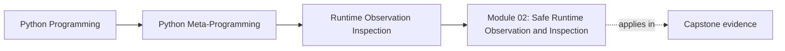

# Module 02: Safe Runtime Observation and Inspection

<!-- page-maps:start -->
## Page Maps




<!-- page-maps:end -->

Module 02 takes the object model from Module 01 and turns it into a review discipline:
how to inspect runtime objects without accidentally executing the very behavior you are
trying to observe.

This is a complete teaching unit, not preparation notes for reading the capstone. The
five cores define distinct observation questions, the runtime-observation lab makes
boundary crossings countable, the worked example applies those choices to a debugging
tool, and the exercises require a reviewable decision packet. The capstone comes last as
an integration check.

## What this module is for

By the end of Module 02, you should be able to explain five things clearly:

- why attribute access is a protocol and not automatically passive
- how visible names differ from physically stored state
- why dynamic attribute access is powerful but unsafe as casual inspection
- when exact type checks differ from polymorphic classification
- how static lookup fits into a disciplined observation workflow

You should also be able to defend one higher-level judgment:

> when does a tool need attachment truth, when does it need stored-state truth, and when
> is it intentionally crossing into runtime execution?

## Keep these pages open

- [First-Contact Map](../module-00-orientation/first-contact-map.md)
- [Proof Ladder](../guides/proof-ladder.md)
- [Practice Map](../reference/practice-map.md)
- [Capstone Map](../capstone/capstone-map.md)

## How to spend the day

Use this sequence on purpose instead of reading pages as isolated notes:

1. read the overview and name the runtime question you keep confusing in real life
2. run `make observation-lab` and save the five before-state packets
3. study the five core lessons in order, comparing each claim with its matching packet
4. trace the packet implementation and focused test before changing either
5. walk through the worked example and mark where the helper changes from observation into execution
6. do the exercises in order and keep one decision packet as you go
7. use the answer key only after you have written your own runtime question, tool choice, and evidence route
8. transfer the workflow to the incident-plugin inspection commands

If you skip the lab or exercises, the module usually feels clearer than it really is. The ideas do
not stabilize until you have compared names, storage, static lookup, and dynamic lookup on
one concrete object and explained what executed.

## Run the observation lab

From `programs/python-programming/python-meta-programming`:

```console
$ make observation-lab
{
  "dynamic_access": {
    "property_reads_after_static_lookup": 0,
    "property_reads_after_dynamic_lookup": 1,
    "property_reads_after_hasattr": 2,
    ...
  },
  ...
}
$ make observation-lab-test
Ran 7 tests

OK
```

All five packets use objects defined in `labs/runtime_observation/evidence.py`.
Side-effect counters make the safety claim observable:

- zero reads means the structural question stayed observational
- a rising counter marks the exact operation that executed a property or fallback hook
- the tests prove the expected boundary, not that arbitrary inspection is universally safe

## The published lesson set

1. Overview (`index.md`)
2. [Visible Names and Stored State](visible-names-and-stored-state.md)
3. [Dynamic Attribute Access Is Not Inspection](dynamic-attribute-access-is-not-inspection.md)
4. [Exactness and Polymorphism in Runtime Type Checks](exactness-and-polymorphism-in-runtime-type-checks.md)
5. [Callable Objects and the Call Protocol](callable-objects-and-the-call-protocol.md)
6. [Static Lookup and Disciplined Observation](static-lookup-and-disciplined-observation.md)
7. [Worked Example: Building a Safer Debug Printer](worked-example-building-a-safer-debug-printer.md)
8. [Exercises](exercises.md)
9. [Exercise Answers](exercise-answers.md)
10. [Glossary](glossary.md)

The executable companion is `labs/runtime_observation/`, with claim-level proof in
`tests/test_runtime_observation_lab.py`.

## How to use the lesson set

| If you need to... | Start here |
| --- | --- |
| separate candidate names from actual stored state | [Visible Names and Stored State](visible-names-and-stored-state.md) |
| inspect attributes without forgetting that lookup can execute code | [Dynamic Attribute Access Is Not Inspection](dynamic-attribute-access-is-not-inspection.md) |
| choose between `type`, `isinstance`, and `issubclass` honestly | [Exactness and Polymorphism in Runtime Type Checks](exactness-and-polymorphism-in-runtime-type-checks.md) |
| decide whether an object can be called and what that claim really means | [Callable Objects and the Call Protocol](callable-objects-and-the-call-protocol.md) |
| keep runtime observation disciplined with static lookup when needed | [Static Lookup and Disciplined Observation](static-lookup-and-disciplined-observation.md) |
| see the safety boundary tested in one realistic debugging tool | [Worked Example: Building a Safer Debug Printer](worked-example-building-a-safer-debug-printer.md) |
| produce all five controlled evidence packets | `make observation-lab` |
| verify the observation boundaries after an edit | `make observation-lab-test` |
| test your understanding before moving to Module 03 | [Exercises](exercises.md) |
| compare your reasoning against a reference answer | [Exercise Answers](exercise-answers.md) |
| stabilize the module vocabulary | [Glossary](glossary.md) |

## Inspection packet to build while you study

By the end of the module, leave behind one small review packet:

- one observation table that lists the runtime question, candidate tool, risk, and evidence
- one object where `dir`, `vars`, static lookup, and dynamic lookup give meaningfully different results
- one fallback-hook or property demo that proves why dynamic access is behavior
- one inspection workflow ordered from least risky to most invasive
- one repaired helper rule that keeps default tooling observational

If your notes do not produce those five artifacts, you probably understood the prose but
did not yet build a reusable inspection habit.

## The running question

Carry this question through every page:

> Am I discovering structure, reading stored state, or executing runtime behavior?

Strong Module 02 answers usually mention one or more of these:

- a best-effort name list from `dir`
- stored state from `vars(obj)` or `obj.__dict__`
- risky value resolution through `getattr` or `hasattr`
- exact versus polymorphic type checks
- static lookup when tooling must avoid triggering descriptors or fallback hooks

Weak Module 02 answers usually sound like one of these:

- "I just checked whether the attribute exists."
- "I inspected the object with `getattr`."
- "I used `type` because I wanted to be precise."
- "I used `callable` so I know the call is safe."

Each of those sentences hides the real runtime question. This module is here to stop that
kind of blur.

## Learning outcomes

By the end of this module, you should be able to:

- inspect runtime objects without casually triggering business behavior
- explain the safety difference between names, storage, and resolved values
- choose the least risky observation tool that answers the real question
- use capstone inspection surfaces as evidence before reading implementation details

## Capstone transfer: inspect before invoking

After the small lab is explainable, compare two capstone routes:

```console
make capstone-manifest
make demo
```

`capstone-manifest` reports registered fields and actions without invoking an incident
delivery action. `demo` constructs a plugin and deliberately calls `deliver`. Read that
as an observation-to-execution boundary, not merely as two convenient commands.

The focused proof is
`capstone/tests/test_runtime.py::test_manifest_does_not_construct_or_invoke_registered_plugin`.
It registers a plugin whose constructor and action record runtime events, builds the
manifest, and proves that the event record stays empty.

The capstone already contains descriptors, decorators, and a metaclass. Module 02 does
not yet justify those mechanisms. Its transfer question is narrower:

> which public route reports structure, which route executes application behavior, and
> what evidence lets a reviewer tell the difference?

## Mid-module pressure points

Watch for these specific misunderstandings while you study:

| Pressure point | What usually goes wrong | Repair route in this module |
| --- | --- | --- |
| name discovery | learners assume `dir(obj)` proves storage or future lookup success | return to [Visible Names and Stored State](visible-names-and-stored-state.md) |
| existence checks | learners treat `hasattr` as passive probing | return to [Dynamic Attribute Access Is Not Inspection](dynamic-attribute-access-is-not-inspection.md) |
| type precision | learners use exact type checks when the real question is role compatibility | return to [Exactness and Polymorphism in Runtime Type Checks](exactness-and-polymorphism-in-runtime-type-checks.md) |
| callability | learners mistake "call is permitted" for "call is valid and safe" | return to [Callable Objects and the Call Protocol](callable-objects-and-the-call-protocol.md) |
| tool design | learners let debug helpers resolve values before they understand attachment structure | return to [Static Lookup and Disciplined Observation](static-lookup-and-disciplined-observation.md) |

## Exit standard

Do not move on until all of these are true:

- you can explain why attribute access is not automatically passive
- you can separate visible names, stored state, and resolved values
- you can say when `getattr`, `hasattr`, and `inspect.getattr_static` answer different questions
- you can describe one debugging or tooling scenario where static lookup is the safer first move
- you can run the observation lab, identify which counters should remain zero, and
  explain what each focused test does not prove
- you can distinguish the capstone manifest route from the invocation route without
  treating the capstone as the lesson itself

If you want one final self-test before moving on, answer this without looking anything up:

> A debugging helper says it only "prints object fields," but it uses `dir(obj)` followed
> by `getattr(obj, name)` on every name. What truths is it actually discovering, and where
> has it already crossed from observation into behavior?

When those feel ordinary, Module 02 has done its job and Module 03 can deepen the
inspection story with `inspect`, signatures, and provenance.
