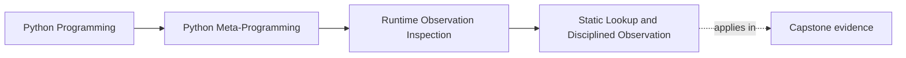

# Static Lookup and Disciplined Observation


<!-- page-maps:start -->
## Page Maps




<!-- page-maps:end -->

The earlier pages in Module 02 teach separate boundaries:

- names are not stored state
- dynamic attribute access is not passive
- classification tools answer different questions
- callability is only a limited claim

This page turns those ideas into one repeatable observation workflow and introduces the
most important preview tool for that workflow:

`inspect.getattr_static`

For a missed-class learner, this page should feel like the module clicking into one
coherent habit. The earlier lessons each removed one confusion. This one turns them into a
least-risk inspection route you can actually reuse.

## The sentence to keep

When you inspect runtime objects for tooling or review, ask:

> do I need the value normal lookup would produce, or do I need the raw thing attached to
> the object without executing lookup behavior?

That is the static-versus-dynamic boundary in one sentence.

Keep one stronger version nearby:

> choose static lookup when attachment truth is enough, and choose dynamic lookup only
> when you intentionally want the object's runtime behavior.

## Dynamic lookup answers the runtime-behavior question

Normal attribute access and `getattr(obj, name)` answer:

> what happens if I let Python run the attribute protocol?

That can involve:

- descriptors
- `__getattribute__`
- `__getattr__`
- proxy logic
- metaclass behavior for class attributes

Sometimes that is exactly what you want. Often, tooling wants a narrower and safer
question.

That is why this lesson matters so much for educational tooling, admin panels, plugin
loaders, serializers, and debug helpers. Those surfaces often need to describe an object
without accidentally "using" it.

## Static lookup answers a tooling question

`inspect.getattr_static(obj, name)` aims to retrieve the raw attribute or descriptor
without triggering normal attribute resolution behavior.

That makes it useful when you need to inspect what is attached rather than what executing
lookup would return.

Typical cases:

- debugging tools
- schema or manifest builders
- documentation helpers
- review utilities that should avoid business behavior

This is not a claim that static lookup is perfect or universal. It is a claim that the
question is different, and the tool matches that different question.

Use this decision table while you study:

| If your question is... | Better first move | Why |
| --- | --- | --- |
| "What names might be relevant?" | `dir(obj)` | discovery is enough |
| "What state is locally stored?" | `vars(obj)` or storage inspection | asks the storage question directly |
| "What raw attribute object is attached here?" | `inspect.getattr_static` | attachment truth without normal protocol execution |
| "What value would normal lookup produce?" | `getattr(obj, name)` | this is the moment you intentionally cross into behavior |

## One picture of the boundary

```text
Dynamic read
  getattr(obj, "x")
  -> run normal attribute protocol

Static read
  inspect.getattr_static(obj, "x")
  -> inspect the attached object without normal protocol execution
```

Caption: debugging and tooling often want attachment truth, not execution truth.

## A property shows the difference clearly

```python
import inspect


class Demo:
    @property
    def value(self):
        print("property executed")
        return 10


obj = Demo()

raw = inspect.getattr_static(obj, "value")
assert isinstance(raw, property)

resolved = getattr(obj, "value")
assert resolved == 10
```

The printed line only appears during the dynamic read. That is the runtime boundary:

- static lookup reveals the property object
- dynamic lookup executes the property

That difference is the teaching core of the page. A beginner who says "both lines got the
attribute" has missed the boundary. One line observed attachment structure. The other line
ran runtime behavior.

## Static lookup is not the first tool for every question

This module is not arguing that static lookup should replace everything else.

A disciplined workflow usually looks like this:

1. discover candidate names with `dir(obj)` when needed
2. inspect stored state with `vars(obj)` or `obj.__dict__` when available
3. use `type`, `isinstance`, or `issubclass` for the classification question you really mean
4. resolve values dynamically only when you actually need the runtime behavior
5. use static lookup when tooling must avoid triggering descriptors or fallback hooks

That workflow keeps the risk of observation proportional to the question being asked.

It also gives you a reusable review order:

1. discover
2. inspect storage
3. classify
4. inspect attachment structure
5. execute behavior only on purpose

If a helper jumps straight to step 5, it should have to justify that jump.

## Static lookup improves honesty in tooling

Suppose you are building a debug printer, plugin manifest, or field inspector.

If you use dynamic reads by default, your tool may:

- execute properties
- trigger lazy-loading behavior
- trigger network or file access hidden behind `__getattr__`
- accidentally mutate caches or other state while "observing"

If you use static lookup where appropriate, the tool can say something narrower and more
honest:

> here is the raw attribute object attached to this instance or class, without running its
> normal access behavior.

That is often the right default for observability tools.

## Misreadings this page should correct

These are the most common weak conclusions after a first read:

| Weak conclusion | Why it is weak | Better repair |
| --- | --- | --- |
| "Static lookup is always safer, so use it everywhere." | some questions genuinely need runtime semantics | choose by question, not by blanket preference |
| "`inspect.getattr_static` gives me the real value." | it may give a property, descriptor, or raw function object | say it gives attachment truth, not necessarily resolved value truth |
| "Dynamic lookup is bad." | dynamic lookup is the right tool when you intentionally need runtime behavior | treat it as a deliberate later step, not a forbidden one |
| "Static lookup solved the tool design." | policy still matters for display, evaluation, and fallback behavior | decide what to show, evaluate, or defer explicitly |

## Static lookup still needs interpretation

Static lookup does not remove the need for judgment.

It may return:

- a property object
- a slot descriptor
- a function stored on the class
- a plain value

The tooling still has to decide what to show and what to execute, if anything.

That is why Module 02 treats static lookup as part of a workflow, not as a silver bullet.

One useful self-check is to ask:

> after static lookup returns this object, what will my tool do next, and does that next
> step preserve the same risk boundary or cross into execution?

## Module 03 will deepen this story

This page is only a preview, not the final `inspect` module lesson.

Module 03 will expand the tooling story around:

- signatures
- provenance
- stronger runtime evidence
- more explicit static-versus-dynamic distinctions

Module 02 only needs enough of the idea to make observation discipline real.

## One realistic self-study lab

Build one object that has all three of these:

- a property
- one ordinary stored attribute
- one fallback hook such as `__getattr__`

Then write a four-row packet:

- the question you asked
- the tool you chose first
- what evidence that tool produced
- whether the tool stayed observational or crossed into behavior

If your packet never names the crossing point, the workflow is still too implicit.

## Review rules for disciplined observation

When reviewing tooling or runtime-inspection code, keep these questions close:

- does the code need raw attachment truth or normal runtime behavior?
- is a dynamic read being used where static lookup would better match the tool's purpose?
- has the workflow separated discovery, stored-state inspection, classification, and execution?
- is the code explicit about when it chooses to evaluate descriptors or properties?
- does the tool fail honestly when a surface is unavailable instead of quietly executing more protocol?

One final pressure question:

> If a tool says it is "only inspecting" but its first move is `getattr(obj, name)`, what
> stronger evidence would you want before believing that claim?

## What to practice from this page

Try these before moving on:

1. Compare `inspect.getattr_static(obj, "x")` with `getattr(obj, "x")` on a property.
2. Write down one tooling situation where dynamic lookup is the right choice and one where static lookup is the right choice.
3. Turn the five-step workflow above into a checklist you could use during code review.

If those feel ordinary, the worked example can pressure-test the workflow in a realistic
debug-printing tool.

## Continue through Module 02

- Previous: [Callable Objects and the Call Protocol](callable-objects-and-the-call-protocol.md)
- Next: [Worked Example: Building a Safer Debug Printer](worked-example-building-a-safer-debug-printer.md)
- Practice: [Exercises](exercises.md)
- Terms: [Glossary](glossary.md)
