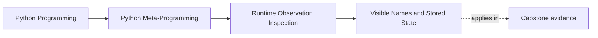
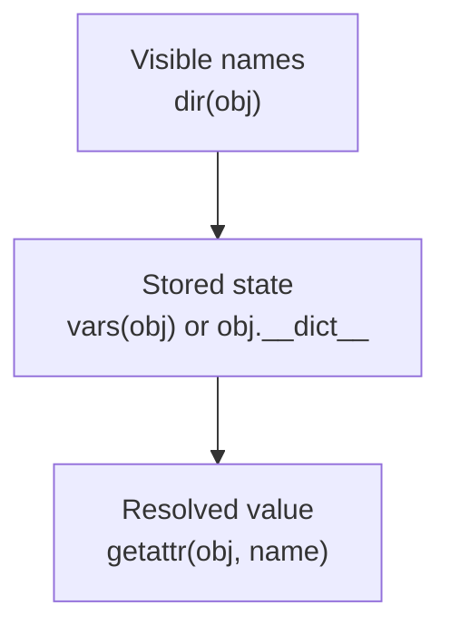

# Visible Names and Stored State


<!-- page-maps:start -->
## Page Maps




<!-- page-maps:end -->

The safest early observation habit in Python is learning not to ask one vague question
about an object.

Instead, separate these questions:

1. what names might be meaningful here?
2. what state is physically stored on this object right now?
3. what value would normal attribute lookup produce?

This page focuses on the first two. That separation prevents a large share of
introspection mistakes before `getattr` even enters the picture.

For many beginners, this is the first place Python introspection becomes slippery. The
object seems to "have" a method, property, slot, or inherited name, so it is tempting to
assume all of those live in one simple bucket. They do not. This page exists to break
that false picture early.

## The sentence to keep

When you inspect an object, ask:

> am I discovering candidate names, or am I reading stored state?

If you do not separate those questions, you will eventually mistake one for the other and
reach for a riskier tool than you needed.

Keep one repair sentence in front of you while you read:

> A visible name is a candidate for lookup, not proof of local storage.

## The four surfaces that matter first

Module 02 starts with four basic surfaces:

- `dir(obj)` for best-effort name discovery
- `vars(obj)` for attribute dictionaries when they exist
- `obj.__dict__` for direct stored-state access when present
- `__slots__` for classes that replace dictionary-backed instance storage with a fixed layout

These are related, but they are not interchangeable.

Use them as a review ladder:

| If your question is... | First tool | Why this is the honest first move |
| --- | --- | --- |
| "What names might matter here?" | `dir(obj)` | discovery is enough; you are not claiming storage or value resolution |
| "What is physically stored on this object?" | `vars(obj)` | it asks the storage question directly and fails honestly when no dictionary exists |
| "Does this class use slot-backed storage?" | class definition or slot descriptors | storage model matters before you guess about dictionaries |
| "What value would normal lookup produce?" | not this page yet | value resolution is a different question and belongs to later steps |

## `dir(obj)` discovers names, not truth

`dir(obj)` returns a best-effort list of names that may be meaningful on the object.

That list may draw from:

- the instance
- the class
- base classes in the MRO
- a custom `__dir__` implementation

Two review points matter:

- treat the result like a discovery aid, not a contract
- do not rely on ordering as semantic meaning

CPython often sorts the result, but that is a debugging convenience rather than a promise
the module should teach as truth.

This matters because beginners often read `dir(obj)` as if it were a compact object
inventory. It is not. It is closer to "here are names the runtime thinks may be relevant
for lookup or tooling."

## `vars(obj)` and `obj.__dict__` read stored state when it exists

`vars(obj)` returns the object's attribute dictionary when one exists.

Typical cases:

- instances usually expose a mutable dictionary
- modules expose a mutable dictionary
- classes expose a namespace view

If the object has no attribute dictionary, `vars(obj)` raises `TypeError`.

That matters because `vars(obj)` answers a much narrower and more honest question than
`dir(obj)`:

> what is physically stored on this object right now?

It does not tell you everything lookup could resolve. It tells you what storage is
present.

That narrower question is a strength, not a limitation. Review work gets safer the moment
you stop asking one oversized question like "what does this object have?"

## `__slots__` changes the storage model

When a class declares `__slots__`, instance storage may move out of a per-instance
dictionary into fixed slot storage.

That means:

- the instance may still expose discoverable names in `dir(obj)`
- `vars(obj)` may fail because no `__dict__` exists
- generic tools that assume dictionaries can break

This is one reason Module 02 keeps names and storage separate. Slots make the difference
visible immediately.

They also expose a frequent tooling bug: helpers written against ordinary instance
dictionaries quietly become wrong the moment a class chooses a tighter storage model.

## One picture of discovery versus storage versus resolution



Caption: discovery is not storage, and storage is not normal attribute resolution.

One good study habit is to say out loud which arrow you are on before you run a tool:

- discovery
- storage
- resolution

That tiny pause prevents many false "inspection" claims.

## Example: discoverable names can exceed stored state

```python
class Explorer:
    def __init__(self):
        self.instance_only = "personal"

    def method(self):
        return "ok"


e = Explorer()

assert "instance_only" in vars(e)
assert "method" not in vars(e)
assert "method" in dir(e)
```

The method is discoverable because the class provides it, but it is not physically stored
in the instance dictionary.

That difference is ordinary and important.

It also explains why many first debug helpers overreport object "fields." They mix class
provided names with local state and present the whole set as if it were one storage view.

## Example: slotted instances are visible without being dict-backed

```python
class Slotted:
    __slots__ = ("x", "y")

    def __init__(self, x, y):
        self.x = x
        self.y = y


s = Slotted(1, 2)

assert "x" in dir(s)

try:
    vars(s)
except TypeError:
    missing_dict = True
else:
    missing_dict = False

assert missing_dict is True
```

This is a good reminder that visibility and storage are different questions.

A learner who misses this point often says something like "the object has `x`, so `vars`
should show it." Slot-backed classes are the quickest counterexample to that mistaken
expectation.

## `dir()` is not fully passive

Even the safer-looking discovery tool has a boundary:

```python
class Noisy:
    def __dir__(self):
        print("dir called")
        return ["safe"]


dir(Noisy())
```

That is why Module 02 treats `dir()` as lower risk than value resolution, not as
zero-risk. A custom `__dir__` method can still execute code.

So the safety claim for `dir()` must stay precise:

- usually safer than dynamic value reads
- still not a formal no-execution guarantee
- useful for discovery, not for proving storage or runtime semantics

## Prefer `vars(obj)` over probing for `__dict__` with `hasattr`

A common anti-pattern is:

```python
if hasattr(obj, "__dict__"):
    state = obj.__dict__
```

That is weaker than it looks because `hasattr` itself performs attribute access and can
run user code.

The safer pattern is:

```python
try:
    state = vars(obj)
except TypeError:
    state = None
```

This is a recurring Module 02 habit:

- ask the narrower question directly
- let the specific tool fail honestly
- avoid general probing that executes more protocol than needed

## Classes expose namespace views, not plain instance-style state

For classes, `vars(cls)` and `cls.__dict__` usually expose a namespace view rather than a
plain mutable instance dictionary.

That view is often a `mappingproxy` on CPython:

- it reflects the class namespace
- it is read-only as a mapping interface
- class assignment still mutates the underlying namespace

This is another reason to keep the storage question narrow. "Stored state" has slightly
different shapes across instances, modules, and classes.

## A deliberate inspection route for beginners

When you meet an unfamiliar object, use this order before you touch `getattr`:

1. ask whether you need candidate names, local storage, or resolved values
2. run `dir(obj)` only if candidate names are enough for the next decision
3. run `vars(obj)` if your question is about dictionary-backed state
4. inspect the class for `__slots__` or class-provided attributes when `vars(obj)` is not enough
5. postpone value resolution until you can explain why discovery and storage did not answer the question

This route is intentionally conservative. It makes you earn the move into dynamic
behavior instead of drifting there by habit.

## Misreadings to catch during review

These are the most common wrong inferences from this page:

| Wrong inference | Why it is wrong | Better statement |
| --- | --- | --- |
| "`dir(obj)` shows everything the object stores." | `dir` merges candidate names from several places and may include inherited or synthetic names. | "`dir(obj)` shows names that may matter for lookup." |
| "`vars(obj)` failed, so the object has no meaningful state." | slot-backed or builtin storage can exist without an instance dictionary. | "`vars(obj)` failed, so this object is not exposing dictionary-backed state." |
| "If a method appears in `dir(obj)`, it must be stored on the instance." | class-provided names are discoverable without local storage. | "The method is visible through the class lookup story, not local instance storage." |
| "Using `hasattr(obj, \"__dict__\")` is a harmless way to check storage." | `hasattr` already participates in attribute access. | "Ask the storage question directly with `vars(obj)` or inspect the class model." |

## Review rules for this boundary

When reviewing runtime observation code, keep these questions close:

- is the tool trying to discover candidate names or read actual stored state?
- is `dir()` being treated like a truth source instead of a discovery helper?
- is `hasattr` being used where a direct `vars()` or explicit try/except would be safer?
- does the code handle slotted objects honestly instead of assuming every instance has a dictionary?
- does the review distinguish instance storage from class-provided names?

## What to practice from this page

Try these before moving on:

1. Write `state_view(obj)` that returns `set(dir(obj))` plus `vars(obj)` when available.
2. Run it on a normal instance, a slotted instance, and a builtin such as `list()`.
3. Explain one attribute that appears in `dir(obj)` but not in stored state.
4. Write one sentence explaining why a missing `__dict__` does not prove missing state.

If those feel ordinary, you are ready for the next boundary: dynamic attribute access is
powerful, but it is not passive inspection.

## Continue through Module 02

- Previous: [Overview](index.md)
- Next: [Dynamic Attribute Access Is Not Inspection](dynamic-attribute-access-is-not-inspection.md)
- Practice: [Exercises](exercises.md)
- Terms: [Glossary](glossary.md)
