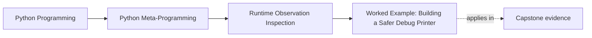

# Worked Example: Building a Safer Debug Printer


<!-- page-maps:start -->
## Page Maps




<!-- page-maps:end -->

The five core lessons in Module 02 become much easier to trust when they all appear in
one realistic tool.

This example uses a debugging helper because it creates exactly the right pressure:

- the tool wants to inspect runtime state
- the caller expects observation, not business behavior
- ordinary attribute access would quietly execute descriptors and fallback hooks

That is the right place to make the static-versus-dynamic boundary concrete.

For a self-study learner, the debug printer is also useful because it looks harmless. That
is exactly why it teaches so well. Many weak runtime tools begin with a sentence like "it
just prints fields," and then quietly become accidental execution engines.

## The incident

Assume a team wants a helper called `debug_print()` for quick runtime inspection during an
incident review.

The original helper does what many first versions do:

- it loops through names from `dir(self)`
- it reads values with `getattr(self, name)`
- it recursively prints nested objects

The team reports four problems:

1. properties execute during debugging
2. dynamic fallback hooks run even when nobody wanted business behavior
3. slotted objects are awkward to inspect
4. recursive object graphs can loop forever

Every one of those problems is a Module 02 problem, not just a formatting problem.

Use the incident as a review packet, not just as a code sample:

| Reported symptom | Hidden boundary mistake |
| --- | --- |
| properties execute during debugging | dynamic lookup was treated as passive inspection |
| fallback hooks run unexpectedly | the helper asked for resolved values too early |
| slotted objects feel inconsistent | the helper assumed dictionary-backed storage |
| recursive graphs loop forever | the tool crossed into object walking without an explicit policy |

## The first mistake: treating value resolution as observation

The inherited sketch looks plausible:

```python
def debug_print(self):
    for name in dir(self):
        value = getattr(self, name)
        print(name, value)
```

That helper looks observational, but it is already executing the attribute protocol.

So the first repair is conceptual:

> a debug printer should not use dynamic reads by default unless executing runtime behavior
> is the stated goal.

That is the same boundary the module has been drawing all along.

If you remember only one thing from the worked example, remember that sentence. Most
runtime-inspection bugs are policy bugs before they are implementation bugs.

## Step 1: separate name discovery from value resolution

`dir(self)` can still be useful for candidate names, with one caveat: it may call a
custom `__dir__` implementation.

That is acceptable as a lower-risk discovery step, but it should not be confused with
stored state or resolved values.

The workflow becomes:

1. discover candidate names
2. inspect attached objects statically
3. evaluate dynamic values only when the tool is explicitly configured to do so

That one shift changes the honesty of the whole helper.

It also changes the user contract. The tool can now say:

- "by default I will show structure"
- "with an explicit flag I will evaluate selected runtime values"

That is a much better educational and operational promise than "I print everything."

## Step 2: switch the default read path to static lookup

The most important repair is using `inspect.getattr_static` for default reads.

```python
import inspect


raw = inspect.getattr_static(obj, "name")
```

Why this is better:

- properties stay as property objects unless explicitly evaluated
- `__getattr__` is not triggered during default inspection
- class-attached descriptors remain visible as attached objects

This is the core of the worked example:

> debugging tools usually want attachment truth first, not execution truth.

That sentence should shape your review of any future serializer, admin panel, inspector,
or object browser. They all face the same temptation to resolve values too early.

## Step 3: decide what to do with descriptors

Once static lookup is the default, the tool still needs policy.

For example:

- show property objects without evaluating them
- optionally evaluate properties behind an explicit flag
- read slot descriptors carefully when you want actual slot values

That policy is clearer than pretending every attribute read is harmless.

A good learner-facing rewrite is to make the policy visible in a table:

| Surface encountered | Default behavior | Optional behavior |
| --- | --- | --- |
| plain stored value | show it | same |
| property | show the property object | evaluate only behind an explicit flag |
| slot descriptor | identify the descriptor | read the slot value deliberately |
| fallback hook | do not trigger it by default | trigger only in a deliberate runtime mode |

## Step 4: make recursion explicit and bounded

Naive debug printers often recurse into everything, which creates two kinds of trouble:

- giant unreadable output
- infinite loops on cyclic graphs

A safer design makes recursion explicit:

- recurse only into known safe opt-in objects
- keep a visited set
- enforce a maximum depth

Those are not cosmetic concerns. They are part of making the tool behave like a debugging
tool instead of like an accidental object walker with side effects.

## Start with the executable non-recursive baseline

Before studying the larger mixin below, run the course implementation:

```console
$ make observation-debug-view
[
  {
    "display": "<routine>",
    "kind": "routine",
    "name": "acknowledge",
    "owner": "IncidentObservationTarget"
  },
  {
    "display": "<property>",
    "kind": "property",
    "name": "risk_score",
    "owner": "IncidentObservationTarget"
  },
  {
    "display": "'queue lag'",
    "kind": "stored-value",
    "name": "title",
    "owner": "instance"
  }
]
```

The implementation in `labs/runtime_observation/debug_view.py` deliberately does less
than the final mixin:

- it discovers instance and class attachments without calling custom `__dir__`
- it reads each candidate with `inspect.getattr_static`
- it labels properties, routines, slots, and stored scalar values
- it enforces a maximum number of names
- it does not recurse or evaluate descriptors

That smaller contract is executable and tested. Read
`test_debug_view_does_not_evaluate_property_or_fallback` before modifying it: both
side-effect counters must remain zero.

### What the baseline proves

The output proves that this tool can show attachment ownership without resolving the
property or triggering fallback lookup. It also proves that the output bound is enforced
and slot attachments are reported as structure.

It does not prove that `repr()` is safe for arbitrary values, that class namespaces never
change concurrently, or that recursive observation is safe. The implementation avoids
calling arbitrary `repr()` by displaying only scalar stored values directly.

### Why the larger version still matters

The mixin below explores opt-in property evaluation, slot reads, and bounded recursion.
Those features introduce new policies and failure paths. Treat it as an extension design
to review against the executable baseline:

| Added capability | New cost to review |
| --- | --- |
| property evaluation | descriptor code can run |
| slot value reads | descriptor access can fail |
| recursion | cycles, depth, and output growth need policy |
| general representation | user-defined `__repr__` may execute |

Do not copy the larger implementation until you can say which added capability your tool
actually needs.

## A healthier implementation

```python
import inspect
from types import MemberDescriptorType
from typing import Any


class DebugMixin:
    def debug_print(
        self,
        *,
        max_depth: int = 3,
        _depth: int = 0,
        _visited: set[int] | None = None,
        indent: int = 0,
        eval_properties: bool = False,
        show_dunder: bool = False,
    ) -> None:
        if _visited is None:
            _visited = set()

        obj_id = id(self)
        if obj_id in _visited:
            print(" " * indent + f"<Revisited id={obj_id}>")
            return
        _visited.add(obj_id)

        t = type(self)
        print(" " * indent + f"{t.__name__}(id={obj_id}) " + "{")

        if _depth >= max_depth:
            print(" " * (indent + 2) + "[Max depth reached]")
            print(" " * indent + "}")
            return

        for name in sorted(dir(self)):
            if not show_dunder and name.startswith("__"):
                continue

            if name == "debug_print":
                try:
                    raw_dbg = inspect.getattr_static(self, name)
                    if raw_dbg is DebugMixin.debug_print:
                        continue
                except Exception:
                    pass

            try:
                raw = inspect.getattr_static(self, name)
            except AttributeError:
                print(" " * (indent + 2) + f"{name}: <missing>")
                continue

            value: Any

            if isinstance(raw, MemberDescriptorType):
                try:
                    value = raw.__get__(self, t)
                except Exception as exc:
                    value = f"<slot read error {type(exc).__name__}: {exc}>"
            elif isinstance(raw, property):
                if eval_properties:
                    try:
                        value = raw.__get__(self, t)
                    except Exception as exc:
                        value = f"<property error {type(exc).__name__}: {exc}>"
                else:
                    value = raw
            else:
                value = raw

            is_primitive = isinstance(value, (int, float, str, bool, type(None)))
            rep = repr(value)
            rep = rep if len(rep) <= 80 else rep[:77] + "..."

            prefix = "" if is_primitive else f"{type(value).__name__} "
            print(" " * (indent + 2) + f"{name}: {prefix}{rep}")

            if (
                not is_primitive
                and not callable(value)
                and isinstance(value, DebugMixin)
            ):
                value.debug_print(
                    max_depth=max_depth,
                    _depth=_depth + 1,
                    _visited=_visited,
                    indent=indent + 4,
                    eval_properties=eval_properties,
                    show_dunder=show_dunder,
                )

        print(" " * indent + "}")
```

## Why this version is better

The repaired helper is stronger because it makes its observation policy explicit:

- discovery comes from `dir`
- default reads come from `inspect.getattr_static`
- property execution is opt-in
- slot values are handled deliberately
- recursion is bounded and cycle-aware

It is still not magic. It is just honest about what it is observing and when it crosses
into execution.

## How to read the implementation without getting lost

If the code block feels dense, walk it in this order:

1. locate the visited-set guard and note that recursion has an explicit boundary
2. find the `inspect.getattr_static` call and mark it as the default read path
3. find the property branch and notice that evaluation is opt-in
4. find the slot-descriptor branch and notice that slot reads are treated specially
5. find the recursion branch and notice that only specific non-primitive values recurse

That reading order turns one long code listing into five policy decisions.

## What this example teaches about Module 02

This worked example ties the module together:

- names are not the same as stored state or resolved values
- dynamic reads execute runtime behavior
- static lookup is the right default for many tools
- callability still matters because recursion and display policy should not blindly invoke values
- disciplined observation is a workflow, not one builtin

That is the real win. A safer debug printer is just one concrete place where the module's
observation rules prove their value.

## A review packet to leave behind after this example

When you finish the worked example, you should be able to write these five short notes
without rereading the page:

- one sentence explaining why `dir` is only a discovery step
- one sentence explaining why `inspect.getattr_static` is the default read path
- one sentence explaining when the helper intentionally crosses into behavior
- one sentence explaining why slot-backed objects need special handling
- one sentence explaining how the recursion policy protects the tool from becoming an object walker

If you cannot write those notes cleanly, the code probably felt more convincing than it
was actually understood.

## The review loop to keep

When you inherit a runtime-inspection helper, run this loop:

1. identify whether it discovers names, reads state, or resolves values
2. mark every dynamic read that may execute code
3. move default inspection paths toward static lookup where appropriate
4. make evaluation, recursion, and display policy explicit

One final pressure question:

> If a team says "our debug helper is safe because it only runs in development," which
> risk boundary from this example are they failing to name?

If you can do that here, Module 02 has done its job and Module 03 can build on a much
cleaner observation discipline.

## Continue through Module 02

- Previous: [Static Lookup and Disciplined Observation](static-lookup-and-disciplined-observation.md)
- Next: [Exercises](exercises.md)
- Reference: [Exercise Answers](exercise-answers.md)
- Terms: [Glossary](glossary.md)
