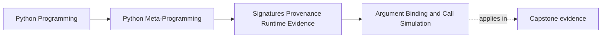
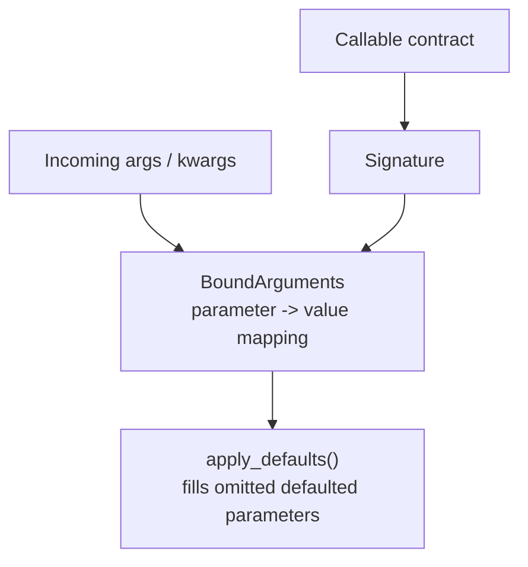

# Argument Binding and Call Simulation


<!-- page-maps:start -->
## Page Maps




<!-- page-maps:end -->

Knowing a callable's signature is useful. Using that signature to simulate real call
matching is where Module 03 starts paying off in wrappers, validators, RPC adapters, and
tooling.

This page focuses on the binding helpers attached to `Signature` objects:

- `.bind()`
- `.bind_partial()`
- `BoundArguments`
- `.apply_defaults()`

Treat this as the page where signature evidence becomes operational. A learner who
understands signatures but still hand-matches arguments has not yet internalized the
main discipline of the module.

## The sentence to keep

When a wrapper, validator, or adapter needs to understand a call, ask:

> can I let `Signature.bind()` do the interpreter-like matching instead of reimplementing
> it myself?

The answer should usually be yes.

Keep one second question beside it:

> do I need full call validation, or am I deliberately working with a partial future call?

## Why binding matters

Decorators and adapters often need to answer questions like:

- did the caller satisfy the required arguments?
- which value ended up bound to which parameter?
- did the caller try to pass a positional-only parameter by keyword?
- which defaults should be filled in before validation or logging?

Those are argument-matching questions, not merely signature-display questions.

`bind()` exists so tools can reuse Python's own call rules instead of inventing partial,
inconsistent copies of them.

That matters most in the places self-study learners often forget:

- positional-only parameters
- keyword-only parameters
- duplicate value assignment
- missing required arguments
- the difference between explicitly provided values and default-filled values

## `bind()` versus `bind_partial()`

The two binding helpers answer related but different questions:

- `sig.bind(*args, **kwargs)` requires all required arguments to be present
- `sig.bind_partial(*args, **kwargs)` allows required arguments to remain unbound

That makes the split useful:

- `bind()` is the right default for call validation and forwarding
- `bind_partial()` is useful for staged application, partial wrappers, or progressive configuration

Use this decision table when the choice feels fuzzy:

| If the tool needs to know... | Better helper | Why |
| --- | --- | --- |
| "Would Python accept this call right now?" | `bind()` | full callability is the question |
| "What has been supplied so far in a staged configuration?" | `bind_partial()` | partial state is intentional |
| "Which defaults should be materialized before review or logging?" | `bind()` or `bind_partial()`, then `apply_defaults()` only if needed | default filling is a separate decision from binding itself |

## One picture of binding as call simulation



Caption: binding turns a call attempt into explicit parameter/value relationships using interpreter-like rules.

## A basic example

```python
import inspect


def demo(a, /, b, *, c=False, **kw):
    pass


sig = inspect.signature(demo)
ba = sig.bind(10, 20, extra=1)

assert ba.arguments == {"a": 10, "b": 20, "kw": {"extra": 1}}
```

The important point is not the dictionary itself. It is that the mapping came from
interpreter-aligned matching rules rather than from hand-written parsing logic.

That is the review win. The tool is not merely "using `inspect`." It is reusing the same
binding logic the runtime itself would apply at the call boundary.

## Defaults are not applied automatically

Binding and default application are separate steps:

```python
import inspect


def demo(a, /, b, *, c=False):
    pass


sig = inspect.signature(demo)
ba = sig.bind(10, 20)

assert "c" not in ba.arguments

ba.apply_defaults()
assert ba.arguments["c"] is False
```

That separation matters because some tools want only explicitly supplied arguments, while
others want a complete view including defaults before validation, caching, or logging.

Strong review language here sounds like:

- "we bind first to establish argument truth"
- "we apply defaults only because the next step needs a complete mapping"

Weak review language sounds like:

- "we fill defaults because it seemed easier"
- "we just turn everything into one dict immediately"

## Binding failures are features, not inconveniences

If the call shape is invalid, `bind()` raises `TypeError` with interpreter-like messages.

```python
import inspect


def demo(a, /, b):
    pass


sig = inspect.signature(demo)

try:
    sig.bind(a=10, b=20)
except TypeError as exc:
    print("Expected:", exc)
```

That exception is useful evidence:

- the call shape is wrong
- Python would reject it too
- your wrapper does not need to invent its own slightly different rule

Strong wrapper code usually preserves or lightly adapts these failures rather than
replacing them with vague custom messages.

If a wrapper changes the error text, it should still preserve the same contractual reason
for failure. Otherwise the wrapper becomes harder to trust than the underlying callable.

## Bound arguments are useful beyond validation

Once you have a `BoundArguments` object, you can use it for:

- validation
- tracing and logging
- standardized forwarding
- cache key construction
- documentation or error reporting

This is why binding belongs in Module 03 before decorators. It is one of the cleanest
ways to keep later wrapper behavior honest.

Review checkpoint:

- binding tells you which parameter got which value
- it does not tell you whether the callable body will accept those values semantically
- later validation should start from the bound mapping, not replace it with looser custom reasoning

## A small validation pattern

```python
import inspect


def validate_call(func, *args, **kwargs):
    sig = inspect.signature(func)
    ba = sig.bind(*args, **kwargs)
    ba.apply_defaults()
    return ba.arguments
```

This is intentionally small, but the runtime contract is large:

- cache the signature in real code when repeated calls matter
- let binding establish argument truth
- run later validation against that established mapping

That ordering matters. If validation runs before binding, the validator is often forced to
recreate the very call rules Python already knows.

## Binding is stronger than manual tuple-and-dict reasoning

Many fragile wrappers do some version of:

- count positional arguments manually
- merge keyword arguments manually
- guess whether a name was required
- miss positional-only or keyword-only edges

That is exactly the kind of low-quality reimplementation Module 03 is meant to prevent.

If the runtime already has a precise call-matching model, use the model.

Common weak alternatives to reject explicitly:

- counting positional arguments manually
- merging keyword dictionaries manually
- special-casing "optional" parameters from docstrings or annotations
- assuming a wrapper with `*args, **kwargs` has no recoverable contract

## Guided lab: compare full, failed, and partial binding

Run:

```console
$ python3 -m labs.runtime_evidence |
  python3 -c 'import json, sys; print(json.load(sys.stdin)["binding"])'
{'bound_arguments': {'incident_id': 'INC-42', 'metadata': {'owner': 'platform'}, 'retries': 2, 'severity': 'warning'}, 'evidence_strength': 'strong-call-matching', 'keyword_for_positional_only_rejected': True, 'partial_arguments': {'retries': 3}}
```

The three outcomes answer different questions:

- full binding plus defaults produces the mapping an actual call would receive
- passing `incident_id` by keyword is rejected because the signature marks it
  positional-only
- partial binding accepts only `retries` because the tool is intentionally assembling an
  incomplete call

`strong-call-matching` means Python's argument rules accepted or rejected the shape. It
does not mean the eventual function body succeeds.

### Failure route

Replace `bind()` with `bind_partial()` for the complete-call validation path. A call
missing `incident_id` will now appear acceptable even though actual invocation cannot
proceed. Record the different question partial binding answers, restore full binding, and
run `make evidence-lab-test`.

### Transfer to the incident-plugin runtime

Run the capstone preflight:

```console
$ make capstone-bind-action
{
  "action_name": "deliver",
  "bound_arguments": {
    "severity": "warning",
    "summary": "node-1 crossed 90%",
    "title": "CPU high"
  },
  "executed": false,
  "group": "delivery",
  "plugin_name": "console"
}
```

This is not simulated application success. The public
`bind_action_arguments(...)` API retrieves the registered action's stored
`inspect.Signature`, calls `bind(...)`, applies defaults, and returns the interpreter-
aligned argument mapping. It does not construct the plugin or invoke the action.

The capstone proof uses an event-recording plugin to assert that both side effects remain
absent. Invalid action shapes raise `TypeError` during preflight. Actual action wrappers
use the same binding rule before invocation and history recording, so preflight and
execution do not drift into separate hand-written argument models.

## Review rules for binding logic

When reviewing call-validation or forwarding code, keep these questions close:

- is the code using `bind()` or reimplementing argument matching by hand?
- does the code distinguish full binding from partial binding?
- are defaults applied only when the downstream logic actually needs them?
- are `TypeError` failures from binding preserved clearly enough to remain useful?
- is signature lookup cached in repeated wrapper paths where cost matters?

## Self-study lab

Before leaving this page, write one example in this four-step format:

1. the call attempt
2. the exact binding helper you chose
3. the resulting bound mapping or binding failure
4. one sentence explaining why a hand-written matcher would be weaker here

If the fourth step feels optional, the main lesson has not landed yet.

## What to practice from this page

Try these before moving on:

1. Write a helper that binds a call, applies defaults, and returns the bound mapping.
2. Compare `bind()` with `bind_partial()` on the same signature and explain the difference.
3. Force one binding failure involving a positional-only or keyword-only parameter and
   explain why the failure is a feature.

If those feel ordinary, the next step is provenance: useful evidence about where code came
from, with honest limits.

## Continue through Module 03

- Previous: [Signature Contracts and Parameter Kinds](signature-contracts-and-parameter-kinds.md)
- Next: [Provenance Helpers and Best-Effort Recovery](provenance-helpers-and-best-effort-recovery.md)
- Practice: [Exercises](exercises.md)
- Terms: [Glossary](glossary.md)
