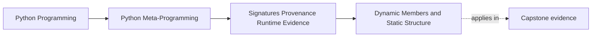
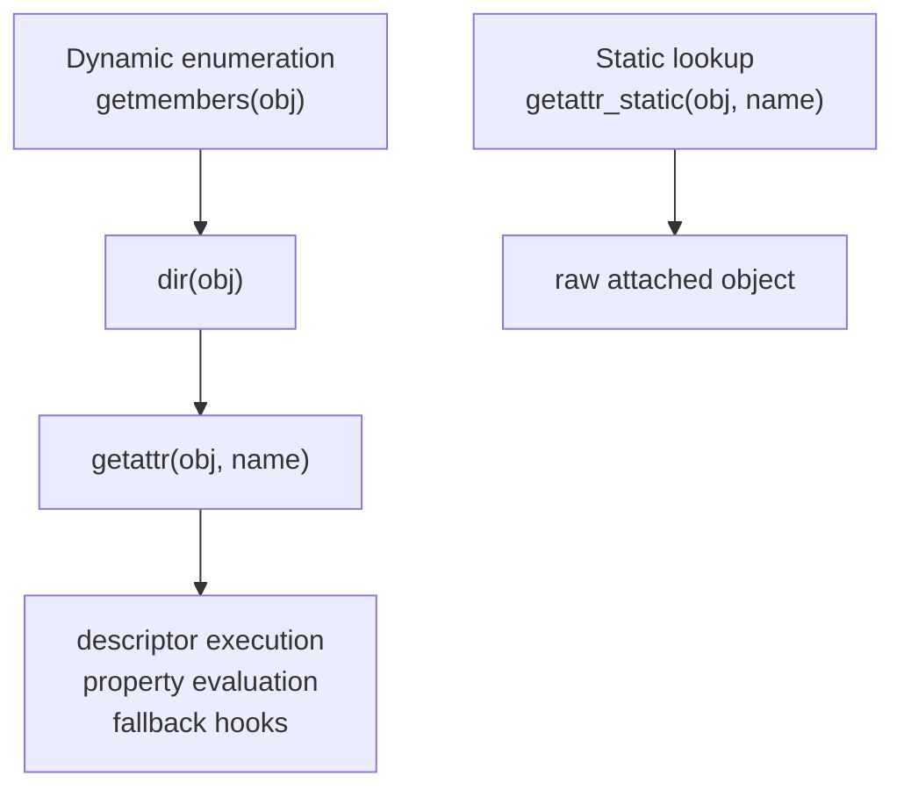

# Dynamic Members and Static Structure


<!-- page-maps:start -->
## Page Maps




<!-- page-maps:end -->

By Module 03, the course has enough pieces to name one of the most important inspection
choices in metaprogramming:

> do you want the value normal lookup would produce, or do you want the raw structure
> attached to the object?

This page puts that choice into concrete tooling terms with:

- `inspect.getmembers`
- `inspect.getattr_static`

This is a high-value lesson because many weak tools do not fail loudly here. They simply
slide from "inspection" into "execution" without admitting it.

## The sentence to keep

When enumerating members, ask:

> am I trying to collect dynamic values, or am I trying to inspect attached structure
> without executing runtime behavior?

That question should drive the tool choice.

Keep one review question beside it:

> if I use the dynamic path here, what behavior am I allowing to run while pretending to inspect?

## `inspect.getmembers` is dynamic enumeration

`inspect.getmembers(obj, predicate=None)` works roughly like this:

1. discover names with `dir(obj)`
2. call `getattr(obj, name)` for each name
3. optionally filter the resulting values with a predicate
4. return sorted `(name, value)` pairs

That is useful, but it is not passive.

Because it uses dynamic lookup, it can:

- execute properties
- trigger descriptors
- trigger `__getattr__`
- activate proxy behavior

So `getmembers` is a value-oriented tool, not a structural-inspection tool.

That wording matters. It is not "bad." It is simply answering a different question:

- "what values does normal runtime lookup currently produce?"

That is a legitimate question, but it is not the same as:

- "what members are attached here before behavior runs?"

## `inspect.getattr_static` is structural inspection

`inspect.getattr_static(obj, name)` tries to retrieve the raw attribute object without
running normal lookup behavior.

That means it can return:

- a property object
- a function stored on the class
- a descriptor object
- a plain attached value

without automatically executing it.

That is why it fits library and framework introspection much better when the goal is
structure rather than behavior.

Use this table when the choice feels too abstract:

| Real question | Better surface | Why |
| --- | --- | --- |
| Which descriptor object is attached under this name? | `getattr_static` | attachment truth is the goal |
| What value would normal lookup yield right now? | `getmembers` or `getattr` | resolved runtime value is the goal |
| Which members can I inspect without triggering application behavior? | static helper route | safety is part of the inspection contract |

## One picture of the difference



Caption: one path collects resolved values, the other inspects what is attached before runtime behavior runs.

## A property shows the difference clearly

```python
import inspect


class Example:
    @property
    def expensive(self):
        print("SIDE EFFECT: property executed")
        return 123

    def method(self):
        pass


obj = Example()

_ = inspect.getmembers(obj)
raw = inspect.getattr_static(Example, "expensive")

assert isinstance(raw, property)
```

The printed side effect is the important boundary:

- `getmembers` resolved the value dynamically
- `getattr_static` revealed the attached structure without evaluation

The key self-study habit is to say which truth you got:

- attached-object truth
- resolved-value truth

If an answer just says "I inspected the member," it is still too vague.

## Structural enumeration often needs a custom helper

Because `getmembers` is dynamic, framework or tooling code often wants its own structural
enumeration helper:

```python
import inspect


def static_getmembers(obj, predicate=None):
    for name in dir(obj):
        value = inspect.getattr_static(obj, name)
        if predicate is None or predicate(value):
            yield name, value
```

That helper still inherits the lower-risk caveat around `dir(obj)`, but it avoids the
larger mistake of resolving every name dynamically by default.

That is often good enough for framework discovery, manifests, or review tooling. You do
not always need perfect structure recovery to make a much safer choice than broad dynamic
enumeration.

## Use the tool that matches the question

Good reasons to use `getmembers`:

- quick REPL exploration
- controlled debugging where executing descriptors is acceptable
- value-oriented inspection when you explicitly want runtime semantics

Good reasons to use `getattr_static`:

- framework discovery
- manifest or schema extraction
- class and descriptor inspection
- any tool that should not trigger business behavior while observing structure

The key discipline is not to use the dynamic tool by habit when the question is clearly
structural.

Weak review move to reject:

- "I used `getmembers` because it shows me everything"

It does not show "everything." It shows the results of dynamic lookup, which may be more
than you wanted and less than you safely understand.

## Static structure is often the stronger review surface

When reviewing framework code, the structural question is often the one that matters most:

- what descriptors are attached?
- what functions are defined on the class?
- what property objects exist?
- what raw members make up the framework contract?

Dynamic values may be interesting later, but they are not the first truth the reviewer
needs.

That order matters for standalone learners:

1. ask the structural question first
2. collect attached-object evidence
3. cross into value resolution only when the runtime question actually requires it

## Evidence practicum: make hidden execution measurable

The course target makes the difference observable instead of asking you to trust a
warning:

```console
$ make evidence-lab |
  python3 -c 'import json, sys; print(json.load(sys.stdin)["members"])'
{'dynamic_value': 7, 'evidence_strength': 'structural-before-dynamic', 'property_reads_after_getmembers': 1, 'property_reads_after_static_lookup': 0, 'static_value_is_property': True}
```

`MemberEvidenceTarget.risk_score` increments `property_reads` whenever the property body
runs. The two counters turn an otherwise invisible boundary into executable evidence:

1. `inspect.getmembers(instance)` returns the resolved value `7` and the counter becomes
   `1`
2. `inspect.getattr_static(instance, "risk_score")` returns the property object and the
   counter stays `0`

Both results are truthful, but they answer different questions. The dynamic value is
evidence about normal lookup behavior. The property object is evidence about attached
structure. Neither should be relabeled as the other.

### Transfer into the worked implementation

Run `make evidence-repr`. Its packet reports
`"dynamic_member_lookup": false` and `"property_reads_after_repr": 0`. Then run
`make evidence-repr-test` to prove that the representation works for dictionary-backed,
slotted, inherited-slot, private-slot, and custom-lookup cases.

This transfer matters: the safer member-inspection rule changes an actual utility design.
The representation does not enumerate names with `dir()` and then resolve them. It reads
owned instance storage and deliberately excludes the `risk_score` property.

### Investigation

Temporarily replace the storage reader in `safe_repr` with
`getattr(instance, "risk_score")`. The test should expose the property read. Restore the
storage implementation before continuing. The failure is the lesson: a more informative-
looking string silently became application execution.

## Review rules for member inspection

When reviewing member-inspection code, keep these questions close:

- is the code trying to inspect attached structure or resolved runtime values?
- is `getmembers` being used where `getattr_static` would better match the tool's purpose?
- does the enumeration path risk executing properties or proxy behavior unintentionally?
- is a custom structural helper justified instead of broad dynamic enumeration?
- does the code document when it chooses to cross from structure into value resolution?

## Self-study lab

Before leaving this page, write one member-review note in this format:

- the member name under review
- the structural question
- the dynamic question
- the exact point where you chose one over the other

If you cannot name both questions separately, the tool choice is probably still accidental.

## What to practice from this page

Try these before moving on:

1. Compare `getmembers(obj)` with a `static_getmembers(obj)` helper on a class that has a property.
2. Use `getattr_static` to list properties on a class without evaluating them.
3. Explain one case where dynamic member values are the right goal and one where raw structure is the right goal.

If those feel ordinary, the final core can close the module with the highest-risk
introspection surface here: frames and stack inspection.

## Continue through Module 03

- Previous: [Provenance Helpers and Best-Effort Recovery](provenance-helpers-and-best-effort-recovery.md)
- Next: [Frames and Diagnostic-Only Runtime Evidence](frames-and-diagnostic-only-runtime-evidence.md)
- Practice: [Exercises](exercises.md)
- Terms: [Glossary](glossary.md)
