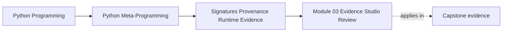
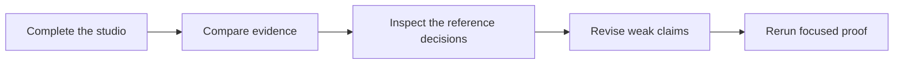

# Module 03 Evidence Studio Review

<!-- page-maps:start -->
## Page Maps




<!-- page-maps:end -->

Use this review only after attempting the studio. A good submission does not need to use
these exact sentences or implementation details. It does need to expose the same
reasoning: claim first, evidence second, strength label third, and executable proof last.

## Baseline review

The shipped baseline supports this ledger:

| Claim | Direct observation | Evidence strength | Boundary |
| --- | --- | --- | --- |
| `dispatch_incident` has enforced parameter kinds | `Signature.parameters` reports positional-only, positional-or-keyword, keyword-only, and variadic keyword kinds | strong call shape | does not prove semantic success |
| a proposed call matches Python's argument rules | `Signature.bind` accepts or raises `TypeError` | strong call matching | does not execute the body |
| source context can be recovered in this environment | file-backed source succeeds while generated source fails | best-effort provenance | environment and loader dependent |
| normal lookup executes `risk_score` | the property counter becomes one | resolved-value truth | observation itself caused behavior |
| raw lookup reveals a property | `getattr_static` returns a property and the counter stays zero | attached-object truth | does not produce the property's value |
| caller names can be sampled | a bounded tuple of names is returned | diagnostic-only | refactors can change the result |
| stored state can be represented without property reads | `property_reads_after_repr` is zero | stored-state evidence | stored values still control their own `repr` |

The important feature is the boundary column. Without it, technically correct
observations can still support dishonest conclusions.

## Studio 1 review: contract and binding

For `dispatch_incident`, the call matrix should be equivalent to:

| Attempt | Accepted? | Result | What it proves |
| --- | --- | --- | --- |
| `bind("INC-90", "critical", retries=2, owner="platform")` | yes | incident, severity, retries, and `metadata={"owner": "platform"}` | the complete shape follows Python's matching rules |
| `bind(incident_id="INC-90")` | no | positional-only `TypeError` | the slash marker is enforced by binding |
| `bind("INC-90", unknown=1)` | yes | `unknown` is collected in `metadata` | `**metadata` accepts an otherwise unknown keyword |
| `bind_partial(retries=2)` | yes | only `retries` is present | an incomplete mapping can be assembled |

One common mistake is predicting that `unknown=1` fails. It does not, because the
signature explicitly contains `**metadata`. Another is treating successful partial
binding as evidence that an actual call is ready. Required parameters are intentionally
allowed to remain absent in `bind_partial`.

After `apply_defaults()`, the complete binding includes defaults and an explicit variadic
mapping. This is strong evidence about call matching. It remains silent about whether
`dispatch_incident` will return successfully for the supplied values.

## Studio 2 review: evidence downgrades

### Provenance

Changing a generated code object's filename may change the label returned by
`inspect.getfile`. Source lookup might also behave differently if linecache or a matching
file is available. Neither observation makes the path authoritative. The code object
stores a filename label; it does not carry proof that current text at that path produced
the callable.

### Members

`getmembers(target)` asks for resolved runtime values. It executes the property and
returns `7`. `getattr_static(target, "risk_score")` asks what is attached and returns the
property object without execution. Both are accurate answers to different questions.
Framework discovery normally needs the second question first.

### Frames

Positive limits return bounded caller-name snapshots; zero raises `ValueError`. The exact
names are diagnostic context, not an application contract. A production action that
needs an actor, route, or operation name should receive that value explicitly.

A strong evidence-downgrade paragraph will say that evidence becomes weaker when it
depends on source availability, requires runtime behavior to execute, or reflects a
transient call path. It should not say that weak evidence is useless. Best-effort and
diagnostic evidence remain useful when labeled and kept out of correctness boundaries.

## Studio 3 review: representation exclusion

One reasonable structural policy helper is:

```python
def _excluded_names(cls: type[object]) -> frozenset[str]:
    excluded: set[str] = set()
    for owner in cls.__mro__:
        value = vars(owner).get("__repr_exclude__", ())
        if not isinstance(value, (set, frozenset, tuple, list)):
            raise TypeError("__repr_exclude__ must be a collection of names")
        if not all(isinstance(name, str) for name in value):
            raise TypeError("__repr_exclude__ entries must be strings")
        excluded.update(value)
    return frozenset(excluded)
```

`ordered_state` can filter the collected state using that structural policy before
constructor ordering:

```python
state = {
    name: value
    for name, value in stored_state(instance).items()
    if name not in _excluded_names(type(instance))
}
```

The design reads class dictionaries through `vars(owner)` rather than resolving
`instance.__repr_exclude__`. That keeps policy discovery out of instance
`__getattribute__`, descriptors, and `__getattr__`.

Tests should prove more than the final string:

```python
class CredentialRecord(SignatureGuidedRepr):
    __repr_exclude__ = frozenset({"token"})

    def __init__(self, user: str, token: str) -> None:
        self.token = token
        self.user = user


record = CredentialRecord("operator", "secret")
assert repr(record) == "CredentialRecord(user='operator')"
assert "secret" not in repr(record)
```

The slotted test should carry the same policy, and a property counter should remain zero.
Existing representation and evidence-lab tests must stay green.

This policy still is not general secret redaction:

- it relies on authors naming every excluded field
- aliases or nested secrets can remain
- `repr(value)` can execute value-owned code
- recursive graphs are not handled

Those are limitation statements, not reasons to abandon the bounded improvement.

## Studio 4 review: capstone preflight

The completed comparison is:

| Question | Preflight | Trace |
| --- | --- | --- |
| constructs plugin? | no | yes |
| invokes action body? | no | yes |
| applies Python binding rules? | yes | yes |
| returns configuration? | no | yes |
| records action history? | no | yes |

`bind_action_arguments` retrieves the registered `ActionSpec`, binds a placeholder for
`self` plus the proposed arguments, applies defaults, and removes `self` from the returned
mapping. No plugin instance is required.

`"executed": false` is a public statement produced by the same software under review, so
it cannot prove itself. The independent proof defines a plugin whose constructor and
action append to an event list. After binding, the list remains empty. That test would
fail if preflight crossed either execution boundary.

The trace route deliberately crosses both boundaries. It constructs a configured plugin,
resolves the action, invokes it, and returns action history. The routes share Python's
binding semantics without pretending that validation and execution are the same event.

## Review the final submission

A strong final review contains:

- observed values, not only helper names
- a limitation for every best-effort or diagnostic claim
- focused test output for the representation change
- a clear distinction between structural policy and stored state
- capstone non-execution proof that does not depend on CLI output
- one production limitation that remains after the exercise

Use these repairs when the writing is still vague:

| Weak statement | Stronger repair |
| --- | --- |
| "The signature explains the function." | Name the parameter kind or binding rule it exposes. |
| "The source proves where it came from." | State the recovered context and the environment-dependent limitation. |
| "Static lookup is safer." | Name the attached-object question that avoids dynamic execution. |
| "The stack told me the caller." | Label it diagnostic-only and name the explicit input production code needs. |
| "Preflight does not run anything." | Point to the event-recording test that proves construction and invocation remain absent. |
| "The representation is safe." | State the exact non-execution promise and the remaining `repr(value)` risk. |

You are ready to continue when you can challenge an inspection claim by asking what it
proves, what it does not prove, and which test would expose accidental execution.

## Continue through Module 03

- Previous: [Module 03 Evidence Studio](exercises.md)
- Return: [Overview](index.md)
- Next module: [Module 04](../module-04-function-wrappers-transparent-decorators/index.md)
- Terms: [Glossary](glossary.md)
