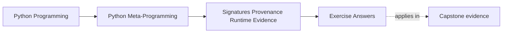

# Exercise Answers


<!-- page-maps:start -->
## Page Maps




<!-- page-maps:end -->

Use this page after attempting the exercises yourself. The point is not to match every
example literally. The point is to compare your reasoning against answers that name the
runtime claim first and then judge the strength of the evidence honestly.

## Answer 1: Describe one callable contract precisely

Example answer:

```python
import inspect


def demo(a: int, /, b, *, c: bool = False, **kw):
    pass


sig = inspect.signature(demo)
```

Strong evidence:

- `str(sig)` is `(a: int, /, b, *, c: bool = False, **kw)`
- `a` is `POSITIONAL_ONLY`
- `b` is `POSITIONAL_OR_KEYWORD`
- `c` is `KEYWORD_ONLY`
- `kw` is `VAR_KEYWORD`

Good conclusion:

The signature is stronger than a hand-written summary because it exposes interpreter-level
parameter rules, not just a human description of "roughly what the function takes."

## Answer 2: Bind one call honestly

Example answer:

```python
import inspect


def demo(a, /, b, *, c=False):
    pass


sig = inspect.signature(demo)
ba = sig.bind(10, 20)
ba.apply_defaults()
```

Strong evidence:

- `ba.arguments == {"a": 10, "b": 20, "c": False}`
- `sig.bind(a=10, b=20)` raises `TypeError` because `a` is positional-only

Good conclusion:

Binding is better than manual matching because it reuses Python's own call rules, including
positional-only and keyword-only behavior, instead of relying on incomplete custom logic.

## Answer 3: Recover provenance without overclaiming

Example answer:

```python
import inspect


def demo():
    return 42


module = inspect.getmodule(demo)
```

Strong evidence:

- `module` often points at the defining module
- `getfile(demo)` may return a file path
- `getsource(demo)` may succeed in a normal file-backed context

Good limitation statement:

Those helpers are best-effort because interactive sessions, generated code, packaged
environments, or transformed source can break or weaken the recovery path.

## Answer 4: Compare dynamic members with static structure

Example answer:

```python
import inspect


class Example:
    @property
    def expensive(self):
        print("SIDE EFFECT")
        return 123
```

Strong evidence:

- `inspect.getmembers(Example())` can trigger `SIDE EFFECT`
- `inspect.getattr_static(Example, "expensive")` returns the `property` object itself

Good conclusion:

Dynamic member enumeration is a value-oriented tool and may execute behavior. Static lookup
is the stronger fit for framework inspection when the goal is to inspect structure safely.

## Answer 5: Use frames only as diagnostics

Example answer:

```python
import inspect


def top_callers(limit=2):
    frame = inspect.currentframe()
    if frame is None:
        return []
    try:
        out = []
        current = frame.f_back
        while current is not None and len(out) < limit:
            out.append(current.f_code.co_name)
            current = current.f_back
        return out
    finally:
        del frame
```

Strong evidence:

- the helper returns a small slice of caller names
- it releases the starting frame explicitly

Good conclusion:

This belongs to diagnostics because it inspects execution context rather than explicit
program state. It should not become ordinary application control flow.

## Answer 6: Review a runtime-description helper

Example answer:

Suppose a `__repr__` helper:

- uses `inspect.signature(cls.__init__)` for ordering
- reads `__dict__` and slots for values
- avoids `getattr` on arbitrary names

Strong assessment:

- signature ordering is strong evidence when available
- stored state is the right value source for a safe representation
- avoiding broad dynamic lookup keeps properties from being evaluated accidentally

Good repair if the helper is weaker:

If the helper currently uses `getattr` over arbitrary names, replace that with direct
storage reads and deliberate slot handling so representation stays observational.

## Answer 7: Compare signature evidence with annotation evidence

Example answer:

```python
import inspect


def publish(report: str, /, *, retries: int = 0) -> bool:
    return True


sig = inspect.signature(publish)
annotations = publish.__annotations__
```

Strong evidence:

- `sig` proves `report` is positional-only and `retries` is keyword-only
- `annotations` say something about intended value categories
- annotations do not prove call-shape rules such as positional-only or keyword-only constraints

Good conclusion:

Annotations support review, but signature evidence is stronger for runtime contract shape
because Python enforces the binding rules directly through the call protocol.

## Answer 8: Build one provenance-and-contract manifest

Example answer:

Suppose the manifest for a helper includes:

- `inspect.signature(helper)` for call shape
- `helper.__module__` and `inspect.getmodule(helper)` for ownership
- `inspect.getsource(helper)` marked as best-effort only

Strong assessment:

- the signature is strong contract evidence
- module ownership is usually strong enough for review and tracing
- source recovery is a convenience surface that can fail in interactive, generated, or transformed contexts

Good conclusion:

A reviewer should trust the contract and ownership story first, then treat source recovery
as helpful context rather than as the main proof.

## Answer 9: Separate production evidence from debugging evidence

A strong answer might ask:

- "Can this helper be called with these arguments in production, and where did it come from?"

Production-grade evidence:

- `inspect.signature(helper)`
- `sig.bind(...)`
- module identity through `helper.__module__` and `sys.modules`

Debugging-only evidence:

- stack inspection through `inspect.currentframe()`
- line-number guesses from `helper.__code__.co_firstlineno`

Good conclusion:

Production evidence answers the durable runtime contract and ownership questions.
Debugging evidence helps explain a moment in execution but should not be promoted into the
main correctness claim.

## Answer 10: Produce a runtime evidence packet

The packet is strong when another learner can answer:

- what claim is being made about the callable or helper
- which surface proves call shape directly
- which provenance details are strong enough for review and which are only convenience
- where the packet drops into diagnostics instead of durable contract evidence

## What strong Module 03 answers have in common

Across the whole set, strong answers share the same habits:

- they state the runtime claim before naming a helper
- they separate strong callable evidence from best-effort provenance
- they distinguish dynamic value inspection from static structure
- they keep frame inspection in the diagnostics bucket
- they keep signature evidence separate from annotation support
- they leave behind a packet another learner can audit without guessing

If an answer still sounds like "inspect told me so," revise it until you can say what
kind of evidence `inspect` actually gave you.

## Continue through Module 03

- Previous: [Exercises](exercises.md)
- Return: [Overview](index.md)
- Next module: [Module 04](../module-04-function-wrappers-transparent-decorators/index.md)
- Terms: [Glossary](glossary.md)
