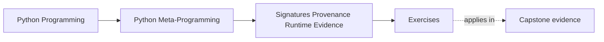

# Exercises

<!-- page-maps:start -->
## Page Maps

<!-- page-maps:end -->

Use these after reading the five core lessons and the worked example. The goal is not to
collect more introspection tricks. The goal is to make your evidence standards visible.

Each exercise asks for three things:

- the runtime claim you are trying to support
- the evidence surface you chose
- the reason that surface is strong enough, best-effort, or diagnostic-only

Treat the ten exercises as one full lab day on runtime evidence.

This is not ten disconnected prompts. It is one review packet on evidence quality. The
packet should leave behind enough reasoning that another learner can tell:

- what you were actually trying to prove
- why the chosen surface was the right evidence class
- where the packet intentionally crosses from strong evidence into convenience or diagnostics

Do them in order:

- Exercises 1-3 establish callable contracts, binding, and provenance limits
- Exercises 4-6 separate dynamic structure, frame diagnostics, and helper review
- Exercises 7-8 extend that discipline into annotation evidence and reviewable manifests
- Exercises 9-10 package the whole module into a capstone-ready evidence packet

Keep one runtime-evidence table while you work:

| Runtime claim | Evidence surface | Strong, best-effort, or diagnostic-only | Boundary or design judgment that follows |
| --- | --- | --- | --- |

Build one small packet beside that table:

- one callable contract you can describe precisely from a `Signature`
- one bound-call example that proves or rejects a call attempt honestly
- one provenance note with an explicit limitation statement
- one structure-versus-resolution comparison on a side-effectful member
- one diagnostic-only helper that you would refuse to promote into production logic

## Exercise 1: Describe one callable contract precisely

Choose one callable with a non-trivial signature.

What to hand in:

- the string form of the signature
- at least three parameter kinds or fields that matter
- one sentence explaining why the signature is stronger evidence than a hand-written summary
- one sentence explaining one thing the signature still does not prove at all

## Exercise 2: Bind one call honestly

Take the same callable or a new one and simulate a call with `bind()` or `bind_partial()`.

What to hand in:

- the call attempt
- the resulting bound arguments or the expected `TypeError`
- one explanation of why binding is better than manual argument matching
- one sentence explaining whether you needed `bind()` or `bind_partial()` and why

## Exercise 3: Recover provenance without overclaiming

Use one function, class, or module and gather provenance context.

What to hand in:

- the result of `getmodule`, `getfile`, or `getsource` as available
- one case where one of those helpers fails or could fail
- one sentence explaining why provenance is best-effort evidence rather than a correctness boundary
- one sentence explaining how your surrounding tool should remain honest if the lookup fails entirely

## Exercise 4: Compare dynamic members with static structure

Use one class that contains a property, descriptor, or other side-effectful member.

What to hand in:

- what `getmembers` returns or triggers
- what `getattr_static` reveals for the same member
- one explanation of which tool fits framework inspection and why
- one sentence naming whether your claim needed attached-object truth or resolved-value truth

## Exercise 5: Use frames only as diagnostics

Write one small helper that inspects caller information.

What to hand in:

- the helper implementation
- the limited caller evidence it returns
- one sentence explaining why the helper belongs to diagnostics and not normal application logic
- one sentence naming the explicit parameter or owned state you would use instead in production logic

## Exercise 6: Review a runtime-description helper

Use the worked example pattern on a small `__repr__`, logger, or manifest helper.

What to hand in:

- which evidence source it uses for ordering or naming
- which surface it uses for values
- one repair that makes the helper safer or more honest
- one sentence naming the exact point where the helper would become less honest if it reached for provenance or caller context

## Midday self-check

Before moving into the final four exercises, make sure you can already answer these
questions clearly:

- which runtime questions `inspect.signature()` answers strongly and which ones it does not
- why `bind()` is stronger than hand-matched arguments when you want callability evidence
- where provenance helpers help and where they remain best-effort only
- why frame inspection and structure inspection belong in different evidence buckets

If you cannot answer those four questions in plain language, return to Exercises 1-6 and
make the claim, evidence surface, and evidence strength more explicit before continuing.

Add one more self-check before continuing:

- can you point to the exact step where your packet leaves strong evidence and enters convenience or diagnostics?

## Exercise 7: Compare signature evidence with annotation evidence

Choose one callable whose annotations help but do not fully define its runtime contract.

What to hand in:

- the signature evidence and the annotation evidence side by side
- one example of a rule the signature proves that annotations alone do not
- one sentence explaining why annotations support review without replacing call-shape evidence
- one sentence explaining the overclaim you would be making if you treated annotations as full contract proof

## Exercise 8: Build one provenance-and-contract manifest

Take one callable, class, or helper and write a short evidence manifest another learner
could review without rerunning your whole notebook.

What to hand in:

- the object under review
- the contract evidence, provenance evidence, and any diagnostic-only evidence you included
- one note explaining what a reviewer should trust strongly and what they should treat as convenience only
- one sentence explaining what should happen when one convenience surface in the manifest disappears

## Exercise 9: Separate production evidence from debugging evidence

Choose one realistic runtime question and answer it twice: once with production-grade
evidence and once with debugging-only evidence.

What to hand in:

- the runtime question
- the production-grade evidence path
- the debugging-only evidence path
- one explanation of why mixing those two paths would weaken the review
- one sentence naming which path you would refuse to place in a hot path or correctness boundary

## Exercise 10: Produce a runtime evidence packet

Assemble:

- one runtime-evidence table
- one bound-call example using `bind()` or `bind_partial()`
- one provenance example with an honest limitation statement
- one helper review rule that separates strong, best-effort, and diagnostic-only evidence

The packet is strong when another learner can use it to answer:

- what runtime claim is being made
- which surface supports that claim most directly
- where the packet crosses from strong evidence into convenience or diagnostics

## Repair table for weak exercise drafts

Use this when an answer still sounds vague:

| Weak answer pattern | What is missing | Repair |
| --- | --- | --- |
| "I inspected the callable." | the claim and the evidence class | say whether you used signature, binding, provenance, structure, or diagnostics |
| "The source shows where it came from." | the limitation statement | name the environment where that recovery could fail |
| "I used `getmembers` to inspect the class." | the structure-versus-resolution distinction | say whether you needed attached-object truth or resolved-value truth |
| "The stack told me what to do." | the rejected explicit input design | state what parameter or owned state should have carried that information |

## Mastery standard for this exercise set

Across all six answers, the module wants the same habits:

- you state the runtime claim before choosing evidence
- you distinguish strong contract evidence from best-effort provenance
- you keep dynamic execution, static structure, and diagnostic stack inspection separate
- you use `inspect` to clarify behavior rather than to make vague claims sound technical

Across all ten answers, add two more habits:

- you keep signature evidence separate from annotation or provenance support
- you leave behind a runtime evidence packet another learner could audit without guessing

If an answer still says only "I inspected it," keep going.

## Continue through Module 03

- Previous: [Worked Example: Building a Safe Signature-Guided `__repr__`](worked-example-building-a-safe-signature-guided-repr.md)
- Next: [Exercise Answers](exercise-answers.md)
- Return: [Overview](index.md)
- Terms: [Glossary](glossary.md)
