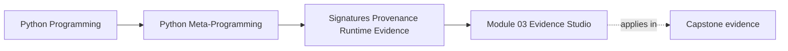
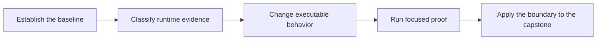

# Module 03 Evidence Studio

<!-- page-maps:start -->
## Page Maps




<!-- page-maps:end -->

This studio is the assessed learning product for Module 03. It is not a list of unrelated
`inspect` puzzles. You will inspect two shipped course programs, change one of them, and
use the capstone only after the core evidence distinctions are established.

Your final review should let another developer answer four questions without guessing:

1. What runtime claim did you investigate?
2. Which evidence surface supports it?
3. How strong is that evidence?
4. What executable proof keeps the claim honest?

## Establish the baseline

Run these from `programs/python-programming/python-meta-programming`:

```console
make evidence-lab
make evidence-lab-test
make evidence-repr
make evidence-repr-test
make capstone-bind-action
```

Do not begin by editing. Save the outputs you need under the repository-level
`artifacts/` directory and make a baseline ledger:

| Claim | Observation | Evidence class | Proof |
| --- | --- | --- | --- |
| callable parameter kinds are recoverable | signature packet | strong call shape | `test_signature_packet_reports_enforced_parameter_kinds` |
| Python's matching rules accept or reject a call | binding packet | strong call matching | `test_binding_packet_uses_python_call_rules` |
| source context may disappear | provenance packet | best-effort provenance | generated-source assertion |
| dynamic enumeration can execute a property | member packet | resolved-value truth | property-read counter |
| bounded caller names can help diagnostics | frame packet | diagnostic-only | limit and no-retained-frame assertions |
| representation can avoid dynamic reads | representation packet | stored-state evidence | representation boundary suite |

That ledger is the beginning of your submission, not a model answer to copy. Add the
actual observed values and explain each boundary in your own words.

## Studio 1: contract and binding investigation

Use `dispatch_incident` from `labs/runtime_evidence/evidence.py`.

### Work

1. Predict the result of each call before running it:

   ```python
   signature.bind("INC-90", "critical", retries=2, owner="platform")
   signature.bind(incident_id="INC-90")
   signature.bind("INC-90", unknown=1)
   signature.bind_partial(retries=2)
   ```

2. Run the calls and record either `BoundArguments.arguments` or the complete exception
   category and message.
3. Apply defaults to the successful complete binding and explain where `metadata` comes
   from.
4. State why the partial binding is valid evidence for incremental assembly but invalid
   evidence that an invocation is ready.

### Deliverable

Add a call matrix to your review:

| Attempt | Accepted? | Bound mapping or failure | What the result proves |
| --- | --- | --- | --- |

Your explanation must distinguish call-shape success from function-body success.

### Focused proof

```console
make evidence-lab-test
```

## Studio 2: evidence downgrade investigation

The purpose of this studio is to experience evidence getting weaker as the runtime
question changes.

### Provenance experiment

In a temporary local edit, change the filename supplied to `compile(...)` in
`provenance_evidence`. Use a plausible path and rerun `make evidence-lab`.

Record:

- what `inspect.getfile` reports
- whether source recovery succeeds
- why either outcome still fails to prove that the path is authoritative ownership

Restore the shipped filename before continuing.

### Member experiment

Read `MemberEvidenceTarget.risk_score`, then compare:

```python
inspect.getmembers(target)
inspect.getattr_static(target, "risk_score")
```

Record the property counter before and after each operation. Explain why both results are
truthful even though only one is suitable for passive framework inspection.

### Frame experiment

Call `caller_names(1)`, `caller_names(3)`, and `caller_names(0)`. Record:

- the bounded snapshots
- the rejected request
- the explicit application input you would use instead of caller identity

Do not store a frame or return a frame object as part of this exercise.

### Deliverable

Write one paragraph that starts with:

> Evidence is downgraded when...

The paragraph must mention environment dependence, behavior execution, and transient
caller context.

## Studio 3: extend the representation policy

The worked implementation deliberately lacks redaction or exclusion policy. Add an
explicit class-level exclusion contract:

```python
class CredentialRecord(SignatureGuidedRepr):
    __repr_exclude__ = frozenset({"token"})
```

### Required behavior

- excluded stored names do not appear in the representation
- remaining constructor parameters retain constructor order
- extras remain alphabetically ordered
- a property with an excluded name is never evaluated
- dictionary-backed, slotted, inherited-slot, and private-slot cases remain supported

Read the policy from class structure without broad instance `getattr`. Keep discovery,
state collection, ordering, and formatting as separate responsibilities.

### Required proof

Add focused tests before changing the implementation:

1. a failing dictionary-backed exclusion case
2. a failing slotted exclusion case
3. a property counter proving non-execution
4. a regression assertion for the existing demo packet

Then implement the smallest coherent policy that makes the tests pass.

```console
make evidence-repr-test
make evidence-lab-test
```

### Review questions

- Is exclusion structural policy or instance runtime state?
- Why would `getattr(instance, "__repr_exclude__")` weaken the inspection boundary?
- What remains unsafe about calling `repr()` on a stored value?
- Why is an exclusion list not equivalent to a general secret-redaction policy?

## Studio 4: transfer binding into the capstone

Only now move to the incident-plugin runtime.

Compare:

```console
make capstone-bind-action
make capstone-trace
```

The first route validates action arguments without plugin construction or action
execution. The second route deliberately constructs, invokes, and records history.

Trace these code paths:

- `bind_action_arguments` in `capstone/src/incident_plugins/framework.py`
- the stored `ActionSpec.signature` in `capstone/src/incident_plugins/actions.py`
- `_handle_bind_action` and `_handle_trace` in the capstone CLI
- the side-effect proof in `capstone/tests/test_runtime.py`

### Deliverable

Create a preflight-versus-execution table:

| Question | Preflight | Trace |
| --- | --- | --- |
| constructs plugin? | | |
| invokes action body? | | |
| applies Python binding rules? | | |
| returns configuration? | | |
| records action history? | | |

Then explain why `"executed": false` is useful output but is not sufficient proof by
itself. Point to the test double that records construction and invocation events.

### Focused proof

```console
make -C capstone test
```

## Final evidence review

Place your final write-up under the repository `artifacts/` directory. It should contain:

- the completed evidence ledger
- the Studio 1 call matrix
- the Studio 2 evidence-downgrade paragraph
- the Studio 3 design decision and focused test results
- the Studio 4 preflight-versus-execution table
- one remaining limitation you would address before using the representation helper for
  sensitive production objects

## Assessment rubric

| Dimension | Developing | Proficient | Strong |
| --- | --- | --- | --- |
| Claim precision | names helpers without naming claims | states the runtime claim | separates observation, inference, and unsupported conclusion |
| Evidence classification | treats all inspection as equal | distinguishes strong, best-effort, structural, and diagnostic evidence | explains when and why evidence is downgraded |
| Executable change | changes output only | adds exclusion behavior and focused proof | preserves ownership boundaries and regression coverage |
| Safety reasoning | says "no side effects" without proof | uses counters and test doubles | identifies remaining `repr(value)` and redaction limits |
| Capstone transfer | describes capstone generally | traces preflight and execution routes | proves non-execution independently of CLI output |

You are ready for Module 04 when the evidence class follows from the question you are
asking, not from whichever `inspect` helper you remember first.

## Continue through Module 03

- Previous: [Worked Example: Building a Safe Signature-Guided `__repr__`](worked-example-building-a-safe-signature-guided-repr.md)
- Next: [Exercise Answers](exercise-answers.md)
- Return: [Overview](index.md)
- Terms: [Glossary](glossary.md)
