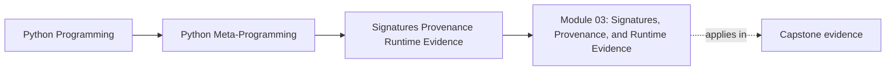

# Module 03: Signatures, Provenance, and Runtime Evidence

<!-- page-maps:start -->
## Page Maps




<!-- page-maps:end -->

Module 03 turns raw inspection into stronger evidence. It introduces `inspect` as the
structured introspection layer that documentation tools, debuggers, wrappers, and runtime
frameworks rely on when "it looks inspectable" is no longer a strong enough claim.

This module is a complete course unit rather than a catalog of `inspect` helpers. Five
evidence packets classify their own trust level, the core lessons explain why those
classifications differ, the worked example applies them to representation, and the
exercises require a reviewable evidence manifest. The capstone then tests whether the
same distinctions survive wrapper and generated-signature pressure.

The central skill is learning to say:

- this claim is supported by strong callable-contract evidence
- this claim is supported only by best-effort provenance
- this claim belongs to diagnostics and must not quietly become application logic

If a learner finishes the module still saying "I inspected it and it looked right," the
module has not done enough work yet.

## What this module is for

By the end of Module 03, you should be able to explain five things clearly:

- what `inspect.signature` proves about a callable contract
- how `bind()` turns a signature into interpreter-like argument matching
- why provenance helpers are useful but remain best-effort evidence
- how dynamic member enumeration differs from static structural inspection
- why frame and stack introspection belong to diagnostics rather than ordinary control flow

You should also be able to review weak tooling code and say exactly where it overclaims:

- pretending annotations prove call shape
- pretending provenance helpers provide guaranteed ownership truth
- pretending dynamic member enumeration is harmless structure inspection
- pretending stack evidence is acceptable production control flow

## Keep these pages open

- [First-Contact Map](../module-00-orientation/first-contact-map.md)
- [Proof Matrix](../guides/proof-matrix.md)
- [Proof Ladder](../guides/proof-ladder.md)
- [Capstone Walkthrough](../capstone/capstone-walkthrough.md)

## Run the runtime-evidence lab

From `programs/python-programming/python-meta-programming`:

```console
$ make evidence-lab
{
  "binding": {
    "evidence_strength": "strong-call-matching",
    ...
  },
  "provenance": {
    "evidence_strength": "best-effort-provenance",
    "generated_source_available": false,
    ...
  },
  "frames": {
    "evidence_strength": "diagnostic-only",
    ...
  }
}
$ make evidence-lab-test
Ran 7 tests

OK
```

The strength labels are part of the teaching contract:

| Evidence class | Appropriate claim | Boundary |
| --- | --- | --- |
| strong call shape or matching | Python's parameter and binding rules | says nothing about semantic success |
| best-effort provenance | useful file, module, or source context | may disappear for generated or transformed code |
| structural before dynamic | what object is attached before resolution | does not reveal the eventual runtime value |
| diagnostic-only | bounded caller context for troubleshooting | must not become hidden application input |

## The published lesson set

1. Overview (`index.md`)
2. [Signature Contracts and Parameter Kinds](signature-contracts-and-parameter-kinds.md)
3. [Argument Binding and Call Simulation](argument-binding-and-call-simulation.md)
4. [Provenance Helpers and Best-Effort Recovery](provenance-helpers-and-best-effort-recovery.md)
5. [Dynamic Members and Static Structure](dynamic-members-and-static-structure.md)
6. [Frames and Diagnostic-Only Runtime Evidence](frames-and-diagnostic-only-runtime-evidence.md)
7. [Worked Example: Building a Safe Signature-Guided `__repr__`](worked-example-building-a-safe-signature-guided-repr.md)
8. [Exercises](exercises.md)
9. [Exercise Answers](exercise-answers.md)
10. [Glossary](glossary.md)

## How the day should feel

Treat the module as one escalating review route:

1. establish what a callable contract really proves
2. inspect the matching `evidence-lab` packet and focused test
3. turn that contract into interpreter-aligned binding evidence
4. recover provenance without promoting convenience into correctness
5. separate structural inspection from dynamic resolution
6. quarantine frames and stacks inside diagnostic-only reasoning
7. combine all of that in one helper review packet
8. transfer the evidence hierarchy to capstone signatures and action metadata

By the end, you should be able to audit a runtime-facing helper and sort its evidence
surfaces by trust level without guessing.

The executable companion is `labs/runtime_evidence/`, with focused proof in
`tests/test_runtime_evidence_lab.py`.

## How to use the lesson set

| If you need to... | Start here |
| --- | --- |
| understand what a callable contract really contains | [Signature Contracts and Parameter Kinds](signature-contracts-and-parameter-kinds.md) |
| validate or forward arguments without reimplementing Python's call rules | [Argument Binding and Call Simulation](argument-binding-and-call-simulation.md) |
| recover source or file context without pretending provenance is perfect | [Provenance Helpers and Best-Effort Recovery](provenance-helpers-and-best-effort-recovery.md) |
| separate dynamic value enumeration from safe structural inspection | [Dynamic Members and Static Structure](dynamic-members-and-static-structure.md) |
| keep stack and frame introspection in the diagnostics bucket | [Frames and Diagnostic-Only Runtime Evidence](frames-and-diagnostic-only-runtime-evidence.md) |
| see safe evidence-collection choices inside one realistic helper | [Worked Example: Building a Safe Signature-Guided `__repr__`](worked-example-building-a-safe-signature-guided-repr.md) |
| generate all five classified evidence packets | `make evidence-lab` |
| verify the trust-boundary claims | `make evidence-lab-test` |
| test your understanding before wrappers and decorators begin | [Exercises](exercises.md) |
| compare your reasoning against a reference answer | [Exercise Answers](exercise-answers.md) |
| stabilize the module vocabulary | [Glossary](glossary.md) |

## The running question

Carry this question through every page:

> What runtime evidence is strong enough to trust, and what evidence stays best-effort or diagnostic-only?

Carry two more review questions beside it:

- what exact claim is the code making?
- which evidence surface is the narrowest honest way to support that claim?

Strong Module 03 answers usually mention one or more of these:

- a `Signature` object describing callable structure
- `bind()` as interpreter-like argument matching
- best-effort provenance from source and file helpers
- static versus dynamic member inspection
- frames and stacks as diagnostic surfaces with cost and retention hazards

Weak Module 03 answers usually sound like one of these:

- "the annotations tell us how it can be called"
- "the source file proves where it really came from"
- "I can just enumerate members and inspect the results"
- "the stack lets me infer who should be allowed to call this"

This module is designed to make those sentences feel obviously unsafe.

## Learning outcomes

By the end of this module, you should be able to:

- use `inspect` to gather runtime facts without overstating what those facts prove
- preserve or validate callable metadata in wrapper-heavy designs
- separate correctness-grade evidence from best-effort provenance and diagnostic tooling
- explain why the capstone exposes callable facts without turning inspection into uncontrolled execution

## Capstone transfer: contract evidence before invocation

After the course packet is clear, run:

```console
make -C capstone signatures
make capstone-trace
```

The signatures route reports constructor and action call shapes. The trace route crosses
into construction and invocation. Module 03 asks whether signature metadata is
inspectable and bindable; it does not yet explain how wrappers preserve that metadata.
Modules 04 and 05 own that later pressure.

Use `capstone/tests/test_registry.py::test_action_decorator_preserves_signature_and_wrapped_metadata`
as the focused bridge. It proves that the action surface still exposes the expected
parameter kinds and return annotation after decoration.

## Module 03 review packet

Before you move on, you should be able to assemble one small packet that includes:

- one callable with a signature you can read precisely
- one bound-call example that demonstrates interpreter-grade argument matching
- one provenance example with an honest limitation statement
- one structural-inspection example that refuses to trigger behavior by accident
- one diagnostic-only helper with a clear argument for why it stays out of normal logic

That packet is the standalone-learning proof that you can use the module without an instructor in the room.

## Mid-module pressure points

Expect these to be the points where self-study learners slow down:

| Pressure point | What usually goes wrong | What to do instead |
| --- | --- | --- |
| Signatures versus annotations | treating intent notes as if they were call-shape proof | ask which rules Python actually enforces through binding |
| Provenance recovery | treating module, file, or source hints as guaranteed truth | name the failure conditions before trusting the result |
| Dynamic member enumeration | forgetting that value resolution can execute behavior | ask whether you need raw structure or resolved values |
| Frame inspection | using caller context as hidden application input | keep the same information explicit in parameters unless the tool is explicitly diagnostic |

## Exit standard

Do not move on until all of these are true:

- you can explain what `inspect.signature` proves and what it does not
- you can use `bind()` or `bind_partial()` instead of reimplementing call matching
- you can say why `getsource`, `getfile`, and `getmodule` are useful but not correctness foundations
- you can distinguish structural inspection from dynamic member resolution and diagnostic stack inspection
- you can name the exact point where a review crosses from strong evidence into convenience or diagnostics
- you can run the evidence lab and justify every strength label without treating the
  capstone as the primary explanation
- you can connect capstone signature output to a focused test before invoking an action

When those feel ordinary, Module 03 has done its job and the decorator modules can build
on a stronger evidence discipline.
