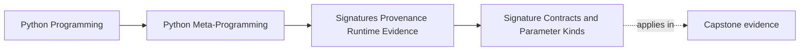
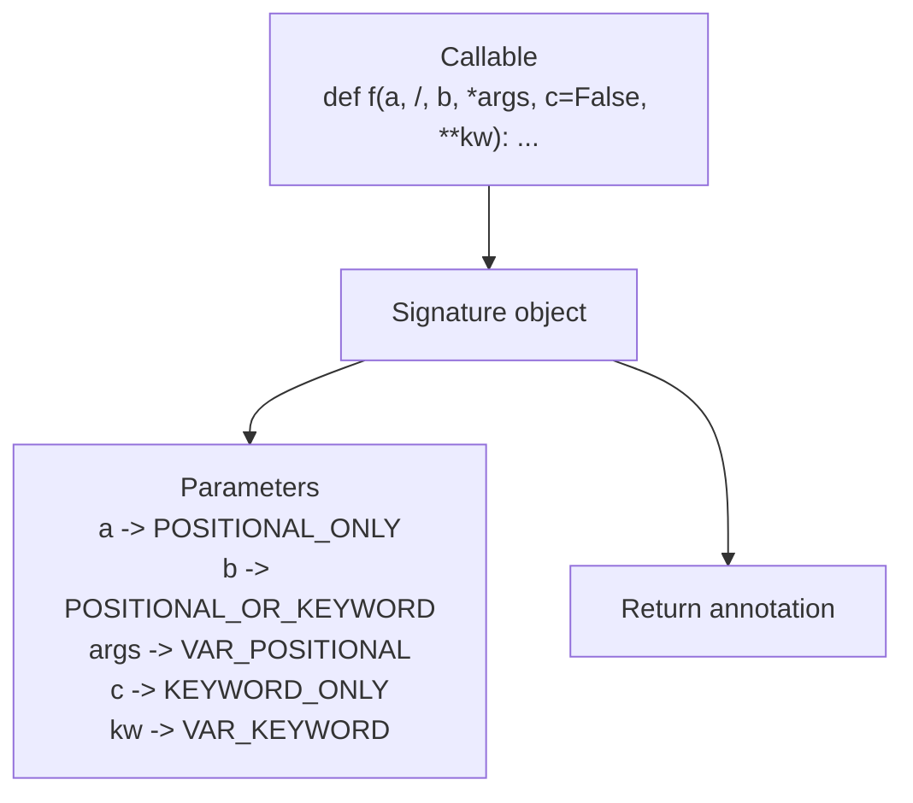

# Signature Contracts and Parameter Kinds


<!-- page-maps:start -->
## Page Maps




<!-- page-maps:end -->

Module 03 becomes useful the moment you stop saying "this callable looks fine" and
starts asking for stronger evidence.

The first strong evidence surface is `inspect.signature`.

It does not tell you everything about behavior, but it does give you a structured,
reviewable description of how a callable presents its invocation contract.

That middle sentence matters. Self-study learners often drift in one of two bad
directions:

- treating signatures as decorative summaries and missing real call-shape rules
- treating signatures as if they prove everything important about runtime behavior

This page is about keeping the evidence claim precise.

## The sentence to keep

When reviewing a callable, ask:

> what contract does its signature expose, and which parameter kinds make that contract
> precise?

That question is much stronger than "what arguments do I think it takes?"

Keep one more question beside it:

> which parts of the callable contract come from signature evidence, and which parts still need later runtime evidence?

## What `inspect.signature` returns

`inspect.signature(callable, *, follow_wrapped=True)` returns a `Signature` object that
describes how the callable should be invoked.

That object can expose:

- an ordered mapping of parameters
- a return annotation
- binding helpers such as `.bind()` and `.bind_partial()`
- a `.replace()` method for derived signatures

For this page, the important point is that the signature object turns invocation shape
into something explicit and inspectable.

That does not mean it proves side effects, return-value truth, or semantic safety. It
proves the visible call boundary.

## Where the signature can come from

`inspect.signature` may synthesize its answer from:

- an explicit `__signature__` override
- a `__wrapped__` chain created by decorators
- Python function metadata such as defaults and annotations
- implementation-specific metadata for some built-ins

That is why the result is strong evidence when available, but not universal evidence for
every possible callable in the runtime.

Use this review table when the claim starts to blur:

| Review question | Signature evidence status | Why |
| --- | --- | --- |
| How must arguments be supplied? | strong | parameter kinds and defaults are interpreter-relevant |
| Does the callable mutate state safely? | not enough | behavior lives after binding succeeds |
| Is this wrapper still exposing the original contract? | often strong, but review the wrapper chain | `__wrapped__` and `__signature__` can preserve or distort the visible contract |

## The five parameter kinds matter

A `Signature` is not just a pretty string. Its parameters each have a specific kind:

- `POSITIONAL_ONLY`
- `POSITIONAL_OR_KEYWORD`
- `VAR_POSITIONAL`
- `KEYWORD_ONLY`
- `VAR_KEYWORD`

Those kinds matter because they encode real interpreter rules:

- positional-only parameters cannot be supplied by keyword
- keyword-only parameters cannot be supplied positionally
- variadic parameters collect excess positional or keyword arguments

That is the level of precision wrappers and validators need.

It is also the level where hand-written summaries start to fail. "Takes `a`, `b`, and
optional `c`" drops real rules immediately:

- whether `a` is positional-only
- whether `c` may be supplied positionally
- whether excess keywords are accepted
- whether a wrapper is silently widening or narrowing the real call surface

## One picture of a callable contract



Caption: a signature is a structured contract surface, not just a formatted string for documentation.

## A basic example

```python
import inspect


def demo(a: int, /, b, *, c: bool = False, **kw):
    pass


sig = inspect.signature(demo)

assert str(sig) == "(a: int, /, b, *, c: bool = False, **kw)"
assert sig.parameters["a"].kind is inspect.Parameter.POSITIONAL_ONLY
assert sig.parameters["b"].kind is inspect.Parameter.POSITIONAL_OR_KEYWORD
assert sig.parameters["c"].kind is inspect.Parameter.KEYWORD_ONLY
assert sig.parameters["kw"].kind is inspect.Parameter.VAR_KEYWORD
```

The printed signature is useful, but the parameter kinds are the stronger runtime fact.

## Parameter objects carry more than names

Each `Parameter` object can also expose:

- `.name`
- `.default`
- `.annotation`
- `.kind`

That matters because signature-aware tooling often needs to distinguish:

- required versus defaulted parameters
- annotated versus unannotated parameters
- keyword-only versus positional-only boundaries

This is why Module 03 treats signatures as evidence, not decoration.

Read those fields as review hooks:

- `kind` answers the binding rule
- `default` answers whether the parameter is required
- `annotation` supplies optional intent support, not enforced call shape

If a review comment mentions only parameter names, it is usually still too weak.

## Bound and unbound methods expose different callable contracts

Method access changes the visible call contract:

```python
import inspect


class Service:
    def run(self, x: int = 0, *, y):
        pass


assert str(inspect.signature(Service.run)) == "(self, x: int = 0, *, y)"
assert str(inspect.signature(Service().run)) == "(x: int = 0, *, y)"
```

That difference is an honest runtime fact:

- the unbound method still includes `self`
- the bound method already has an instance attached

Signature-aware tooling must respect that instead of assuming the same shape everywhere.

This is a common pressure point in wrapper code. Always ask:

- am I reading the function stored on the class?
- or the bound method already attached to one instance?

Mixing those two surfaces leads to avoidable forwarding mistakes.

## Decorators can preserve or distort signature evidence

Decorators matter here because they often sit between the tool and the original callable.

If a decorator preserves `__wrapped__` correctly, `inspect.signature` can often see
through it:

```python
import functools
import inspect


def deco(func):
    @functools.wraps(func)
    def wrapper(*args, **kwargs):
        return func(*args, **kwargs)
    return wrapper


@deco
def f(a, /, b, *, c=0):
    pass


print(inspect.signature(f))
```

That is one reason later decorator modules will treat `functools.wraps` as a correctness
tool, not as mere style.

The stronger review question is not just "did the wrapper use `wraps`?" It is:

- did the wrapper preserve the original contract honestly?
- or did it present a more generic surface while still looking like the original callable?

## Signature availability is strong but not universal

Some callables still cannot provide a signature, and the failure modes matter:

- `TypeError` when the object is not callable or has a broken custom signature surface
- `ValueError` when a callable exists but the runtime cannot provide a signature for it

That means strong review code should not assume uniform support across every callable it
might see.

```python
import inspect


def safe_signature(obj):
    try:
        return str(inspect.signature(obj))
    except (TypeError, ValueError) as exc:
        return f"<no signature: {type(exc).__name__}: {exc}>"
```

Failure handling is part of the teaching point, not cleanup. If signature recovery fails,
the right conclusion is "strong contract evidence is unavailable here," not "this case is
impossible and we can ignore it."

## Guided lab: read the contract as structured evidence

Run:

```console
$ python3 -m labs.runtime_evidence |
  python3 -c 'import json, sys; print(json.load(sys.stdin)["signature"])'
{'annotation_names': ['incident_id', 'metadata', 'retries', 'return', 'severity'], 'evidence_strength': 'strong-call-shape', 'parameter_kinds': {'incident_id': 'positional_only', 'metadata': 'var_keyword', 'retries': 'keyword_only', 'severity': 'positional_or_keyword'}, 'return_annotation': 'str', 'signature': "(incident_id: 'str', /, severity: 'str' = 'warning', *, retries: 'int' = 0, **metadata: 'str') -> 'str'"}
```

Read the packet in two layers:

- `parameter_kinds` and the printed signature describe call shape Python can bind
- `annotation_names` and `return_annotation` describe metadata that supports review but
  is not enforced value validation by this function

The label `strong-call-shape` applies only to the first claim. It does not mean the
callable succeeds, is side-effect free, or receives values matching its annotations.

### Failure route

Pass `42` to `inspect.signature`. The resulting `TypeError` means strong callable
contract evidence is unavailable because the object is not callable. Preserve that
failure instead of fabricating an empty signature, then run `make evidence-lab-test`.

### Transfer to the incident-plugin runtime

Compare the course packet with `make -C capstone signatures`. The capstone publishes
generated constructor signatures and decorated action signatures. Module 03 can inspect
their parameter kinds and return annotations, while deferring the metadata-preservation
mechanism to Modules 04 and 05.

## Review rules for signature contracts

When reviewing signature-aware code, keep these questions close:

- is the code reading the signature as a structured contract or only as a string?
- does the logic respect parameter kinds such as positional-only and keyword-only?
- does the code assume signature availability for all callables when it should handle failure honestly?
- is decorator behavior preserving signature evidence through `__wrapped__` or `__signature__`?
- is a bound method being treated like an unbound method, or vice versa?

## Self-study lab

Before leaving this page, write down one callable in this four-line format:

- the exact printed signature
- the parameter kinds that matter most
- one thing the signature proves strongly
- one thing the signature does not prove at all

If the fourth line is hard to write, you are still treating signature evidence as broader
than it really is.

## What to practice from this page

Try these before moving on:

1. Inspect one function with positional-only, keyword-only, and variadic parameters.
2. Compare the signature of an unbound method with the signature of its bound form.
3. Write down one reason parameter kinds are stronger evidence than a hand-written docstring summary.

If those feel ordinary, the next step is to turn the contract surface into action with
argument binding.

## Continue through Module 03

- Previous: [Overview](index.md)
- Next: [Argument Binding and Call Simulation](argument-binding-and-call-simulation.md)
- Practice: [Exercises](exercises.md)
- Terms: [Glossary](glossary.md)
