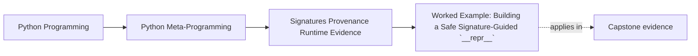

# Worked Example: Building a Safe Signature-Guided `__repr__`


<!-- page-maps:start -->
## Page Maps




<!-- page-maps:end -->

The five core lessons in Module 03 are easiest to trust when they all show up in one
helper that feels practical and easy to get subtly wrong.

A `__repr__` mixin is a good fit because it creates exactly the right pressures:

- it should show useful runtime state
- it should prefer stable ordering
- it should not evaluate properties during representation
- it should not reach for stack inspection just because debugging is involved

That makes it a clean worked example for signatures, structure, and evidence discipline.

This is an executable course product, not a copy-paste-only walkthrough. The maintained
implementation lives in `labs/runtime_evidence/safe_repr.py`, the concrete demonstration
in `labs/runtime_evidence/repr_demo.py`, and the focused proof in
`tests/test_signature_guided_repr.py`.

Treat the page as a design and review packet. The real teaching goal is to show how one
helper can mix three different evidence classes:

- strong contract evidence for ordering
- strong stored-state evidence for values
- diagnostic or convenience surfaces that should stay out of the default path

## The incident

Assume a team wants a reusable `ReprMixin` that prints instances clearly for debugging and
review.

The first attempts tend to fall into predictable traps:

1. they call `getattr` on arbitrary attribute names and accidentally evaluate properties
2. they only support `__dict__`-backed instances and mishandle slotted classes
3. they order fields arbitrarily instead of using the class's callable contract
4. they overreach into stack or frame inspection because "it's just debugging"

Every one of those is a Module 03 issue:

- which evidence is strong enough?
- which evidence is best-effort?
- which inspection surfaces are safe by default?

One more failure mode belongs beside them:

5. they start adding provenance or caller-context tricks because the helper is "only for debugging"

That move usually makes the helper less honest, not more helpful.

## The design goal

The helper should be:

- stable across regular and slotted classes
- ordered by `__init__` signature when that evidence is available
- careful not to evaluate properties
- free from frame or stack inspection

That set of goals already tells you which surfaces to trust:

- `inspect.signature` for ordering
- raw instance storage and slots for state
- `object.__getattribute__` for safer direct reads

It also tells you which surfaces to avoid by default:

- broad `getattr` over arbitrary names
- provenance lookups that pretend to explain runtime state
- frame or stack inspection that drags caller context into representation

## Run the finished behavior before reading the design

```console
$ make evidence-repr
{
  "evidence": {
    "dynamic_member_lookup": false,
    "frame_inspection": false,
    "ordering": "constructor-signature",
    "values": "instance-storage"
  },
  "property_reads_after_repr": 0,
  "regular": "IncidentRecord(incident_id='INC-42', severity='warning', owner='platform')",
  "slotted": "SlottedIncident(incident_id='INC-43', severity='critical', property_reads=0)",
  "slotted_state": {
    "incident_id": "INC-43",
    "property_reads": 0,
    "severity": "critical"
  }
}
```

Before inspecting the source, account for each output:

- constructor parameters appear before `owner`, even though assignment order differs
- the regular and slotted objects use the same public representation contract
- `risk_score` is absent because it is computed behavior, not stored state
- `property_reads_after_repr` stays zero

Then run the focused proof:

```console
$ make evidence-repr-test
...
Ran 5 tests

OK
```

The proof includes inherited slots, private slots, and a class whose custom
`__getattribute__` counts dynamic reads. Those are part of the course contract, not bonus
edge cases.

## Step 1: choose strong evidence for field order

If the class exposes a useful `__init__` signature, that is stronger ordering evidence
than arbitrary dictionary iteration.

The mixin can inspect the constructor and prefer the parameter order:

```python
import inspect


sig = inspect.signature(cls.__init__)
order = [
    p.name
    for p in sig.parameters.values()
    if p.name != "self"
    and p.kind not in (inspect.Parameter.VAR_POSITIONAL, inspect.Parameter.VAR_KEYWORD)
]
```

That is a good use of signatures:

- the helper is not pretending the signature proves runtime state
- it is using the constructor contract as a strong ordering hint when available

Review checkpoint:

- the signature proves call-shape order, not instance completeness
- parameters missing from storage may be normal if construction and current state diverged
- extra stored fields may be normal if the object accumulates runtime state after construction

## Step 2: read state from storage, not from arbitrary lookup

If the helper uses `getattr(self, name)` on arbitrary names, it can:

- evaluate properties
- trigger custom `__getattribute__`
- trigger dynamic fallback hooks

That is too eager for a representation helper.

A better path is:

- read `__dict__` directly when present
- read slot-backed names deliberately
- avoid broad dynamic lookup over arbitrary member names

This keeps the helper attached to stored state rather than runtime behavior.

That sentence is the heart of the worked example. A representation helper should answer:

> what stored state can I show safely and honestly?

It should not quietly switch to:

> what code can I run to make the object look more informative?

## Step 3: support slotted classes honestly

Regular and slotted classes need different storage reads, so the helper should inspect
both:

- instance `__dict__` when present
- declared `__slots__` through the MRO

That is a stronger approach than assuming all interesting state lives in one dictionary.

## Step 4: keep properties unevaluated

This is one of the most important boundaries in the whole example.

A representation helper should not call arbitrary properties just to look informative.
Doing so changes the contract from:

> show me the object's visible stored state

to:

> run arbitrary runtime behavior while printing a debug string

That is a terrible default.

If a team truly wants computed values in a debug view, that should be an explicit higher-
risk mode, not the base contract of `__repr__`.

## The maintained implementation

```python
def stored_state(instance):
    state = {}
    try:
        dictionary = object.__getattribute__(instance, "__dict__")
    except AttributeError:
        dictionary = None
    if isinstance(dictionary, Mapping):
        state.update(dictionary)

    for name in _slot_storage_names(type(instance)):
        if name in state:
            continue
        try:
            state[name] = object.__getattribute__(instance, name)
        except AttributeError:
            continue
    return state


def safe_repr(instance):
    fields = ", ".join(
        f"{name}={value!r}" for name, value in ordered_state(instance)
    )
    return f"{type(instance).__name__}({fields})"
```

This excerpt shows the safety center, not the entire module. Read the maintained source
for `_slot_storage_names(...)`, including inherited and name-mangled private slots, and
`ordered_state(...)`, including its signature-failure fallback. Keeping those helpers
separate makes evidence ownership testable:

- `_slot_storage_names` owns storage-name discovery
- `stored_state` owns value collection
- `ordered_state` owns contract-guided ordering
- `safe_repr` owns formatting

## Why each surface is in the implementation

Use this table when reviewing the code:

| Surface | Role in the helper | Why it belongs there |
| --- | --- | --- |
| `inspect.signature(cls.__init__)` | preferred field ordering | constructor contract is a strong ordering hint |
| `object.__getattribute__(self, "__dict__")` | stored dictionary-backed state | direct storage read avoids broad dynamic lookup |
| MRO slot walk | stored slot-backed state | supports classes without pretending everything lives in `__dict__` |
| alphabetical extras fallback | deterministic output beyond constructor order | preserves reviewability when extra runtime state exists |
| no frame, stack, or provenance helpers | excluded default path | context recovery is not needed to represent stored state safely |

## Why this version is better

This helper is stronger because it keeps each evidence source in the right role:

- `inspect.signature` provides ordering when available
- raw storage provides values
- slots are included deliberately
- arbitrary dynamic lookup is avoided
- stack inspection is excluded entirely

The result is still a debugging aid, but it is a disciplined debugging aid.

That distinction matters. "Debugging aid" is not a license to make the evidence weaker.
It is a reason to keep the helper bounded and reviewable.

## Honest limitations

Safe does not mean inert under every imaginable object graph. This implementation makes
specific, reviewable promises:

- it does not discover values through properties, `__getattr__`, or custom
  `__getattribute__`
- it does not inspect provenance, frames, or callers
- it does call `repr(value)` for values already found in instance storage
- it does not redact secrets or detect recursive object graphs
- it treats constructor order as an ordering hint, not proof that constructor parameters
  and current state are identical

The last three boundaries matter in production. A stored value can have a custom
`__repr__`; secrets need an explicit redaction policy; recursive structures need cycle
handling. Those are valid extensions, but smuggling them into this lesson would blur the
evidence boundary it is designed to teach.

## Regular and slotted classes both work

```python
class A(ReprMixin):
    def __init__(self, x, y=0):
        self.x = x
        self.y = y


class B(ReprMixin):
    __slots__ = ("x", "y")

    def __init__(self, x, y=0):
        self.x = x
        self.y = y


print(A(1))
print(B(2))
```

This is important because it proves the helper was built around storage evidence rather
than around one narrow storage assumption.

Independent learners should name the real win here:

- the helper works across different storage layouts
- without promoting dynamic execution into its base path

## What this example teaches about Module 03

This worked example ties the module together:

- signatures are strong evidence when used for the right job
- provenance and stack tricks are not needed just because a helper is "developer-facing"
- structural inspection beats eager dynamic evaluation when representation should stay safe
- strong runtime evidence and best-effort context should not be confused

That is the durable takeaway. The `__repr__` helper is just one concrete place where
evidence discipline produces a better design.

## Review packet for inherited helpers

When you inherit a similar helper, sort its evidence by bucket before changing code:

| Question | Strong surface | Weak surface to distrust first |
| --- | --- | --- |
| How should fields be ordered? | signature or deliberate explicit field list | arbitrary current dictionary order treated as meaning |
| Which values are safe to show? | stored state, deliberate slot reads | broad `getattr` over discovered names |
| Does the helper need context about origin or caller? | usually no | source recovery or stack recovery added "just in case" |

## The review loop to keep

When you inherit a runtime-description helper, run this loop:

1. identify which evidence it uses for ordering, value collection, and context
2. remove dynamic reads that are not required for the helper's purpose
3. keep provenance and signatures in the narrow roles they can support honestly
4. reject frame inspection unless the tool is explicitly diagnostic and truly needs it

## Learner change: extend the contract without weakening it

Add an explicit exclusion mechanism such as `__repr_exclude__ = {"token"}` to a new
class in the test file. Implement the policy in `ordered_state` or a narrowly owned
helper. Your proof must show:

1. the named stored value is absent
2. constructor ordering still holds for remaining values
3. a property with the same name is not evaluated
4. dictionary-backed and slotted cases remain green

Do not add broad `getattr` to discover the policy. Read class structure deliberately,
state the trust boundary, and keep `make evidence-repr-test` green.

If you can also explain where the helper would cross from strong evidence into
convenience-only evidence, the module has done its job.

If you can do that here, Module 03 has done its job and later wrapper modules can build on
stronger inspection habits.

## Continue through Module 03

- Previous: [Frames and Diagnostic-Only Runtime Evidence](frames-and-diagnostic-only-runtime-evidence.md)
- Next: [Exercises](exercises.md)
- Reference: [Exercise Answers](exercise-answers.md)
- Terms: [Glossary](glossary.md)
