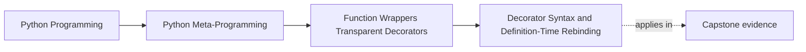

# Decorator Syntax and Definition-Time Rebinding


<!-- page-maps:start -->
## Page Maps




<!-- page-maps:end -->

Once the wrapper skeleton feels ordinary, the next step is to remove the last bit of
surface mystique:

> `@decorator` syntax is just rebinding at definition time.

That sentence is the foundation for understanding stacked decorators, decorator
factories, and the difference between one-time transformation work and per-call behavior.

It is also the page where a common confusion must end:

- `@decorator` is not "special syntax that runs around every call"
- `@decorator` is a definition-time rebinding step that determines what callable later receives the call

## The sentence to keep

When you see `@decorator`, ask:

> what expression was evaluated at definition time, and what name was rebound to the
> returned wrapper?

That question makes the timing and ownership explicit immediately.

If you can answer that question clearly, stacked decorators stop feeling like folklore and
start feeling like ordinary evaluation order.

## Single decorators desugar to assignment

This:

```python
@d
def f(...):
    ...
```

means:

```python
def f(...):
    ...

f = d(f)
```

The original function object is created first. Then the decorator is applied. Then the
name `f` is rebound to the returned callable.

That sequence matters because decoration happens once, not on every later call.

That one-time timing is not a side note. It affects:

- import-time side effects
- configuration capture in decorator factories
- when failures appear
- whether later behavior is controlled by one-time setup or per-call logic

## Stacked decorators compose predictably

Multiple decorators apply from the bottom up:

```python
@d3
@d2
@d1
def f(...):
    ...
```

desugars to:

```python
def f(...):
    ...

f = d1(f)
f = d2(f)
f = d3(f)
```

So the final binding is:

```python
f = d3(d2(d1(f)))
```

That is why definition-time application order and call-time execution order are related
but not identical.

Use that distinction as a review check:

| Question | Definition-time answer | Call-time answer |
| --- | --- | --- |
| which decorator applies first? | the lowest decorator in the stack | the outermost resulting wrapper runs first |
| where do configuration expressions run? | once, while the function is being defined | not again unless the wrapper itself re-evaluates something |
| where do wrapper-local side effects happen? | only if the decorator performs them during construction | on each later call if the wrapper body performs them |

## One picture of stacking

```text
Definition time:
original f -> d1(f) -> d2(d1(f)) -> d3(d2(d1(f)))

Call time:
caller -> outermost wrapper d3 -> d2 -> d1 -> original function
```

This is one of the most useful review diagrams in the module because it keeps timing and
composition straight.

## A simple example

```python
def uppercase(func):
    def wrapper(text):
        return func(text).upper()
    return wrapper


@uppercase
def greet(name):
    return f"Hello, {name}!"


print(greet("Alice"))
```

The important point is not the output. It is the rebinding:

- the raw `greet` function existed first
- `uppercase(greet)` produced a wrapper
- the name `greet` now points to that wrapper

For a missed-class learner, that rebinding sentence is the durable fact to keep. If the
code is confusing later, rewrite the decorated form back into assignment form and inspect
the returned callables one step at a time.

## Stacked wrappers show both definition-time and call-time order

```python
def add_exclaim(func):
    def wrapper(text):
        return func(text) + "!"
    return wrapper


def trim(func):
    def wrapper(text):
        return func(text.strip())
    return wrapper


@add_exclaim
@trim
@uppercase
def message(text):
    return f"{text} world"
```

Definition time:

- `uppercase` applies first to the raw `message`
- `trim` wraps that result
- `add_exclaim` wraps the result of that

Call time:

- the outermost wrapper runs first
- control flows inward to the original function
- the return value flows back outward

That is why decorator order is never cosmetic.

It also explains why "the same decorators are present" is not enough to claim the same
behavior. The stack order is part of the behavior.

## Decorator factories add one more evaluation step

A factory such as `@factory(config)` means:

1. evaluate `factory(config)` once at definition time
2. treat the result as the actual decorator
3. apply that decorator to the function

So:

```python
@factory(arg)
def f(...):
    ...
```

means:

```python
decorator = factory(arg)

def f(...):
    ...

f = decorator(f)
```

This is another useful timing lesson: both the factory call and the decoration happen once
when the function is defined, not on every invocation.

That is where import-time surprises often enter. If `factory(arg)` does expensive work,
opens resources, or validates configuration, those costs happen while the definition is
being evaluated, not lazily on the first later call.

## Definition time versus call time is a real review boundary

By this point in the course, that boundary should stay explicit:

- definition time: decorator expressions evaluate and wrappers are built
- call time: wrapper logic runs around the original function

If a code review blurs those together, it becomes much harder to reason about imports,
state initialization, and wrapper overhead.

## Definition-time mistakes worth catching early

The following mistakes are more common than they first appear:

| Weak explanation or bug | What it confuses | Repair |
| --- | --- | --- |
| "the decorator runs every time I call the function" | the decorator itself versus the wrapper it returned | separate rebinding from later wrapper execution |
| "the factory argument is dynamic per call" | captured definition-time configuration versus call-time input | show where `factory(arg)` was evaluated once |
| "stacked decorators are basically left to right" | source order versus application order | rewrite them as nested calls or rebinding assignments |
| "the error came from inside the function" | definition-time failure versus call-time failure | check whether the decorator expression failed before the function was ever invoked |

## Non-callable decorator expressions fail early

Because decoration is ordinary application of a callable, invalid decorator expressions
break at definition time:

- non-callable decorator object
- broken factory result
- errors inside the decorator itself

That is a useful reminder that decorators are ordinary runtime behavior, just happening at
definition time instead of later at call time.

## Review rules for decorator syntax and timing

When reviewing decorator-heavy code, keep these questions close:

- what raw function existed before rebinding happened?
- what exactly got evaluated at definition time?
- in what order did stacked decorators compose?
- what work happens only once versus on every call?
- is a decorator factory being treated as if it were a per-call configuration step when it is not?

## Exit check for this page

Before leaving this page, make sure you can do all of these without hand-waving:

- rewrite one decorated function into explicit rebinding assignments
- explain why bottom-up application still leads to outermost-first call execution
- show where a decorator factory captured configuration once
- name one failure that would happen at definition time rather than at call time

## What to practice from this page

Try these before moving on:

1. Rewrite one `@decorator` example by hand as `f = decorator(f)`.
2. Desugar one stacked decorator example into its step-by-step rebinding order.
3. Write one decorator factory and explain when the factory runs versus when the wrapper runs.

If those feel ordinary, the next step is practical thin wrappers that change call-time
behavior while still trying to stay transparent.

## Continue through Module 04

- Previous: [Nested Functions and Wrapper Skeletons](nested-functions-and-wrapper-skeletons.md)
- Next: [Thin Practical Wrappers at Call Time](thin-practical-wrappers-at-call-time.md)
- Practice: [Exercises](exercises.md)
- Terms: [Glossary](glossary.md)
