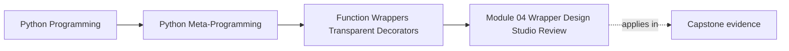
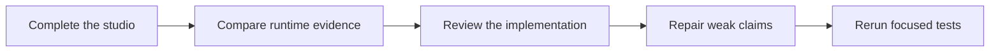

# Module 04 Wrapper Design Studio Review

<!-- page-maps:start -->
## Page Maps




<!-- page-maps:end -->

Use this review after attempting the studio. A defensible solution may differ in code
shape, but it must preserve the timing, identity, state, and capstone boundaries described
here.

## Studio 1 review: wrapper lifecycle

The exact definition-time sequence is:

```text
factory:outer
factory:inner
decorate:inner:render_status
decorate:outer:render_status
```

The two factory calls are decorator-expression evaluation, ordered top-to-bottom. The
two `decorate` events are application of the returned decorators, ordered bottom-up.

The call sequence is:

```text
enter:outer
enter:inner
body:INC-42:critical
exit:inner
exit:outer
```

The public name points at the outer wrapper. Its `function` closure points at the inner
wrapper. The inner wrapper's `function` closure points at the raw function:

```text
render_status name
  -> outer wrapper
       __wrapped__ and closure function -> inner wrapper
         __wrapped__ and closure function -> raw render_status
```

Reversing source order changes which factory evaluates first, which returned decorator
applies last, and which layer receives calls first. A final result comparison cannot prove
any of those timing facts.

## Studio 2 review: qualified transparency

A completed comparison should show:

| Surface | Bare wrapper | Preserved observer | What this proves |
| --- | --- | --- | --- |
| result object identity | not measured by metadata packet | same object in behavior packet | successful forwarding did not replace the result |
| exception object identity | not measured by metadata packet | same exception in behavior packet | observation did not rewrite failure |
| name and docstring | `wrapped`, `None` | original name and docstring | identity labels were copied |
| logical signature | generic forwarding | original incident contract | normal inspection followed `__wrapped__` |
| shell signature | generic forwarding | `(*args, **kwargs) -> 'str'` | executable shell remains variadic |
| unwrap path | absent | reaches original | tools can recover logical ownership |

Identity matters because equal replacement values or exceptions can still be different
objects with different state, traceback, or ownership.

The preserved shell displays an original return annotation because `wraps` copies
`__annotations__`. It does not display annotations for `args` and `kwargs` because the
copied mapping contains the original parameter names instead. Normal signature inspection
avoids this mixed shell view by following `__wrapped__`.

Returning `None` on failure converts an exception contract into an undocumented union-like
return contract. That wrapper now owns failure policy.

## Studio 3 review: cache invalidation

One defensible protocol extension is:

```python
class CachedCallable(Protocol[Parameters, ResultT]):
    ...

    def cache_invalidate(
        self,
        *args: Parameters.args,
        **kwargs: Parameters.kwargs,
    ) -> bool: ...
```

The implementation belongs beside the other closure controls:

```python
def cache_invalidate(
    *args: Parameters.args,
    **kwargs: Parameters.kwargs,
) -> bool:
    key = _call_key(tuple(args), dict(kwargs))
    try:
        del entries[key]
    except KeyError:
        return False
    return True
```

Attach it with the same deliberate public-surface pattern:

```python
wrapped.cache_invalidate = cache_invalidate
```

Why this implementation is defensible:

- `_call_key` keeps invalidation aligned with lookup
- deletion from `OrderedDict` leaves other entries in their relative order
- hit and miss variables are untouched
- key validation finishes before mutation
- boolean return distinguishes removed and absent keys

Tests should establish the transition:

```text
cache miss -> entry stored -> invalidate returns true
next call -> cache miss -> wrapped function executes again
second invalidate -> false
```

A common wrong turn is using `cache_clear()` and rebuilding every other entry. That is
broader than the requested policy and risks changing LRU order. Another is normalizing
arguments differently during invalidation; then a caller can create an entry it cannot
remove with the same apparent call.

This extension still does not solve concurrency, expiration, recursive keys, equivalent
positional/keyword calls, or production eviction monitoring.

## Studio 4 review: capstone transfer

The route comparison is:

| Question | Wrapper audit | Binding preflight | Trace |
| --- | --- | --- | --- |
| constructs plugin? | no | no | yes |
| invokes action? | no | no | yes |
| follows `__wrapped__`? | yes | no | no |
| reads `ActionSpec`? | yes | yes | action wrapper uses captured signature |
| binds proposed arguments? | no | yes | yes |
| records history? | no | no | after successful result |

The action shell owns both `ActionSpec` and explicit `__signature__`; the original method
owns neither. `functools.wraps` preserves name, qualname, docstring, annotations, and
`__wrapped__`. The explicit signature override means the shell reports the logical
signature even when unwrapping is disabled.

The failure test proves:

- the exact `RuntimeError` instance propagates
- failure leaves history empty
- the next successful call records bound arguments and result type

Therefore "records invocations" is too broad. The implementation records successful
invocations after the wrapped method returns. That wording difference matters to audit
and incident expectations.

## Review the complete submission

A strong final review states:

- decorator expressions evaluate top-to-bottom
- returned decorators apply bottom-up
- calls enter outer-to-inner and returns unwind outward
- `wraps` preserves logical contract recovery, not identical implementation shape
- the bounded cache controls execution and eviction across calls
- invalidation is an operational policy surface with atomic key validation
- `@action` is inspectable but owns binding and success-history semantics

Use these repairs when an answer remains vague:

| Weak statement | Repair |
| --- | --- |
| "the outer decorator runs first" | say whether you mean expression evaluation, application, or call entry |
| "`wraps` preserves the signature" | distinguish logical signature recovery, copied annotations, and shell parameters |
| "the cache makes it faster" | name hits, skipped executions, LRU eviction, and remaining limits |
| "invalidation deletes a value" | state key rules, counter behavior, LRU preservation, and failure atomicity |
| "the action decorator logs calls" | say that it binds all calls but records history only after success |

You are ready to continue when every transparency or policy claim points to a concrete
event, identity assertion, state transition, or independent capstone test.

## Continue through Module 04

- Previous: [Wrapper Design Studio](exercises.md)
- Return: [Overview](index.md)
- Next module: [Module 05](../module-05-decorator-design-policies-typing/index.md)
- Terms: [Glossary](glossary.md)
